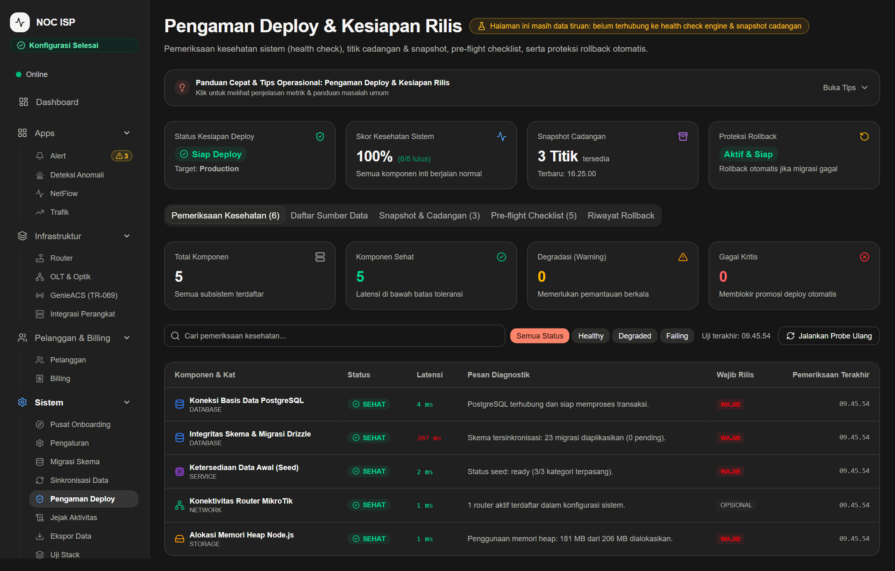
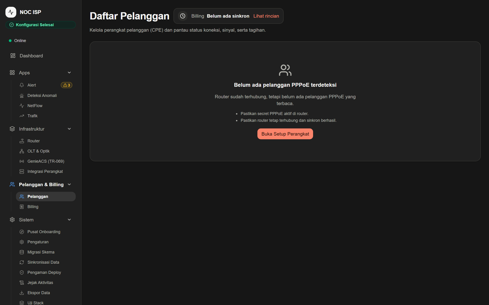
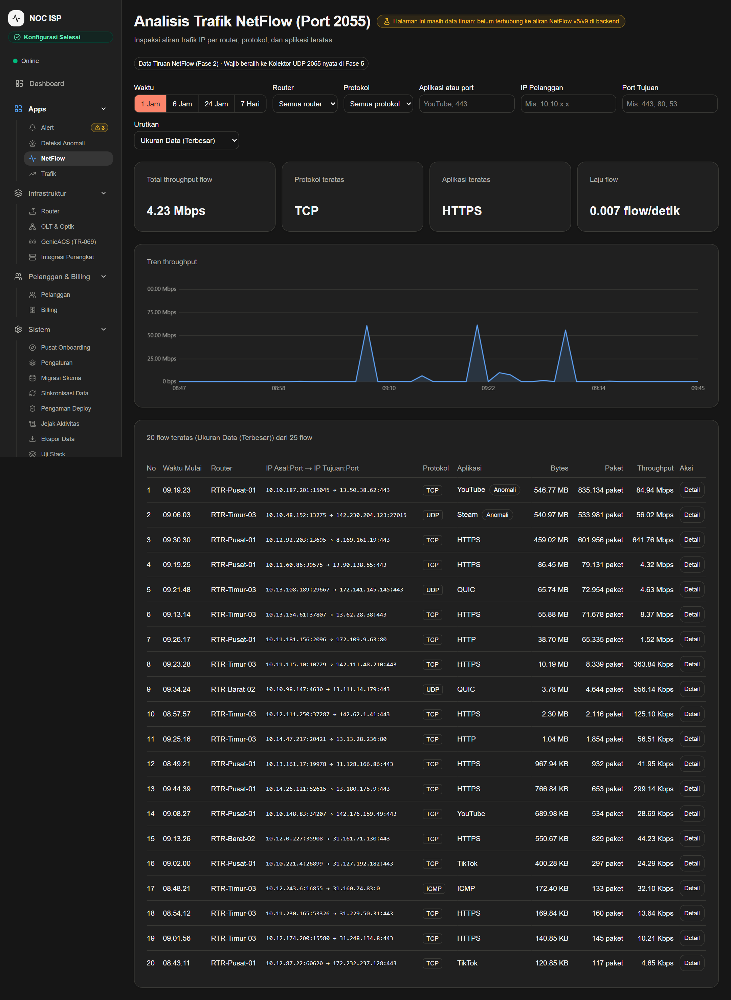
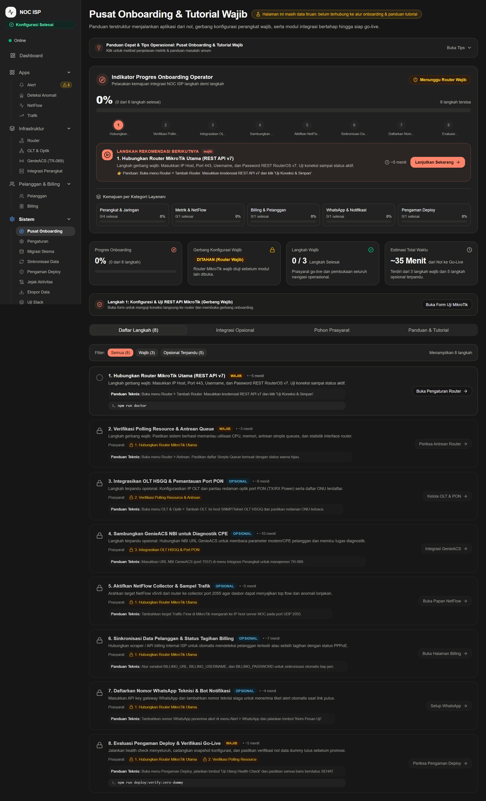
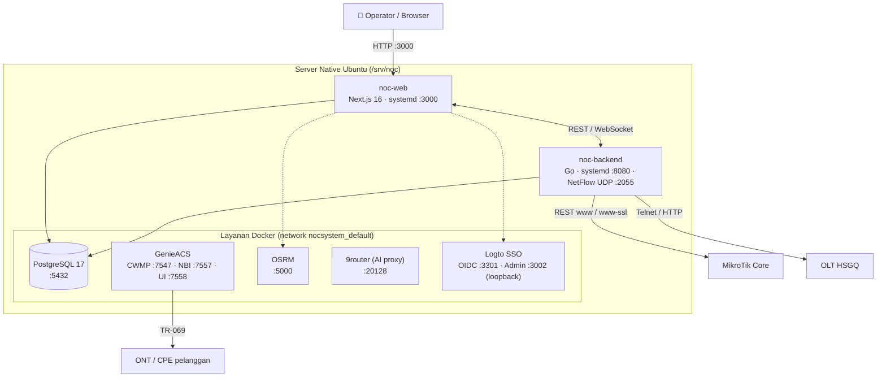

<div align="center">

# 🛰️ NOC SYSTEM

### Network Operations Center & ISP Automation Platform

MikroTik · OLT HSGQ · GenieACS TR-069 · OSRM · NetFlow · Billing RunsNet · Diagnosa 9 Lapisan

[](https://nodejs.org)
[](https://go.dev)
[](https://nextjs.org)
[](https://www.postgresql.org)
[](https://www.docker.com)
[](LICENSE)

[Instal Cepat](#-instal-cepat) · [Fitur](#-fitur-utama) · [Arsitektur](#-arsitektur) · [CLI](#-referensi-cli-noc-system) · [Troubleshooting](#-pemecahan-masalah--anti-freeze) · [Lisensi](#-lisensi)



</div>

---

**NOC SYSTEM** adalah platform NOC all-in-one untuk operator ISP: memantau MikroTik Core, OLT HSGQ (EPON/GPON), mengelola CPE TR-069 lewat GenieACS, memetakan kabel optik dengan road-snapping OSRM, menerima telemetri NetFlow, menyinkronkan billing RunsNet, dan menjalankan mesin diagnosa otomatis 9 lapisan.

## ⚡ Instal Cepat

Di server **Ubuntu 20.04 / 22.04 / 24.04** (akses `sudo`):

```bash
curl -fsSL https://raw.githubusercontent.com/netsynergyinovate-cmyk/noc-system/noc-system-main/scripts/install.sh -o /tmp/noc-install.sh
sudo NOC_ADMIN_EMAIL=anda@domain.com bash /tmp/noc-install.sh   # periksa skrip dulu bila perlu
sudo noc-system deploy              # rilis pertama (build ±6 menit di 2 vCPU)
sudo noc-system features up all     # opsional: Logto, GenieACS, OSRM, 9router
```

Installer mencetak **kata sandi superadmin sekali** di bagian `Akun NOC` (jangan ditutup sebelum disalin). Setelah `deploy`, buka `http://<IP_LAN_SERVER>:3000` dan masuk dengan email tadi. Tanpa `NOC_ADMIN_EMAIL`, akun bawaan adalah `admin@noc.local`; ganti kata sandinya setelah masuk. Lupa kata sandi: `sudo noc-system admin create --reset-password`.

> **Status pengujian:** alur instal bersih (`install.sh` → `noc-system deploy` → sign-in superadmin → tiket realtime + WebSocket) diuji di server **Ubuntu 26.04** (2 vCPU, 3 GB RAM). Ubuntu 20.04/22.04/24.04 dan mesin tanpa Docker/Node/Go sebelumnya belum diuji. `noc-system features up` baru diuji di Windows. Coba di satu VPS kosong sebelum dipakai untuk klien.

| Tahap | Perintah | Hasil |
|---|---|---|
| 1. Bootstrap | `install.sh` | Docker, Node 22, Go 1.25, user `noc`, CLI `noc-system` |
| 2. Superadmin | otomatis di akhir `install.sh` | Akun superadmin pertama + kata sandi acak (sekali tercetak) |
| 3. Rilis | `noc-system deploy` | Build, migrasi DB, systemd `noc-web` + `noc-backend` |
| 4. Add-on | `noc-system features up <id\|all>` | Logto, GenieACS, OSRM, 9router + tautan akses |
| 5. Cek | `noc-system doctor` / `features` / `status` | Status dan spesifikasi server |

## ✨ Fitur Utama

| | Modul | Kemampuan |
|---|---|---|
| 🌐 | **MikroTik Core** | Polling PPPoE aktif, simple queue, bandwidth real-time, kontrol isolir pelanggan |
| 📡 | **OLT HSGQ (EPON/GPON)** | Redaman optik ONU Rx/Tx live via Telnet & HTTP; peringatan `<= -26 dBm`, kritis `<= -30 dBm` |
| 📶 | **CPE TR-069 (GenieACS)** | Provisioning ONT/CPE via CWMP, monitoring Wi-Fi, reboot jarak jauh, inventori |
| 🗺️ | **Peta Optik + OSRM** | Peta feeder/distribusi/OLT/ODC/ODP, kabel mengikuti jalan nyata (OSRM offline) |
| 📊 | **NetFlow / IPFIX** | Telemetri NetFlow v5 pada UDP 2055 untuk analisis lalu lintas per pelanggan |
| 💳 | **Billing RunsNet** | Sinkronisasi tagihan, pembayaran, isolir, dan terminasi |
| 🔐 | **Login SSO (Logto)** | Masuk dengan GitHub/Google selain email + password |
| 🩺 | **Diagnosa 9 Lapisan** | Optik, port PON, sesi PPPoE, IP, traffic flow, queue, billing, DNS, reachability router |

<details>
<summary><b>📸 Tangkapan layar</b></summary>

| | | |
|---|---|---|
|  |  |  |

</details>

## 🏗️ Arsitektur



---

## Spesifikasi Server

| Komponen | Spesifikasi Minimum (Lab / Uji) | Spesifikasi Rekomendasi (Produksi) |
|---|---|---|
| **Sistem Operasi** | Ubuntu 20.04 / 22.04 / 24.04 LTS (x86_64) | Ubuntu 22.04 / 24.04 LTS (x86_64) |
| **Processor (vCPU)** | 2 Cores | 4 Cores atau lebih |
| **RAM (Memory)** | 2 GB *(Wajib aktifkan Swap 2 GB)* | 8 GB RAM atau lebih |
| **Swap File** | 2048 MB (Anti-OOM Killer) | 4096 MB |
| **Penyimpanan (Disk)** | 15 GB SSD / NVMe | 50 GB NVMe SSD |
| **Jaringan & Port** | Akses internet ke GitHub & registry npm | Akses internet + IP Publik / VPN |

> **Catatan Stabilitas VPS**: Proses kompilasi Go dan bundler Next.js 16 Standalone (Turbopack) membutuhkan alokasi memori heap V8 hingga 2 GB. Pada VPS dengan RAM 2 GB, installer otomatis membuat swapfile 2 GB (`/swapfile`) untuk mencegah Linux OOM Killer.

---

## Instalasi di Server Produksi (Ubuntu Native)

### 1. Eksekusi Skrip Bootstrap 1-Baris
Buka terminal SSH server Ubuntu Anda sebagai pengguna `root` atau `sudo`:

#### Opsi A: Repositori Publik
```bash
curl -fsSL https://raw.githubusercontent.com/netsynergyinovate-cmyk/noc-system/noc-system-main/scripts/install.sh -o /tmp/noc-install.sh
sudo bash /tmp/noc-install.sh
```

#### Opsi B: Repositori Privat (dengan GitHub Token)
```bash
export GITHUB_TOKEN="ghp_personal_access_token_anda"
export NOC_DEVICE_SECRET="kunci_rahasia_32_karakter_sama_lokal"
curl -fsSL -H "Authorization: token $GITHUB_TOKEN" https://raw.githubusercontent.com/netsynergyinovate-cmyk/noc-system/noc-system-main/scripts/install.sh | sudo --preserve-env=GITHUB_TOKEN,NOC_DEVICE_SECRET bash
```

Skrip bootstrap akan otomatis:
- Memeriksa kelayakan CPU, RAM, Swap, Disk, dan port server.
- Mengaktifkan swapfile darurat 2GB jika RAM server < 2.5 GB.
- Memasang Docker Engine, Node.js 22 LTS, dan Go Compiler 1.25 (dilewati bila sudah sesuai).
- Menyiapkan user sistem `noc`, hierarki `/srv/noc`, repositori, dan dependensi npm.
- Membuat `/srv/noc/shared/.env` dengan rahasia acak. URL aplikasi otomatis memakai **IP LAN server** (atau `NOC_PUBLIC_URL` bila diisi), dan port backend pindah ke **8090** bila 8080 sudah dipakai layanan lain (mis. Caddy).
- Menginisialisasi kontainer Docker PostgreSQL 17, unit systemd, dan menerapkan migrasi skema.
- Membuat **akun superadmin pertama** (email dari `NOC_ADMIN_EMAIL`, kata sandi dari `NOC_ADMIN_PASSWORD` atau acak dan dicetak sekali).
- Memasang CLI global `/usr/local/bin/noc-system`.

---

### 2. Rilis Pertama (Deploy)
Setelah bootstrap selesai, jalankan deployment rilis pertama:
```bash
sudo noc-system deploy
```
Alur deploy akan:
1. Membuat backup database otomatis ke `/srv/noc/backups/`.
2. Mengompilasi backend Go ke `/srv/noc/releases/<versi>/noc-backend`.
3. Membangun bundle Next.js standalone via Turbopack.
4. Menjalankan migrasi skema database Drizzle.
5. Melakukan swap symlink atomik `/srv/noc/current` -> rilis baru.
6. Me-restart layanan systemd `noc-web` dan `noc-backend`.
7. Menjalankan health check otomatis (polling 45 detik) dengan verifikasi kode HTTP 200.

---

### 3. Instal di Server Klien
Instalasi yang sama dipakai untuk server klien. Tiap klien mendapat `DEVICE_SECRET`, `BETTER_AUTH_SECRET`, dan password DB acak sendiri:
```bash
curl -fsSL https://raw.githubusercontent.com/netsynergyinovate-cmyk/noc-system/noc-system-main/scripts/install.sh -o /tmp/noc-install.sh
sudo NOC_PUBLIC_URL="https://noc.klien.com" NOC_ADMIN_EMAIL="admin@klien.com" bash /tmp/noc-install.sh
sudo noc-system deploy
sudo NOC_OSRM_REGION=java noc-system features up all   # wilayah sesuai lokasi klien
```
- `NOC_PUBLIC_URL` kosong → `http://<IP_LAN>:3000`. Pakai `https://` bila di belakang reverse proxy.
- Server klien **tidak menerima data Anda**: `install` dan `deploy` hanya membuat skema kosong. Pindah data hanya lewat `noc-system data export/import`.
- Logto, router, dan OLT klien dikonfigurasi sendiri; jangan memakai client ID/secret Logto milik penyedia.
- Polling MikroTik butuh layanan REST router (`/ip service`: `www` atau `www-ssl`) yang **bisa dijangkau dan mengizinkan IP server** (`address=` pada service). Isi host router di dashboard dengan `IP:port` bila port bukan 80/443 (HTTPS non-443 ditulis `https://IP:port`).
- Jika server sudah berisi database lama dengan kredensial router terenkripsi, jalankan installer dengan `NOC_DEVICE_SECRET=<nilai-lama>`.

---

### 4. Akses Dashboard Web & Monitoring Server
Buka peramban web dan arahkan ke alamat **IP LAN** server (bukan IP publik, kecuali port 3000 sudah di-port-forward):
```
http://<IP_LAN_SERVER>:3000
```
- Masuk dengan akun superadmin dari installer. Pendaftaran mandiri (`/sign-up`) dimatikan secara bawaan (`ALLOW_SIGN_UP`), jadi akun tambahan untuk operator dibuat lewat `noc-system admin create --email ...`.
- Masuk ke dashboard `/app/deploy` tab **CLI noc-system**.
- Masukkan **Alamat Server** (`http://<IP_SERVER>:3000`) dan **Token Monitor** (diambil dari output installer atau `noc-system status`).
- Panel akan menampilkan spesifikasi server real-time, live terminal stream 50 baris journalctl, status proses aktif, dan matriks fitur secara langsung.

---

## Instalasi Lingkungan Pengembangan Lokal

### Prasyarat
- **Node.js**: Versi `>= 22.12.0` (LTS direkomendasikan).
- **Docker Desktop**: Aktif dan berjalan.
- **Go Compiler**: Versi `>= 1.25` (opsional jika hanya menjalankan frontend web).

### Langkah Setup
1. Clone repositori:
   ```bash
   git clone https://github.com/netsynergyinovate-cmyk/noc-system.git
   cd noc-system
   ```
2. Jalankan konfigurasi otomatis:
   ```bash
   npm run setup
   ```
   *Perintah ini memasang dependensi npm, menyalakan kontainer Docker PostgreSQL development, membuat kredensial acak di `.env.local`, dan menerapkan migrasi database.*
3. Buat akun administrator utama:
   ```bash
   npm run seed:accounts
   ```
   *Akun Admin Utama resmi:* `admin-utama@noc.local` / `admin@noc.local`
4. Jalankan aplikasi development:
   ```bash
   npm run dev
   ```
   Buka [http://localhost:3001](http://localhost:3001) di peramban web.

---

## Katalog & Panduan Fitur Ekosistem

NOC SYSTEM punya 8 komponen. Add-on Docker dipasang per fitur dengan `sudo noc-system features up <id>`; CLI memeriksa status kontainer dan mencetak tautan akses.

| No | Komponen | Port | Pasang / Nyalakan | Log |
|---|---|---|---|---|
| **1** | **NOC Web Dashboard** | 3000 | `sudo systemctl start noc-web` | `journalctl -u noc-web -n 50 -f` |
| **2** | **NOC Backend Engine** | 8080 (8090 bila 8080 terpakai; lihat `BACKEND_ADDR`) | `sudo systemctl start noc-backend` | `journalctl -u noc-backend -n 50 -f` |
| **3** | **PostgreSQL 17** | 5432 | `docker compose -f compose.postgres.yaml up -d` | `docker logs -f noc-postgres --tail 50` |
| **4** | **GenieACS TR-069** | 7547 (CWMP), 7557 (NBI), 7558 (UI) | `sudo noc-system features up genieacs` | `npm run genieacs:logs` |
| **5** | **OSRM Road Snap** | 5000 | `sudo NOC_OSRM_REGION=java noc-system features up osrm` | `npm run osrm:logs` |
| **6** | **9router AI Proxy** | 20128 (UI & /v1) | `sudo noc-system features up 9router` | `npm run 9router:logs` |
| **7** | **Logto SSO** | 3301 (OIDC), 3002 (Admin) — hanya loopback | `sudo noc-system features up logto` | `npm run logto:logs` |
| **8** | **NetFlow Collector** | 2055 (UDP) | Aktif otomatis bersama `noc-backend` | `journalctl -u noc-backend \| grep -i netflow` |

**OSRM:** wilayah dipilih lewat `NOC_OSRM_REGION` (`sumatra` bawaan, `java`, `kalimantan`, `sulawesi`, `maluku`, `nusa-tenggara`, `papua`). Unduh dan olah data hanya sekali per wilayah; wilayah besar butuh RAM jauh lebih banyak saat `osrm-extract`.

**Logto di server:** Admin Console hanya di loopback, akses lewat `ssh -L 3002:127.0.0.1:3002 user@server`. Setelah `features up logto`, ikuti langkah yang dicetak CLI: buat aplikasi + konektor GitHub, daftarkan redirect `https://<domain>/api/auth/callback/logto-github` (tanpa spasi di akhir), isi `LOGTO_ENDPOINT`, `LOGTO_INTERNAL_ENDPOINT`, `LOGTO_CLIENT_ID`, `LOGTO_CLIENT_SECRET` di `/srv/noc/shared/.env`, lalu `sudo systemctl restart noc-web`.

---

## 🔧 Referensi CLI noc-system

Engine CLI `noc-system` terpasang secara global di `/usr/local/bin/noc-system` di server produksi:

```bash
noc-system <perintah> [opsi]
```

### Daftar Subperintah
- `noc-system doctor` / `noc-system specs`:
  Memeriksa kelayakan spesifikasi perangkat keras server sebelum instalasi/deploy (CPU cores, RAM bebas, swap active, sisa disk, status Docker daemon, port 3000/8080/5432, dan koneksi internet).
- `noc-system features [up <logto|genieacs|osrm|9router|all>]`:
  Tanpa argumen: status 8 komponen beserta tautan akses. Dengan `up`: memasang add-on Docker per fitur (memakai `/srv/noc/shared/.env`, memeriksa status kontainer sebelum mencetak tautan, GenieACS otomatis memasang konfigurasi dari repo, OSRM mengikuti `NOC_OSRM_REGION`).
- `noc-system data export [berkas]` / `noc-system data import <berkas.sql.gz> --yes`:
  Memindahkan **data** antar server. `install` dan `deploy` hanya membuat skema kosong, jadi server klien tidak menerima data Anda kecuali Anda menjalankan impor secara sengaja. Impor menimpa database, membuat cadangan `pre-import-*.sql.gz` lebih dulu, menjalankan migrasi skema, dan menyalakan ulang layanan. Salin `DEVICE_SECRET` ke server tujuan supaya kredensial router terenkripsi bisa dibuka.
- `noc-system admin create [--email <email>] [--name <nama>] [--reset-password]`:
  Membuat akun superadmin, atau menaikkan akun yang sudah ada. Kata sandi acak dicetak sekali; kata sandi pilihan lewat env `NOC_ADMIN_PASSWORD` (bukan argumen). Menjalankan ulang tidak mengubah kata sandi kecuali dengan `--reset-password`.
- `noc-system deploy [versi]`:
  Mengeksekusi rilis produksi penuh: backup DB otomatis, kompilasi Go, build bundle Next.js standalone via Turbopack, migrasi skema database, swap atomik `/srv/noc/current`, dan health check 45 detik. Jika tanpa argumen versi, digit build otomatis dinaikkan (+1).
- `noc-system update [ref]`:
  Menyinkronkan kode terbaru dari git (`git fetch && git reset --hard origin/<cabang>`, dijalankan sebagai pemilik repo), memasang dependensi (`npm ci`), lalu menjalankan ulang CLI versi terbaru untuk deploy otomatis.
- `noc-system status`:
  Menampilkan status versi aktif di `/srv/noc/current`, status unit systemd `noc-web` dan `noc-backend`, kesehatan kontainer Docker, alamat IP server, dan Token Monitor.
- `noc-system rollback`:
  Memutar balik symlink `/srv/noc/current` ke direktori rilis sebelumnya secara instan dan me-restart layanan systemd.
- `noc-system logs [-n baris] [--web|--backend]`:
  Menampilkan live stream log journalctl dari kedua layanan server native untuk pelacakan galat dan aktivitas sistem.
- `noc-system upgrade`:
  Menaikkan versi minor aplikasi (misal `1.0.x.y` menjadi `1.1.0.0`) pada `package.json`.
- `noc-system version`:
  Menampilkan versi lokal repositori dan versi rilis aktif di server.
- `noc-system verify`:
  Menjalankan skrip verifikasi integritas lingkungan dan rilis (`scripts/verify-deploy.mjs`).

---

## 🛟 Pemecahan Masalah & Anti-Freeze

### 1. Mengapa Layar Terminal Tampak Diam / Membeku Saat Deploy?
Saat menjalankan `install.sh` atau `noc-system deploy`, terdapat tahapan yang membundel kode dalam jumlah besar secara non-interaktif:
- **npm ci (~500 MB)**: Mengunduh dan mengekstrak ratusan paket npm native Linux. Membutuhkan waktu 1–3 menit di VPS.
- **go build**: Mengunduh modul dependensi Go dan mengompilasi biner server. Membutuhkan waktu 30–90 detik.
- **npm run build (Next.js Standalone)**: Turbopack mengompilasi puluhan rute TypeScript dan menghasilkan output standalone. Terminal akan diam tanpa teks selama 1–3 menit.
- **Heartbeat Otomatis**: CLI `noc-system` kini dilengkapi heartbeat timer yang mencetak status setiap 15 detik untuk memberi tahu operator bahwa proses masih berjalan aktif di latar belakang.
- **Solusi**: **DILARANG menekan Ctrl+C saat terminal diam.** Tunggu hingga tahapan selesai dan tanda sukses tercetak.

---

### 2. Linux OOM Killer (Out of Memory)
- **Gejala**: Proses `npm ci`, `go build`, atau `next build` tiba-tiba berhenti dengan pesan `Killed` atau exit code `137`.
- **Penyebab**: Server VPS kehabisan memori RAM fisik dan tidak memiliki swapfile yang cukup.
- **Solusi**: Aktifkan swapfile darurat minimal 2 GB:
  ```bash
  sudo fallocate -l 2G /swapfile
  sudo chmod 600 /swapfile
  sudo mkswap /swapfile
  sudo swapon /swapfile
  echo "/swapfile none swap sw 0 0" | sudo tee -a /etc/fstab
  ```
  Verifikasi dengan perintah: `free -m` atau `noc-system doctor`.

---

### 3. Port Bentrok (Port Already in Use)
- **Gejala**: `noc-web` gagal start pada port 3000, atau `noc-backend` gagal dengan `address already in use`.
- **Pemeriksaan**:
  ```bash
  sudo ss -tulpn | grep -E ':3000|:8080|:8090|:5432'
  ```
- **Solusi**: Installer otomatis memakai 8090 bila 8080 terisi. Bila bentrok muncul setelah instalasi, ubah `BACKEND_ADDR`, `BACKEND_URL` (alamat untuk **browser**, harus bisa dijangkau klien), `BACKEND_INTERNAL_URL` (loopback), dan `NEXT_PUBLIC_REALTIME_WS_URL` di `/srv/noc/shared/.env`, lalu `sudo noc-system deploy` (nilai `NEXT_PUBLIC_*` ditanam saat build). Jangan menghentikan layanan lain yang bukan milik NOC.

---

### 4. Izin Akses Docker Socket Ditolak (Permission Denied)
- **Gejala**: `Got permission denied while trying to connect to the Docker daemon socket`.
- **Solusi**: Pastikan user yang menjalankan deploy terdaftar dalam grup `docker`:
  ```bash
  sudo usermod -aG docker $USER
  newgrp docker
  ```
  Atau jalankan perintah deployment dengan hak akses root: `sudo noc-system deploy`.

---

### 5. Gagal Menghubungi Server dari Dashboard Web (/app/deploy)
- **Gejala**: Pesan galat `Gagal menghubungi server: fetch failed` pada tab CLI noc-system.
- **Pemeriksaan**:
  1. Pastikan Anda sudah menjalankan `sudo noc-system deploy` di terminal SSH server (port 3000 baru aktif setelah deploy pertama).
  2. Pastikan firewall server (UFW) atau security group VPS membuka port 3000 TCP:
     ```bash
     sudo ufw allow 3000/tcp
     ```
  3. Pastikan **Token Monitor** yang Anda masukkan di web dashboard persis sama dengan nilai `MONITOR_TOKEN` di `/srv/noc/shared/.env`. Anda dapat melihat token kapan saja dengan perintah `noc-system status`.

---

### 6. Router MikroTik Tidak Terhubung
- **Gejala**: log backend `connection refused` atau `router tidak menjawab`, insiden `router-unreachable`.
- **Penyebab umum**: backend memakai REST (`www` port 80/custom atau `www-ssl`), bukan API 8728 atau Winbox 2024. `address=` pada service itu hanya mengizinkan subnet tertentu, dan layanan bisa dipindah ke port lain.
- **Pemeriksaan di router**: `/ip service print where name~"www|api"`. Tambahkan IP server ke `address=` (tambah, jangan ganti daftar yang ada), lalu isi host router di dashboard dengan `IP:port` yang sama. Dari server: `curl -si http://<IP-router>:<port>/rest/system/resource` harus menjawab `401` (REST hidup, menunggu kredensial).

---

## Verifikasi & Pengujian Otomatis

Proyek ini dilengkapi dengan rangkaian pengujian ketat untuk menjamin keandalan produksi:

```bash
# Validasi sintaks TypeScript
npm run typecheck

# Validasi standar kode ESLint
npm run lint

# Uji verifikasi deployment & rilis native
node tests/verify-deploy.test.mjs

# Uji kesehatan API deployment
node tests/deploy-health-api.test.mjs

# Uji sistem penomoran versi 4-digit
node tests/app-version.test.mjs

# Pemeriksaan kesehatan pre-flight
node bin/noc-system.mjs doctor
```

---

## 📄 Lisensi

Dilisensikan di bawah [MIT License](LICENSE). Hak Cipta (c) 2026 NOC SYSTEM contributors & ngodingpakeai contributors. Lihat juga [Pemberitahuan Pihak Ketiga](THIRD_PARTY_NOTICES.md).
