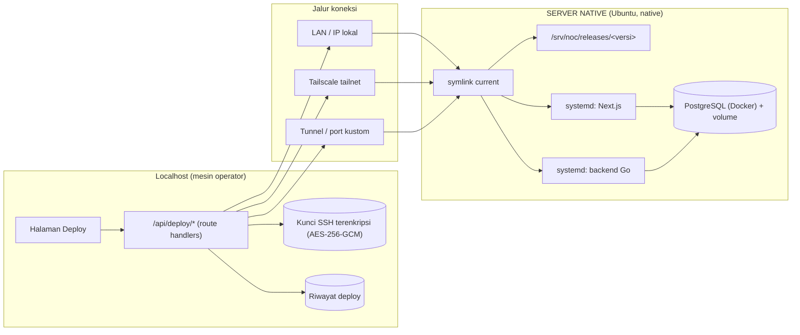
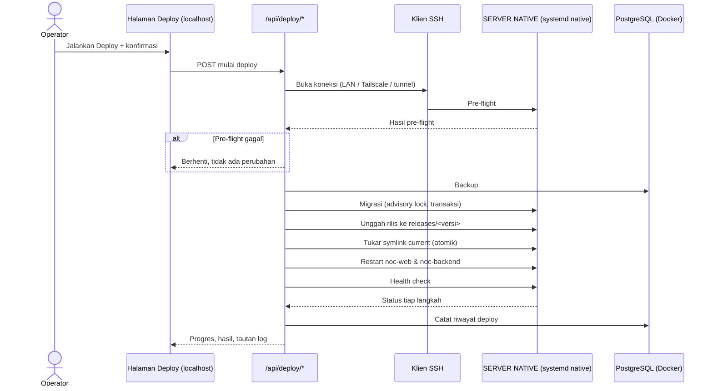
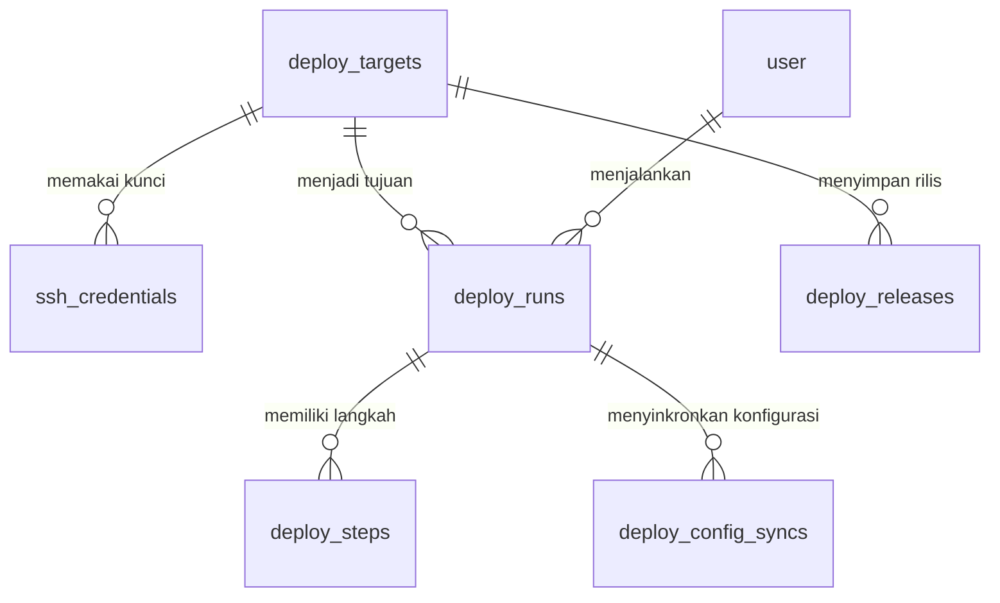

# PRD — Halaman Deploy & Rilis ke SERVER NATIVE

> **Catatan revisi:** Versi ini menggantikan isi PRD sebelumnya yang masih memuat gambaran umum NOC System (monitoring, OLT/ONU, CPE, billing, alert). Aplikasi NOC System **bukan** subjek PRD ini — ia hanya *rumah* tempat halaman deploy berada, dan secara teknis hanya disebut sebagai "aplikasi yang dikirim ke server".

## 1. Overview

PRD ini merinci **satu kemampuan**: halaman di dalam aplikasi NOC System yang berjalan di **localhost** (mesin pengembang/operator rumah), yang dipakai untuk **merilis versi terbaru aplikasi ke SERVER NATIVE**. Rilis dikirim lewat **SSH**, baik melalui jaringan lokal, tunnel, maupun **Tailscale**.

**Definisi istilah**

- **SERVER NATIVE** — server Ubuntu milik sendiri (bukan VPS, bukan layanan cloud), tempat aplikasi dipasang **native** di bawah systemd. Tidak diasumsikan punya IP publik; bisa dijangkau lewat LAN, tunnel, atau Tailscale.
- **Versi** — nomor rilis aplikasi berformat `MAJOR.MINOR.PATCH` (semver), ditambah metadata commit. Versi inilah yang tampil di halaman, dicatat di riwayat, dan menjadi nama direktori rilis di server.
- **Rilis** — satu direktori `/srv/noc/releases/<versi>/` yang sudah terpasang di server. Rilis bersifat *immutable*: sekali dibuat, isinya tidak ditimpa.
- **Tailscale** — **jalur koneksi deploy** dari mesin operator ke SERVER NATIVE, dan hanya itu. Tailscale tidak dipakai sebagai jalur akses pengguna ke aplikasi NOC, dan tidak diaktifkan ketika mesin operator sudah dapat menjangkau server di jaringan lokal yang sama.

**Peran Tailscale — dipersempit dan ditegaskan**

Tailscale berfungsi **saat deploy, ketika server tujuan tidak terjangkau langsung dari jaringan yang sama** — mis. operator sedang di luar rumah, atau target berada di jaringan lain. Dalam kondisi itu Tailscale menjadi jalur SSH ke server.

Tailscale **bukan**:

- jalur akses pengguna ke aplikasi NOC setelah rilis (akses aplikasi adalah hal terpisah, di luar PRD ini),
- jalur yang dipakai ketika mesin operator dan server sudah berada di jaringan lokal yang sama — di kondisi itu **LAN** yang dipakai dan Tailscale tidak diaktifkan sama sekali.

**Masalah yang diselesaikan**

- Rilis ke SERVER NATIVE dilakukan manual: menyalin berkas, menjalankan migrasi, me-restart layanan. Tidak ada catatan versi apa yang sedang berjalan.
- Bila rilis bermasalah, tidak ada cara cepat untuk kembali ke versi sebelumnya — dan tidak ada jejak langkah mana yang gagal.
- Perintah manual rawan salah urutan: migrasi database bisa berjalan setelah aplikasi diganti, atau backup terlewat.
- Satu kesalahan pada database dapat berakibat jauh lebih besar daripada kesalahan kode, karena datanya hidup.
- Tidak ada penanda versi yang bisa dipercaya: tidak jelas versi mana yang sedang berjalan di server, versi mana yang sedang dibangun di localhost, dan apakah keduanya sama.

**Tujuan utama**

1. Satu tombol untuk menjalankan seluruh rantai rilis secara berurutan, dengan progres tiap langkah terlihat.
2. Setiap rilis punya **nomor versi yang jelas dan tidak berubah**, terlihat sejak sebelum deploy dijalankan sampai setelah terpasang di server.
3. Setiap rilis tercatat: versi, waktu, pelaku, hasil, dan log per langkah.
4. Rollback manual ke rilis sebelumnya tanpa memutar balik migrasi database.
5. Database **di-backup lebih dulu**, dan volume PostgreSQL **tidak pernah disentuh** oleh proses deploy.
6. Versi yang sedang berjalan di server selalu bisa dibandingkan dengan versi terbaru di localhost, tanpa menebak.
7. **Pengaturan dan konfigurasi yang sudah berjalan di localhost ikut terbawa ke SERVER NATIVE saat deploy**, sehingga tidak perlu disetel ulang manual di server.
8. **Deploy tidak gagal tanpa diketahui lebih dulu**: kesiapan server diuji sebelum apa pun diubah, dan versi yang sedang berjalan dicatat sebagai titik balik sebelum aplikasi diganti.
9. **Kegagalan teknis setelah aplikasi diganti dipulihkan sendiri.** Bila health check gagal setelah symlink ditukar, halaman mengembalikan aplikasi ke titik balik dan mencatatnya — tanpa menunggu operator menekan tombol.
10. **Localhost tetap boleh menguji dengan perangkat asli — membaca saja.** Verifikasi rilis baru dan perbaikan bug tidak boleh hanya bergantung pada data tiruan pada aplikasi monitoring. Karena itu localhost diberi akses **baca** ke perangkat asli, sementara **akses tulis** ke perangkat dan pihak ketiga dikunci agar server produksi tetap menjadi satu-satunya penulis.

## 2. Ruang Lingkup

**Termasuk dalam lingkup**

- Halaman deploy yang **hanya ada dan hanya bisa diakses dari localhost** — tidak tersedia di SERVER NATIVE, meskipun aplikasi yang sama ikut ter-deploy ke sana.
- Penyimpanan kredensial SSH terenkripsi (AES-256-GCM) beserta uji koneksi.
- Eksekusi deploy berurutan lewat SSH ke SERVER NATIVE.
- **Uji kesiapan (dry-run)** — menjalankan seluruh pemeriksaan rantai deploy tanpa mengubah apa pun di server, lalu melaporkan "siap / tidak siap" beserta penyebabnya.
- **Titik balik tercatat** — versi yang aktif di server dicatat sebagai sasaran pemulihan sebelum symlink `current` ditukar, sehingga rollback tidak bergantung pada ingatan operator.
- **Rollback otomatis** yang dipicu **hanya** oleh kegagalan health check setelah symlink ditukar.
- Struktur rilis berversi + symlink `current` di server tujuan.
- **Penomoran versi**: penentuan versi otomatis (dari `package.json` dan commit Git) maupun pengetikan manual, katalog versi, penolakan versi duplikat, dan tampilan versi berjalan vs versi terbaru.
- Langkah database: backup → migrasi aman.
- **Pemindahan pengaturan dan data konfigurasi dari localhost ke SERVER NATIVE** sebagai bagian dari alur deploy, mencakup: variabel konfigurasi aplikasi, data perangkat (MikroTik, OLT, GenieACS), kredensial integrasi, pelanggan beserta pemetaan IP, ambang *alert*, peran pengguna, serta preferensi aplikasi.
- Restart layanan **native systemd** (Next.js dan Go), lalu health check.
- Riwayat deploy/rollback dan rollback manual.
- Berkas pendukung: unit systemd, checklist, skrip verifikasi.
- **Mode pengembangan berdampingan**: localhost boleh **membaca perangkat asli** (MikroTik, OLT/ONU, GenieACS, status layanan) untuk menguji rilis baru dan memperbaiki bug, sementara **seluruh akses tulis diblokir** di localhost.
- **Penjaga tulis (write guard)** yang menolak endpoint berbahaya di localhost: pembuatan task CPE (`POST /api/cpe/tasks`), sinkronisasi billing, pengiriman WhatsApp, serta pembuatan *alert*/tiket.

**Di luar lingkup**

- Fitur operasional NOC System (monitoring, alert, OLT/ONU, CPE, billing, WhatsApp) — sudah berjalan dan tidak diubah PRD ini.
- Deploy frontend/backend sebagai container. Aplikasi dipasang **native**; hanya PostgreSQL yang berjalan di Docker.
- Provisioning server dari nol (instalasi OS, pembuatan user, instalasi Node/Go/PostgreSQL).
- Pipeline CI/CD berbasis Git (GitHub Actions/GitLab). Halaman ini adalah jalur rilisnya.
- Rollback database / pemulihan otomatis dari backup (backup dibuat, pemulihan dilakukan manual di luar halaman). Rollback otomatis yang dijelaskan PRD ini **hanya memulihkan aplikasi** (symlink rilis), tidak pernah memutar balik skema atau data.
- **Pemindahan data operasional bervolume besar** secara otomatis: riwayat trafik, `netflow_samples`, `traffic_samples`, arsip log, dan `audit_log` **tidak** ikut dikirim pada setiap deploy. Bila suatu saat dibutuhkan, itu tindakan sekali-jalan yang dipilih eksplisit di luar alur deploy rutin.
- Penyuntingan data aplikasi (CRUD perangkat, pelanggan, ambang alert) — halaman deploy **memindahkan** apa yang sudah ada di localhost, bukan menjadi editor data NOC.
- Multi-server / multi-environment (staging, produksi terpisah). Satu SERVER NATIVE, satu target.
- Menerbitkan tag/rilis ke Git (mis. `git tag`, GitHub Release). Versi **dibaca** dari Git dan dari `package.json`, tetapi penandaan versi di repositori tetap dilakukan di luar halaman.
- **Menyediakan halaman deploy di SERVER NATIVE.** Halaman ini tidak ikut aktif di server; menjalankannya dari server adalah hal yang justru dicegah, bukan didukung.
- **Dua penulis aktif bersamaan ke perangkat yang sama.** Localhost dan SERVER NATIVE tidak pernah sama-sama menulis ke perangkat atau pihak ketiga yang sama. Penulisan terjadi di server; bila sebuah perubahan harus diuji tulis, layanan server dihentikan lebih dulu sehingga hanya ada satu penulis.
- **Mengarahkan NetFlow ke dua penerima.** Router mengirim *flow* ke satu tujuan, sehingga pemantauan NetFlow tidak dapat berjalan di localhost dan server sekaligus — memindahkannya adalah tindakan bergantian, bukan bersamaan.

## 3. Requirements

**Persyaratan fungsional**

- Operator hanya dapat membuka Halaman Deploy ketika aplikasi berjalan di **localhost**. Bila aplikasi berjalan di SERVER NATIVE, halaman tidak dirender dan rute `/api/deploy/*` menolak permintaan.
- Operator dapat menyimpan kunci privat SSH terenkripsi, mengujinya, menggantinya, dan menghapusnya; isi kunci tidak pernah ditampilkan kembali.
- Operator dapat mengisi host, port, dan user SSH secara manual, serta memilih **mode koneksi**: LAN, Tailscale, atau tunnel. Pemilihan mode mengikuti **aturan deteksi jaringan**: bila mesin deploy dan SERVER NATIVE berada di jaringan lokal yang sama, jalur **LAN** yang dipakai dan **Tailscale tidak diaktifkan**.
- Operator dapat melihat ringkasan server tujuan dan hasil pemeriksaan pra-deploy dalam keadaan baca-saja.
- Operator dapat menjalankan deploy dari satu tombol, dengan konfirmasi singkat, dan melihat status tiap langkah secara langsung.
- Sistem menjalankan langkah deploy dalam urutan tetap: pre-flight → backup database → migrasi → **pemindahan konfigurasi localhost → server** → unggah rilis → tukar symlink → restart layanan → health check.
- Operator dapat menjalankan **Uji Kesiapan (dry-run)** sebelum deploy sungguhan: seluruh pemeriksaan dijalankan tanpa mengubah apa pun, hasilnya disimpan dan dapat dibandingkan dengan deploy yang benar-benar dijalankan.
- Sebelum symlink `current` ditukar, sistem mencatat **titik balik**: versi yang saat itu aktif di server, sebagai sasaran pemulihan untuk deploy tersebut.
- Bila satu langkah gagal, deploy berhenti dan langkah berikutnya tidak dijalankan — **dengan satu pengecualian**: kegagalan health check setelah symlink ditukar memicu **rollback otomatis** ke titik balik.
- Rollback otomatis menukar symlink kembali ke titik balik, me-restart layanan, menjalankan health check sekali lagi, dan mencatat hasilnya sebagai entri riwayat berjenis `rollback` dengan penanda `otomatis`. Bila pemulihan itu pun gagal, deploy ditandai gagal total dan operator diberi tahu secara eksplisit bahwa server memerlukan tindakan manual.
- Operator dapat membuka detail log tiap langkah, termasuk untuk rilis yang gagal.
- Operator dapat melakukan rollback manual ke rilis sebelumnya dengan konfirmasi eksplisit.
- Setiap deploy dan rollback tercatat di riwayat dan dapat disaring berdasarkan status.
- Operator dapat memilih **tingkat akses perangkat** untuk localhost: `simulator` (bawaan, tanpa perangkat asli), `baca-saja` (membaca perangkat asli, seluruh tulis ditolak), atau `penuh` (tulis diizinkan, hanya ketika layanan server dihentikan sementara).
- Pada tingkat `baca-saja`, halaman menampilkan penanda jelas bahwa data berasal dari **perangkat asli** dan akses tulis sedang dikunci, sehingga hasil uji tidak disalahartikan sebagai perilaku server.
- Setiap upaya tulis dari localhost yang ditolak penjaga **dicatat dan dapat dilihat operator**, supaya penolakan tidak tampak seperti bug aplikasi.

**Persyaratan non-fungsional**

- **Halaman hanya bisa dijalankan di localhost, dan tidak tersedia di SERVER NATIVE.** Penjagaan berlapis, bukan satu pemeriksaan:
  - **Peran runtime** — aplikasi membaca penanda peran (`local` atau `server`) dari environment. Bila perannya `server`, Halaman Deploy dan seluruh rute eksekusi `/api/deploy/*` **tidak terdaftar sama sekali** — bukan sekadar mengembalikan 403, tetapi 404, sehingga keberadaannya pun tidak terbaca dari luar.
  - **Binding ke loopback** — di localhost, server hanya mendengarkan pada `127.0.0.1`/`::1`, sehingga halaman tidak dapat dijangkau dari LAN.
  - **Pemeriksaan permintaan** — permintaan dengan `Host`/`Origin` selain localhost ditolak. Pemeriksaan ini **pelengkap**, bukan pengaman utama, karena header `Host` dapat dipalsukan di belakang reverse proxy.
  - **Prasyarat data** — tanpa baris `deploy_targets` dan kunci SSH tersimpan di database localhost, halaman tidak dapat menjalankan apa pun. Kunci SSH **tidak pernah** dikirim ke SERVER NATIVE.
  - **Menu disembunyikan** — tautan ke Halaman Deploy tidak muncul di navigasi saat peran bukan `local`.
  - **Diuji** — ada pengujian yang memastikan peran `server` benar-benar tidak menyajikan halaman maupun rute eksekusi.
- Kunci privat SSH disimpan terenkripsi AES-256-GCM (pola `billing-credentials.ts`), dengan passphrase opsional dari environment.
- Deploy tidak boleh menghapus, memindahkan, atau menukar volume PostgreSQL di Docker.
- Migrasi dijalankan berurutan dengan advisory lock dan transaksi atomik (`scripts/migrate-server.mjs`).
- Penukaran symlink `current` bersifat atomik: tidak ada jendela waktu ketika `current` tidak menunjuk ke rilis mana pun.
- **Batas tegas dua jenis rollback**: rollback atas keputusan operator (memilih rilis lain, mis. karena curiga ada masalah) tetap **manual dan berkonfirmasi**. Rollback otomatis **hanya** dipicu oleh kegagalan health check tepat setelah symlink ditukar. Otomatisasi tidak pernah berjalan atas dasar tebakan, penilaian kualitas, atau kegagalan langkah lain.
- **Pemulihan otomatis bersifat best-effort dengan batas waktu.** Bila pemulihan tidak selesai dalam tenggang yang ditetapkan, halaman berhenti mencoba dan melaporkan keadaan server apa adanya — bukan mengulang tanpa henti.
- **Titik balik wajib ada sebelum swap.** Bila versi aktif yang lama tidak dapat dipastikan, deploy berhenti sebelum symlink ditukar, karena tanpa titik balik pemulihan otomatis tidak punya sasaran yang benar.
- **Uji kesiapan tidak mengubah keadaan.** Dry-run tidak menyentuh symlink, tidak me-restart layanan, tidak menjalankan migrasi, dan tidak menulis apa pun ke database SERVER NATIVE.
- Rilis lama tidak ditimpa, sehingga rollback selalu mungkin tanpa membangun ulang.
- Bahasa antarmuka Indonesia.
- Kegagalan koneksi (mis. Tailscale mati saat berada di luar jaringan lokal) dilaporkan sebagai kegagalan pre-flight yang jelas, bukan proses menggantung.
- **Tailscale hanya berfungsi sebagai jalur deploy, dan hanya saat server tidak terjangkau langsung.** Tailscale dipakai ketika mesin deploy berada **di luar** jaringan lokal server atau target berada di jaringan lain. Bila mesin deploy dan server berada di jaringan lokal yang sama, jalur **LAN** yang dipakai dan Tailscale **tidak diaktifkan**. Aturan ini ditegakkan oleh halaman, dan pemaksaan manual dicatat di riwayat.
- **Tailscale bukan jalur akses aplikasi.** Halaman deploy dan aplikasi NOC adalah dua hal berbeda: Tailscale mengantar **perintah deploy** ke server, bukan mengantar **pengguna** ke aplikasi. Mengaktifkan atau mematikan Tailscale tidak boleh mengubah cara pengguna membuka aplikasi NOC — jalur akses pengguna diatur di luar halaman ini.
- **Akses perangkat dari localhost dibatasi penjaga di lapisan API, bukan kedisiplinan operator.** Penjaga menolak berdasarkan daftar endpoint berbahaya yang eksplisit, dan tidak bergantung pada tombol yang bisa dilewati dari antarmuka.
- **Kredensial baca dan kredensial tulis dipisahkan.** Localhost memakai kredensial perangkat berhak **baca saja** (mis. user MikroTik dengan *policy* baca), sedangkan kredensial berhak tulis hanya dipakai di SERVER NATIVE — sehingga pembatasan ditegakkan oleh perangkatnya sendiri, bukan hanya oleh kode aplikasi.
- **Kredensial pihak ketiga yang berbahaya dikosongkan di localhost** (portal billing dan WhatsApp gateway). Tanpa kredensial, tidak ada pesan terkirim dan tidak ada akun yang terkunci — pengaman yang tidak bisa salah.
- **Pembaruan otomatis dimatikan di localhost pada tingkat `baca-saja`**, dan uji koneksi perangkat dilakukan manual per satu perangkat, agar sesi perangkat tidak diperebutkan dengan server.
- **Database localhost tetap terpisah dari database server.** Localhost tidak diarahkan ke database produksi, termasuk untuk membaca; bila data asli dibutuhkan, dipakai hasil *restore dump*, bukan koneksi langsung — agar migrasi pengembangan tidak pernah berjalan di produksi.

## 4. Core Features

Lima fase di bawah ini **berurutan dan saling bergantung**. Fase berikutnya tidak bisa diuji sebelum fase sebelumnya berdiri, karena setiap fase menambah satu lapisan yang dipakai fase sesudahnya.

| Fase | Pertanyaan yang dijawab | Bergantung pada |
|---|---|---|
| 1. Halaman Deploy & Target Server | Di mana halaman ini hidup, dan server mana tujuannya? | — |
| 2. Kunci SSH, Mode Koneksi & Panel Pemeriksaan | Bagaimana halaman dapat menjangkau server, dan apa yang harus diperiksa sebelum menyentuhnya? | Fase 1 |
| 3. Alur Deploy Berurutan & Database | Apa yang dijalankan, dalam urutan apa, dan bagaimana database tetap aman? | Fase 2 |
| 4. Rollback & Riwayat Deploy | Bagaimana kembali dengan pasti, dan bagaimana jejaknya terbaca? | Fase 3 |
| 5. Unit systemd, Skrip Verifikasi & Panduan | Apa yang membuat pemasangan native dapat diulang orang lain? | Fase 3 & 4 |

Setiap fase memakai **empat bagian yang sama**, agar mudah dibaca, diuji, dan tidak melebar:

- **Tujuan fase** — hasil yang harus tercapai di akhir fase.
- **Prasyarat** — apa yang harus sudah ada sebelum fase ini dikerjakan.
- **Kriteria selesai** — tanda fase ini benar-benar selesai, bukan sekadar "sudah ada kodenya".
- **Batas fase** — yang sengaja **tidak** dikerjakan di fase ini, agar fase berikutnya tidak tercampur.

### Fase 1 — Halaman Deploy & Target Server

**Tujuan fase** — Halaman deploy hidup dan **hanya** hidup di localhost; operator dapat menyimpan target SERVER NATIVE dan melihat jalur koneksi yang akan dipakai beserta alasannya. Belum ada satu pun perintah yang mengubah server di fase ini.

**Prasyarat** — Aplikasi Next.js dan backend Go sudah berjalan di localhost; database localhost tersedia untuk menyimpan `deploy_targets`.

**Kriteria selesai**

- Halaman terbuka dari `localhost` dan **gagal** dibuka dari alamat LAN mesin yang sama.
- Pada peran `server`, halaman tidak dirender dan `/api/deploy/*` mengembalikan **404**, dibuktikan pengujian otomatis.
- Target server (host, port, user) tersimpan dan masih tampil setelah aplikasi dimulai ulang.
- Ringkasan server tujuan menampilkan jalur terpilih **beserta alasannya**, bukan hanya nama host.
- Tidak ada tombol di fase ini yang mengirim perintah ke server.

**Batas fase** — Belum ada kunci SSH, belum ada koneksi, belum ada eksekusi. Fase ini hanya menjawab "di mana halamannya" dan "server mana tujuannya".

- **Halaman Deploy** *(prioritas tinggi)* — Halaman utama untuk mengirim rilis ke SERVER NATIVE dan memantau jalannya deploy.
  - **Ringkasan Server Tujuan** — Menampilkan host, port, user, jalur koneksi yang **terpilih** (LAN / Tailscale / tunnel) beserta alasan pemilihannya, mis. "LAN — server terjangkau di jaringan lokal" atau "Tailscale — di luar jaringan lokal".
  - **Tombol Jalankan Deploy** — Satu tombol dengan konfirmasi singkat sebelum eksekusi.
  - **Progres Langkah Deploy** — Urutan langkah beserta status masing-masing (menunggu, berjalan, berhasil, gagal, dilewati).
  - **Hasil Deploy & Log** — Ringkasan berhasil/gagal, versi yang terpasang, dan tautan ke detail log.
  - **Kunci Localhost — Tidak Tersedia di Server** *(prioritas tinggi)* — Memastikan halaman hanya hidup di mesin operator.
    - **Penanda Peran Runtime** — Aplikasi membaca peran `local` atau `server` dari environment; peran inilah yang menentukan halaman dirender atau tidak.
    - **Rute Eksekusi Tidak Terdaftar di Server** — Pada peran `server`, `/api/deploy/*` mengembalikan 404 (bukan 403), dan menu tidak menampilkan tautan apa pun.
    - **Hanya Mendengarkan di Loopback** — Di localhost, server mengikat ke `127.0.0.1`/`::1` sehingga tidak terjangkau dari jaringan.
    - **Tolak Host/Origin Asing** — Permintaan dengan `Host`/`Origin` bukan localhost ditolak; ini lapisan tambahan, bukan pengaman utama.
    - **Tanpa Kunci, Tanpa Aksi** — Kunci SSH hanya ada di database localhost dan tidak pernah dikirim ke server, sehingga halaman di server pun tidak punya bahan untuk bertindak.

### Fase 2 — Kunci SSH, Mode Koneksi & Panel Pemeriksaan

**Tujuan fase** — Halaman mampu **membuktikan** bahwa ia benar-benar dapat mencapai server **sebelum** satu pun perintah deploy dijalankan, dan operator dapat membedakan jenis kegagalan: jaringan tidak terjangkau, kunci ditolak, atau Tailscale tidak aktif. Di fase yang sama, localhost diberi cara menguji rilis baru dengan perangkat asli tanpa mengganggu server.

**Prasyarat** — Fase 1 selesai; akun SSH di SERVER NATIVE tersedia (disarankan dengan sudo terbatas untuk langkah deploy); empat rute baca `/api/deploy/{preflight,env-validation,health,status}` sudah ada di `/app/pengaman-deploy`.

**Kriteria selesai**

- Kunci privat tersimpan terenkripsi AES-256-GCM dan **tidak pernah** dapat ditampilkan kembali lewat API mana pun.
- Uji koneksi membedakan tiga kegagalan secara eksplisit: host tidak terjangkau, kunci/passphrase ditolak, dan Tailscale tidak aktif.
- Berada di jaringan yang sama, halaman **tidak membuka** jalur Tailscale sama sekali; pemaksaan manual ditandai dan tercatat.
- Panel pemeriksaan menampilkan data nyata dari keempat rute baca, bukan nilai contoh.
- Tingkat akses perangkat (`simulator` / `baca-saja` / `penuh`) tersimpan, dan penjaga tulis menolak endpoint berbahaya pada tingkat selain `penuh` — penolakan **tercatat** dan dapat dilihat.

**Batas fase** — Seluruh kegiatan di fase ini bersifat **baca-saja terhadap server**: tidak ada deploy, migrasi, restart, atau penukaran symlink. Yang diuji hanya keterjangkauan dan kesiapan.

- **Kunci SSH Terenkripsi** *(prioritas tinggi)* — Pengelolaan kunci privat untuk SERVER NATIVE.
  - **Simpan Kunci Privat** — Kunci disimpan terenkripsi, tidak pernah ditampilkan kembali.
  - **Passphrase Opsional** — Dibaca dari environment bila diisi.
  - **Uji Koneksi SSH** — Menguji host, port, user, dan kunci sebelum deploy dijalankan.
  - **Ganti atau Hapus Kunci** — Dengan konfirmasi.
- **Mode Koneksi** *(prioritas tinggi)* — Pemilihan jalur koneksi ke SERVER NATIVE.
  - **Deteksi Jaringan Otomatis** — Sebelum menghubungkan, halaman memeriksa apakah mesin deploy dapat menjangkau SERVER NATIVE lewat jaringan lokal (alamat LAN server terjangkau langsung). Hasil deteksi menentukan jalur yang dipakai, bukan tebakan operator.
  - **LAN / IP Lokal** — Dipakai ketika mesin deploy dan server berada di jaringan yang sama. **Dalam kondisi ini Tailscale tidak diaktifkan** — halaman tidak membuka koneksi lewat tailnet sama sekali.
  - **Tailscale Hanya Saat di Luar Jaringan yang Sama** — Tailscale baru dipakai ketika mesin deploy berada **di luar** jaringan lokal SERVER NATIVE (mis. operator sedang tidak di rumah). Koneksi memakai alamat tailnet (`100.x.y.z`) atau MagicDNS, dan halaman memeriksa apakah antarmuka Tailscale aktif sebelum mencoba terhubung.
  - **Tidak Ada Dua Jalur Sekaligus** — Hanya satu jalur yang aktif per percobaan koneksi. Halaman tidak mencoba LAN lalu diam-diam beralih ke Tailscale; perpindahan jalur selalu terlihat dan tercatat.
  - **Paksaan Manual** — Operator tetap boleh memaksa Tailscale walaupun berada di jaringan yang sama. Halaman menandainya sebagai **paksaan manual** beserta konsekuensinya (lalu lintas melewati tailnet, bukan LAN), dan tindakan itu tercatat di riwayat.
  - **Tunnel / Port Kustom** — Untuk jalur lain (mis. bastion atau port forward), dengan host dan port diisi manual.
  - **Khusus Deploy, Bukan Jalur Akses Aplikasi** — Panel ini hanya mengatur bagaimana **perintah deploy** mencapai server. Tailscale tidak dipakai untuk mengantar pengguna ke aplikasi NOC; jalur akses pengguna berada di luar halaman deploy dan tidak berubah karena pengaturan di sini.
  - **Status Keterjangkauan** — Menampilkan jalur yang terpilih beserta alasan pemilihannya, agar penyebab kegagalan jelas (host tidak terjangkau vs kunci ditolak vs Tailscale tidak aktif).
- **Panel Pemeriksaan** *(prioritas sedang)* — Panel baca-saja yang memanfaatkan rute `/api/deploy/*` yang sudah ada.
  - **Pemeriksaan Pra-syarat** — Hasil rute `preflight`.
  - **Validasi Environment** — Hasil `env-validation`.
  - **Cek Kesehatan Server** — Hasil `health`.
  - **Status Deploy Terakhir** — Hasil `status`.
- **Mode Pengembangan Berdampingan** *(prioritas tinggi)* — Menguji rilis baru di localhost dengan **perangkat asli** tanpa mengganggu server yang sedang berjalan.
  - **Tingkat Akses Perangkat** — Tiga tingkat yang dipilih operator: `simulator` (bawaan, tanpa perangkat asli), `baca-saja` (membaca perangkat asli, seluruh tulis diblokir), `penuh` (tulis diizinkan, hanya ketika layanan server dihentikan sementara).
  - **Penjaga Tulis** — Menolak pembuatan task CPE, sinkronisasi billing, pengiriman WhatsApp, dan pembuatan *alert*/tiket selama tingkat bukan `penuh`; penolakan disertai alasan yang dapat dibaca, bukan galat samar.
  - **Kredensial Baca-Saja** — Menggunakan kredensial perangkat berhak baca untuk localhost, terpisah dari kredensial tulis yang hanya hidup di server.
  - **Pembaruan Otomatis Dimatikan** — Auto-refresh dashboard dan *alert* tidak aktif pada tingkat `baca-saja`, agar tidak berebut sesi dengan server.
  - **Satu Penulis, Bukan Dua** — Untuk pekerjaan yang benar-benar perlu menulis, operator menghentikan layanan aplikasi di server lebih dulu; halaman menampilkan status itu, sehingga tidak pernah ada dua penulis aktif bersamaan.
  - **Catatan Upaya Ditolak** — Setiap penolakan tercatat, sehingga hilangnya sebuah aksi di localhost dapat dibedakan antara bug dan penjagaan yang memang bekerja.

### Fase 3 — Alur Deploy Berurutan & Database

**Tujuan fase** — Satu perintah menghasilkan **rilis berversi** yang benar-benar berjalan di SERVER NATIVE, dengan database aman dan selalu ada jalan kembali. Fase inilah inti janji "deploy tidak gagal": kegagalan ditemukan **sebelum** aplikasi disentuh, bukan sesudah.

**Prasyarat** — Fase 2 selesai; direktori `/srv/noc/releases` dan `/srv/noc/shared` ada dan dapat ditulis user SSH; PostgreSQL di Docker berjalan dengan volume persisten; `scripts/migrate-server.mjs` tersedia; build aplikasi menghasilkan versi bernomor.

**Kriteria selesai**

- **Uji kesiapan** melaporkan "siap / tidak siap" beserta penyebabnya **tanpa mengubah keadaan** — dibuktikan dengan membandingkan symlink `current` dan status layanan sebelum dan sesudah dry-run.
- Deploy penuh menghasilkan direktori `/srv/noc/releases/<versi>/` **baru**, dan `current` menunjuk ke sana secara atomik.
- Urutan langkah tidak pernah melompati **backup** dan **migrasi**; bila satu langkah gagal, langkah berikutnya tidak dijalankan.
- **Titik balik** tercatat sebelum symlink ditukar, dan deploy **berhenti** bila versi aktif tidak dapat dipastikan.
- Pemindahan konfigurasi **idempoten**: dua kali deploy tidak menggandakan baris, dan hasilnya dilaporkan per tabel.
- Volume PostgreSQL **tidak** dihapus, dipindahkan, atau ditukar.

**Batas fase** — Pemulihan di fase ini masih berupa jalur minimum (kembali ke titik balik lalu restart). Pencatatan riwayat yang lengkap, penanda `otomatis`, tenggang waktu pemulihan, dan rollback manual yang berkonfirmasi dikerjakan di **Fase 4** — bukan di sini.

- **Alur Deploy Berurutan** *(prioritas tinggi)* — Rangkaian eksekusi tetap dengan penghentian saat gagal.
  - **Pre-flight Otomatis** — Memeriksa **deteksi jalur koneksi** (LAN bila di jaringan yang sama, Tailscale hanya bila di luar), koneksi SSH, ruang disk, keberadaan direktori rilis, dan status layanan sebelum langkah lain.
  - **Unggah Rilis Berversi** — Hasil build dikirim ke direktori rilis bernomor versi; rilis lama tidak ditimpa.
  - **Tukar Symlink `current`** — Mengarahkan `current` ke rilis baru secara atomik.
  - **Restart Service** — Menjalankan ulang unit systemd frontend Next.js dan backend Go.
  - **Health Check Setelah Deploy** — Memastikan aplikasi hidup sebelum deploy dinyatakan berhasil. Bila gagal, **rollback otomatis** ke titik balik dijalankan, layanan di-restart, dan health check diuji ulang; hasilnya dicatat di riwayat.
- **Uji Kesiapan Rilis (Dry-run)** *(prioritas tinggi)* — Menjalankan seluruh pemeriksaan rantai deploy **tanpa mengubah apa pun**, untuk menemukan penyebab kegagalan sebelum aplikasi disentuh.
  - **Pemeriksaan Khas Pemasangan Native** — Ruang disk (cukup untuk rilis baru **plus** ukuran backup database), versi Node dan Go yang benar-benar terpasang di server, ketersediaan port, dan izin tulis ke `/srv/noc/releases` serta `/srv/noc/shared`.
  - **Validasi Unit systemd Lebih Dulu** — Unit `noc-web` dan `noc-backend` diperiksa (mis. `systemd-analyze verify`) **sebelum** dipasang, karena unit yang rusak adalah penyebab tersering layanan gagal start setelah restart.
  - **Selisih Environment** — Env wajib di server dibandingkan dengan env localhost, sehingga variabel yang hilang terlihat sebagai selisih, bukan sebagai crash saat start.
  - **Keterjangkauan Database dari Server** — PostgreSQL diuji dari sisi server, bukan hanya dari localhost.
  - **Daftar Migrasi Tertunda** — Migrasi yang belum dijalankan ditampilkan lebih dulu, agar perubahan skema berisiko terlihat sebelum dieksekusi.
  - **Hasil Disimpan** — Hasil dry-run tersimpan dan dapat dibandingkan dengan deploy sungguhan, sehingga selisih antara "katanya siap" dan kenyataan dapat ditelusuri.
- **Titik Balik Sebelum Swap** *(prioritas tinggi)* — Menjamin selalu ada sasaran pemulihan yang pasti.
  - **Catat Versi Aktif** — Sebelum symlink `current` ditukar, halaman membaca dan menyimpan versi yang sedang berjalan di server.
  - **Berhenti Bila Tidak Pasti** — Bila versi aktif tidak dapat dipastikan (mis. `current` hilang atau menunjuk rilis tak dikenal), deploy berhenti sebelum swap.
  - **Satu Klik ke Alamat yang Benar** — Rollback otomatis maupun manual memakai titik balik ini, bukan pilihan operator dari daftar saat sedang panik.
- **Backup & Migrasi Database** *(prioritas tinggi)* — Langkah database di dalam alur deploy.
  - **Backup Database Dulu** — Menyalin database sebelum perubahan apa pun; hasil backup dicatat di riwayat.
  - **Migrasi Aman Berurutan** — Menjalankan `scripts/migrate-server.mjs` (advisory lock + transaksi atomik per migrasi).
  - **Volume PostgreSQL Tidak Disentuh** — Deploy tidak menghapus, memindahkan, atau menukar volume persisten.
  - **Laporan Hasil Migrasi** — Daftar migrasi berhasil/gagal tampil di panel deploy.
- **Pemindahan Konfigurasi Localhost → SERVER NATIVE** *(prioritas tinggi)* — Semua pengaturan dan fitur yang sudah dikonfigurasi di localhost ikut terbawa saat deploy, sehingga server tidak perlu disetel ulang manual.
  - **Pratinjau Sebelum Kirim** — Halaman menampilkan daftar tabel konfigurasi beserta jumlah barisnya lebih dulu; operator melihat apa yang akan dikirim sebelum tombol dijalankan.
  - **Pemindahan Setelah Migrasi** — Konfigurasi dikirim **setelah** skema database server siap dan **sebelum** layanan di-restart, agar rilis baru langsung menemukan data yang lengkap.
  - **Cakupan Konfigurasi** — Variabel konfigurasi aplikasi, data perangkat (MikroTik, OLT, GenieACS), kredensial integrasi, pelanggan + pemetaan IP, ambang *alert*, peran pengguna, dan preferensi aplikasi.
  - **Idempoten, Bukan Duplikasi** — Pemindahan memakai kunci unik per baris (upsert); menjalankan deploy dua kali tidak boleh menggandakan data atau membuat baris kembar.
  - **Laporan Per Tabel** — Setiap tabel melaporkan jumlah disisipkan, diperbarui, dan dilewati; kegagalan pada satu tabel tidak boleh menyembunyikan tabel lain.
  - **Data Operasional Bervolume Besar Dikecualikan** — Riwayat trafik, `netflow_samples`, `traffic_samples`, arsip log, dan `audit_log` **tidak** ikut setiap deploy; itu tindakan sekali-jalan yang dipilih eksplisit oleh operator.

### Fase 4 — Rollback & Riwayat Deploy

**Tujuan fase** — Setiap kegagalan punya **jalan kembali yang pasti** dan **jejak yang bisa dibaca**. Fase ini yang membuat "deploy tidak gagal" menjadi jujur: kalau tetap gagal, server tidak ditinggal dalam keadaan rusak dan penyebabnya dapat ditelusuri.

**Prasyarat** — Fase 3 selesai; rilis lama masih tersimpan di `/srv/noc/releases`; titik balik sudah tercatat pada setiap deploy.

**Kriteria selesai**

- Health check gagal setelah swap → symlink dikembalikan ke **titik balik**, layanan di-restart, health check diuji ulang, dan hasilnya tercatat sebagai rollback `otomatis`.
- Kegagalan **selain** health check tidak memicu rollback otomatis — deploy berhenti dan menunggu operator.
- Rollback manual memerlukan konfirmasi eksplisit dan menampilkan peringatan bahwa **skema database tidak diputar balik**.
- Riwayat menampilkan waktu, versi, pelaku, jenis (deploy/rollback/uji), hasil, serta penanda otomatis; dapat disaring berdasarkan status.
- Bila pemulihan gagal atau melewati tenggang waktu, halaman **berhenti mencoba** dan menyatakan keadaan server apa adanya disertai instruksi manual.

**Batas fase** — Tidak ada pemutaran balik migrasi maupun data. Rollback hanya mengembalikan **aplikasi**, bukan skema — batas ini harus terlihat di layar, bukan hanya tertulis di dokumen.

- **Rollback Manual** *(prioritas tinggi)* — Mengembalikan aplikasi ke rilis sebelumnya.
  - **Pilih Rilis Sebelumnya** — Daftar rilis yang masih tersimpan di server.
  - **Konfirmasi Sebelum Rollback** — Konfirmasi eksplisit sebelum symlink ditukar kembali.
  - **Tukar Symlink ke Rilis Lama** — Lalu layanan dijalankan ulang dan health check dijalankan.
  - **Catatan Tanpa Putar Balik Database** — Ditegaskan di layar: skema database tetap hasil migrasi terakhir.
- **Rollback Otomatis (Kegagalan Health Check)** *(prioritas tinggi)* — Pemulihan tanpa menunggu operator, khusus untuk kegagalan teknis setelah aplikasi diganti.
  - **Pemicu Tunggal** — Hanya aktif bila health check gagal setelah symlink `current` ditukar. Kegagalan langkah lain tetap menghentikan deploy tanpa rollback otomatis.
  - **Kembali ke Titik Balik** — Symlink diarahkan kembali ke versi yang tercatat aktif sebelum swap, bukan ke "rilis sebelumnya" yang ditebak dari daftar.
  - **Restart & Uji Ulang** — Layanan di-restart dan health check dijalankan sekali lagi untuk memastikan pemulihan benar-benar berhasil.
  - **Tercatat Ditandai** — Entri riwayat berjenis `rollback` dengan penanda `otomatis`, memuat versi yang gagal, titik balik, dan hasil pemulihan.
  - **Batas Waktu** — Bila pemulihan tidak selesai dalam tenggang yang ditetapkan, halaman berhenti dan menyatakan keadaan server apa adanya, disertai instruksi tindakan manual.
  - **Tidak Menyentuh Database** — Rollback otomatis tidak memutar balik migrasi maupun data; skema tetap hasil migrasi terakhir.
- **Riwayat Deploy** *(prioritas sedang)* — Mencatat setiap deploy dan rollback.
  - **Daftar Riwayat** — Waktu, versi, pelaku, jenis (deploy/rollback/uji), hasil, dan penanda otomatis bila pemulihan dipicu sistem.
  - **Detail Log per Langkah** — Keluaran tiap langkah untuk penelusuran kegagalan.
  - **Penyaringan Status** — Berhasil, gagal, atau rollback.

### Fase 5 — Unit systemd, Skrip Verifikasi & Panduan

**Tujuan fase** — Pemasangan native dapat **diulang, diverifikasi, dan dijelaskan** tanpa harus membaca kode. Fase ini yang membuat deploy bisa dipercaya setelah Anda tidak lagi ingat detailnya.

**Prasyarat** — Fase 3 dan Fase 4 berjalan; bentuk akhir nama unit, jalur rilis, dan langkah rollback sudah tetap dan tidak berubah lagi.

**Kriteria selesai**

- `systemctl status noc-web` dan `noc-backend` menunjukkan layanan aktif setelah deploy, dan unit lolos `systemd-analyze verify`.
- `scripts/verify-deploy.mjs` memeriksa symlink `current`, rilis yang terpasang, dan layanan yang berjalan — lalu **keluar dengan kode galat** bila ada yang tidak cocok, bukan sekadar mencetak peringatan.
- `docs/deploy-checklist.md` tidak lagi memuat asumsi image Docker untuk aplikasi; hanya PostgreSQL yang dijelaskan sebagai Docker.
- Panduan memuat langkah rollback manual **beserta** peringatan bahwa migrasi database tidak ikut diputar balik.

**Batas fase** — Tidak mencakup CI/CD otomatis, image Docker untuk aplikasi, maupun pemantauan eksternal. Fase ini hanya membuat apa yang sudah ada dapat diulang dan diperiksa.

- **Berkas Pendukung Pemasangan Native** *(prioritas sedang)*
  - **Unit systemd Frontend & Backend** — Unit untuk Next.js dan Go; dipasang dan di-restart oleh alur deploy.
  - **Checklist Deploy Diperbarui** — `docs/deploy-checklist.md` mengikuti pemasangan native, bukan asumsi image Docker.
  - **Skrip Verifikasi Rilis** — `scripts/verify-deploy.mjs` diperluas: memeriksa symlink `current`, rilis terpasang, dan layanan yang berjalan.
  - **Panduan Deploy & Rollback** — Langkah manual beserta peringatan soal migrasi database.

## 5. User Flow

**A. Persiapan sekali jalan**

1. Operator membuka Halaman Deploy dari `localhost`. Aplikasi memeriksa peran runtime: bila peran bukan `local` (mis. sedang berjalan di SERVER NATIVE), halaman tidak dirender dan rutenya 404. Bila peran `local` tetapi permintaan datang dari host/jaringan lain, permintaan ditolak.
2. Operator mengisi host, port, dan user SSH SERVER NATIVE, lalu memilih mode koneksi.
3. Operator menyimpan kunci privat SSH (terenkripsi) dan opsional passphrase.
4. Operator menekan **Uji Koneksi SSH**; hasilnya menunjukkan apakah masalahnya di jaringan atau di kunci.
5. Setelah berhasil, panel pemeriksaan menampilkan pra-syarat, environment, kesehatan server, dan status deploy terakhir.

**B. Deploy rilis baru**

1. Operator menekan **Jalankan Deploy** dan menyetujui konfirmasi.
2. *(Disarankan)* Sebelumnya operator dapat menekan **Uji Kesiapan** — seluruh pemeriksaan rantai deploy dijalankan tanpa mengubah apa pun di server, dan hasil "siap / tidak siap" beserta penyebabnya ditampilkan. Dry-run tidak menyentuh symlink, tidak me-restart layanan, dan tidak menjalankan migrasi.
3. **Pre-flight** dijalankan; jalur koneksi ditentukan lebih dulu (LAN bila berada di jaringan yang sama, Tailscale hanya bila di luar), lalu koneksi diuji. Bila gagal (mis. Tailscale mati padahal sedang di luar jaringan lokal), deploy berhenti sebelum menyentuh apa pun.
4. **Backup database** dibuat; rincian backup dicatat.
5. **Migrasi** dijalankan berurutan; hasil per migrasi dilaporkan.
6. **Pemindahan konfigurasi** dijalankan: pratinjau tabel ditampilkan, konfigurasi dari localhost dikirim ke server secara idempoten, dan hasil per tabel dilaporkan.
7. Hasil build **diunggah ke direktori rilis berversi**.
8. **Titik balik dicatat**: halaman membaca versi yang sedang aktif di server. Bila versi aktif tidak dapat dipastikan, deploy berhenti di sini, sebelum symlink ditukar.
9. **Symlink `current`** ditukar secara atomik.
10. **Unit systemd** Next.js dan Go di-restart.
11. **Health check** dijalankan.
    - Bila sehat: deploy dinyatakan berhasil dan versi terpasang tampil.
    - Bila gagal: **rollback otomatis** ke titik balik dijalankan — symlink dikembalikan, layanan di-restart, health check diuji ulang, dan hasilnya dicatat sebagai rollback `otomatis`. Bila pemulihan itu pun gagal atau melewati batas waktu, halaman berhenti, menyatakan keadaan server apa adanya, dan menampilkan instruksi tindakan manual.
12. Operator dapat membuka detail log tiap langkah, termasuk log deploy yang gagal dan pemulihannya.

**C. Rollback**

1. Operator membuka **Riwayat Deploy**, menyaring entri bermasalah.
2. Operator memilih rilis sebelumnya dari daftar rilis tersimpan.
3. Operator membaca peringatan bahwa database tidak ikut diputar balik, lalu mengonfirmasi.
4. Symlink `current` diarahkan ke rilis lama, layanan di-restart, health check dijalankan, hasil dicatat.

**D. Pengembangan rilis berikutnya (v2) saat v1 berjalan di server**

1. Operator mengatur **tingkat akses perangkat** di localhost ke `baca-saja` (atau `simulator` bila data asli tidak dibutuhkan).
2. Operator mengembangkan dan menguji perbaikan bug di localhost: pembacaan perangkat memakai data asli, sedangkan setiap tindakan tulis ditolak penjaga dan dicatat.
3. Bila sebuah perubahan memang perlu diuji tulis, operator **menghentikan layanan aplikasi di server** lebih dulu, menaikkan tingkat akses ke `penuh`, menguji, lalu menurunkannya kembali dan menjalankan layanan server.
4. Setelah versi dinilai siap, operator melanjutkan ke bagian **B. Deploy rilis baru** untuk memasangnya di server.
5. Setelah rilis, server kembali menjadi **satu-satunya penulis**: localhost tidak diarahkan ke database produksi dan tidak menulis ke perangkat.

## 6. Architecture

Halaman deploy berjalan di dalam aplikasi Next.js pada **localhost**. Ia bertindak sebagai klien SSH — tidak ada agent yang dipasang di SERVER NATIVE. Di server tujuan, aplikasi berjalan **native di bawah systemd** (Next.js dan Go), sementara **PostgreSQL berjalan di Docker** dengan volume persisten yang tidak disentuh proses deploy.

**Halaman yang sama, dua peran berbeda.** Kode Halaman Deploy ikut terkirim ke SERVER NATIVE karena ia bagian dari aplikasi yang sama — tetapi ia **tidak aktif** di sana. Peran ditentukan environment: `local` (mesin operator) dan `server` (SERVER NATIVE). Pada peran `server`, halaman tidak dirender dan rute eksekusi `/api/deploy/*` tidak terdaftar, sehingga hasil deploy tidak pernah bisa dipakai untuk men-deploy dirinya sendiri atau server lain.

**Struktur direktori di SERVER NATIVE**

| Path | Isi |
|---|---|
| `/srv/noc/releases/<versi>/` | Satu direktori per rilis; tidak pernah ditimpa |
| `/srv/noc/current` | Symlink atomik ke rilis yang berjalan |
| `/srv/noc/shared/` | Berkas di luar rilis: env, unggahan, log |
| `/srv/noc/backups/` | Hasil backup database sebelum migrasi |
| Unit systemd (`noc-web.service`, `noc-backend.service`) | Layanan Next.js dan Go |

**Alur eksekusi deploy**

## 7. Database Schema

Hanya entitas **baru** yang dirinci di sini. Tabel yang sudah ada (`user`, `audit_log`) dipakai sebagai rujukan, tidak diubah.

| Entitas | Kegunaan | Kolom penting |
|---|---|---|
| `deploy_targets` | Target server dan mode koneksinya | `nama`, `host`, `port`, `ssh_user`, `mode` (lan/tailscale/tunnel), `tailscale_host`, `created_at` |
| `ssh_credentials` | Kunci privat SSH terenkripsi | `target_id`, `private_key_enc`, `passphrase_enc`, `fingerprint`, `created_at`, `rotated_at` |
| `deploy_runs` | Satu baris per deploy/rollback/uji kesiapan | `target_id`, `versi`, `jenis` (deploy/rollback/uji), `status` (berjalan/berhasil/gagal), `titik_balik_versi`, `otomatis`, `dijalankan_oleh`, `mulai`, `selesai` |
| `deploy_steps` | Status dan log per langkah | `run_id`, `urutan`, `nama`, `status`, `keluaran`, `mulai`, `selesai` |
| `deploy_releases` | Rilis yang diketahui ada di server | `target_id`, `versi`, `path`, `dipasang_pada`, `aktif` |
| `deploy_config_syncs` | Catatan pemindahan konfigurasi per tabel di tiap deploy | `run_id`, `tabel`, `disisipkan`, `diperbarui`, `dilewati`, `status`, `disinkronkan_pada` |

`deploy_config_syncs` sengaja dicatat **per tabel, bukan satu baris per deploy**, supaya operator bisa melihat tabel mana yang gagal tanpa membaca log panjang. Kolom `disinkronkan_pada` menjadi penanda kapan sebuah tabel konfigurasi terakhir kali sinkron — inilah jawaban atas pertanyaan "apakah pengaturan localhost benar-benar sudah sampai ke server".

**Hubungan konseptual**

Catatan: "riwayat rollback" yang dibaca rute `rollback-history` saat ini **belum punya sumber data pasti** di skema. Setelah `deploy_runs` ada, rute itu harus membaca dari tabel tersebut — bukan dari tempat lain.

## 8. Tech Stack

**Halaman & API (localhost)**

- **Next.js route handlers** untuk `/api/deploy/*`: empat rute baca-saja yang sudah ada (`preflight`, `env-validation`, `health`, `status`) dipertahankan, ditambah rute eksekusi baru (deploy, rollback, kredensial, riwayat).
- **Penjagaan peran** lewat environment (mis. `DEPLOY_PAGE_ROLE=local|server`): peran `server` menonaktifkan pendaftaran rute eksekusi dan penyajian halaman. Server diikat ke loopback saat peran `local`.
- **React + Tailwind CSS** untuk komponen panel dan progres langkah.
- **Drizzle ORM + Drizzle Kit** untuk tabel deploy baru; **PostgreSQL** di mesin localhost.

**Koneksi ke server**

- **SSH** sebagai jalur eksekusi. Pustaka klien SSH dijalankan di sisi Node (server-side) — bukan dari browser.
- **Tailscale** sebagai jalur koneksi **cadangan**, khusus untuk akses dari luar jaringan lokal. Saat mesin deploy berada di jaringan lokal yang sama, koneksi memakai LAN dan Tailscale tidak diaktifkan.
- **AES-256-GCM** untuk enkripsi kunci privat dan passphrase, mengikuti pola `billing-credentials.ts`.

**Server tujuan (SERVER NATIVE)**

- **Ubuntu Server**, aplikasi **native di bawah systemd**: unit untuk frontend Next.js dan untuk backend Go.
- **Rilis berversi + symlink `current`** sebagai mekanisme pemasangan dan rollback.
- **PostgreSQL di Docker** dengan volume persisten; hanya database yang bercontainer.
- **`scripts/migrate-server.mjs`** untuk migrasi aman (advisory lock + transaksi atomik).
- **`scripts/verify-deploy.mjs`** dan **`docs/deploy-checklist.md`** disesuaikan untuk pemasangan native.

## 9. Batasan & Risiko

- **Halaman ini memegang kunci ke server.** Karena itu ia dikunci ke loopback. Membukanya ke jaringan sama dengan menyerahkan akses root SERVER NATIVE.
- **SERVER NATIVE bukan VPS.** Tidak ada IP publik, IP bisa berubah, dan tidak ada firewall cloud. Karena itu **Tailscale** atau tunnel menjadi jalur untuk **deploy** jarak jauh, sementara deploy dari jaringan lokal tetap memakai LAN tanpa Tailscale; halaman harus melaporkan dengan jelas bila jalur yang mestinya dipakai sedang mati.
- **Dua kebutuhan akses yang mudah tertukar.** Kebutuhan "aplikasi bisa dibuka dari mana saja" dan kebutuhan "bisa deploy saat tidak di rumah" adalah dua hal berbeda, dan Tailscale hanya melayani yang kedua. Menutup yang pertama dengan Tailscale deploy adalah kekeliruan: aplikasi yang hanya bisa dibuka lewat tailnet tetap menuntut setiap perangkat pengguna terpasang Tailscale dan login, padahal yang diinginkan adalah aplikasi yang tersedia seperti layanan biasa. Jalur akses pengguna belum ditetapkan PRD ini dan harus diputuskan terpisah.
- **Deteksi jaringan bisa keliru.** Salah mengenali "masih di jaringan lokal" (mis. VPN kantor, subnet kembar, atau hotspot dengan alamat berbeda) membuat halaman mencoba LAN padahal server tidak terjangkau, atau sebaliknya mengaktifkan Tailscale padahal LAN tersedia. Karena itu hasil deteksi **selalu ditampilkan beserta alasannya**, perpindahan jalur dicatat, dan operator bisa memaksa jalur secara manual.
- **Rollback tidak mengembalikan database.** Skema tetap hasil migrasi terakhir. Rilis lama hampir selalu masih cocok dengan skema yang lebih baru, tetapi ini bukan jaminan mutlak — peringatan wajib tampil.
- **Kode lama + skema baru bisa tidak cocok.** Ini risiko yang paling sering diremehkan: rollback mengembalikan **aplikasi**, bukan skema. Bila migrasi versi 2 menghapus kolom atau mengubah arti kolom, rilis versi 1 yang dipulihkan bisa berjalan tetapi membaca data yang salah — lebih berbahaya daripada gagal start, karena tidak terlihat. Karena itu migrasi wajib bersifat **aditif dan kompatibel mundur** (kolom/tabel baru boleh, penghapusan ditunda ke rilis berikutnya), dan perubahan yang memutus kompatibilitas harus ditandai sebagai rilis yang **tidak bisa di-rollback** dan diperingatkan di layar sebelum tombol ditekan.
- **Rollback otomatis bisa gagal juga.** Pemulihan ke titik balik adalah upaya terbaik, bukan jaminan: symlink bisa kembali tetapi layanan tetap gagal start (mis. env berubah, port bentrok, unit systemd rusak). Bila pemulihan gagal atau melewati batas waktu, server berakhir dalam keadaan **lebih buruk daripada sebelum deploy** — aplikasi baru gagal, aplikasi lama juga tidak jalan — dan satu-satunya jalan keluar adalah tindakan manual lewat SSH. Halaman hanya bisa menyatakan keadaan itu dengan jujur beserta instruksinya, dan tidak boleh mengulang percobaan tanpa henti.
- **Uji kesiapan bisa lolos padahal deploy gagal.** Dry-run hanya memeriksa hal-hal yang dapat diperiksa **tanpa mengubah keadaan**. Yang paling menentukan — apakah aplikasi benar-benar hidup setelah symlink ditukar — tidak dapat diuji tanpa menukar symlink itu sendiri. Jadi hasil "siap" berarti "tidak ada penghalang yang terdeteksi", bukan jaminan berhasil; jaring pengaman yang sebenarnya tetap rollback otomatis.
- **Pemindahan konfigurasi bisa menimpa data server yang lebih baru.** Arah sinkronisasi hanya **localhost → server**, sehingga bila konfigurasi diubah langsung di server (mis. menambah perangkat baru, memperbaiki IP, menyesuaikan ambang alert karena kondisi lapangan), deploy berikutnya dari localhost yang sudah usang dapat **menimpanya kembali**. Karena itu pratinjau sebelum kirim wajib menampilkan baris yang **akan diperbarui**, bukan hanya yang akan disisipkan, dan operator harus dapat mengecualikan tabel tertentu pada deploy itu.
- **Setelah rilis, sumber kebenaran data berpindah ke server.** Selama pengembangan di localhost, data perangkat dan pelanggan lahir di localhost. Setelah aplikasi berjalan di SERVER NATIVE, data yang lahir di sana — perangkat yang ditemukan polling, perubahan ambang, pelanggan baru — **tidak kembali ke localhost**. Localhost menjadi salinan yang makin lama makin tertinggal. Ini bukan cacat, tetapi harus disadari: membandingkan "data localhost" dengan "data server" setelah beberapa minggu akan menunjukkan selisih yang wajar, dan menyamakannya dengan cara menimpa server adalah kesalahan.
- **Monitoring bergantung pada arah koneksi yang berubah.** Di localhost, aplikasi menghubungi perangkat dari mesin pengembang. Setelah dideploy, yang menghubungi perangkat adalah **SERVER NATIVE** — dengan alamat, rute, dan aturan jaringan yang berbeda. Perangkat yang dapat dijangkau dari localhost belum tentu terjangkau dari server (berbeda subnet, butuh rute statis, firewall, atau kredensial khusus server). Hal yang sama berlaku untuk kredensial integrasi (MikroTik, OLT, GenieACS) dan alamat database: konfigurasi yang **valid di localhost** bisa **gagal di server**. Karena itu env server dipisahkan dari env localhost, pemindahan konfigurasi tidak menyalin nilai yang bersifat lokal (mis. `localhost`, `127.0.0.1`, jalur berkas mesin pengembang), dan dry-run memeriksa keterjangkauan dari sisi server.
- **Beban database tumbuh, jendela deploy ikut melebar.** Sebagai aplikasi monitoring, tabel data (mis. `netflow_samples`, `traffic_samples`) terus bertambah. Backup dibuat **sebelum** migrasi pada setiap deploy, sehingga waktu backup dan kebutuhan disk meningkat seiring waktu — deploy yang semula cepat bisa mulai melewati batas waktu. Karena itu ukuran backup diukur pada dry-run dan diperhitungkan terhadap ruang disk yang tersedia, bukan dianggap tetap.
- **Health check bisa menipu.** Aplikasi bisa "hidup" namun salah konfigurasi. Health check hanya memastikan layanan menjawab, bukan bahwa fitur benar.
- **Backup ≠ pemulihan.** Backup dibuat otomatis; pemulihan tetap tindakan manual di luar halaman.
- **Deploy menyentuh aplikasi yang sedang dipakai.** Restart layanan berarti ada jeda singkat, dan selama jeda itu **pemantauan perangkat berhenti** — data trafik yang seharusnya tercatat pada detik tersebut hilang dan tidak dapat dipulihkan. Ini konsekuensi pemasangan native, bukan cacat rencana; deploy sebaiknya dijalankan pada jam sepi pemantauan.

## 10. Kondisi Awal & Asumsi yang Perlu Dikonfirmasi

**Sudah ada di codebase**

- Enam rute `/api/deploy/*` (semuanya baca-saja), termasuk `backups` dan `rollback-history`.
- Komponen panel: `deploy-safety-panel`, `local-to-server-transfer`, `health-check-panel`, `backup-restore-panel`, `rollback-history-panel`, `config-validation-panel`.
- `scripts/migrate-server.mjs`, `scripts/verify-deploy.mjs`, `docs/deploy-checklist.md`, `docs/deployment.md`.
- Pola enkripsi AES-256-GCM di `billing-credentials.ts`.

**Dikonfirmasi oleh pemilik produk**

- **Backend aplikasi ditulis dalam Go** dan berjalan sebagai layanan systemd terpisah di SERVER NATIVE, berdampingan dengan frontend Next.js. Keduanya memakai PostgreSQL yang sama.
- Catatan sumber: **Wiki di `/wiki` belum merekam backend Go** — ia hanya menyebut Next.js monolitik + Drizzle + PostgreSQL. Wiki perlu disinkronkan ulang agar arsitektur dua layanan ini tidak hilang lagi dari dokumentasi.
- **SERVER NATIVE bukan VPS** — server milik sendiri di rumah, dijangkau lewat LAN, Tailscale, atau tunnel.

**Belum ada (harus dibangun)**

- Rute eksekusi deploy/rollback dan pengelolaan kredensial SSH.
- Seluruh jejak SSH di kode: belum ditemukan satu pun.
- Tabel riwayat deploy.
- Unit systemd untuk Next.js dan Go.
- Struktur rilis berversi + symlink `current` di server.

**Perlu dikonfirmasi sebelum implementasi**

- Cara build artefak rilis: perintah build frontend dan **cara membangun binary Go** (belum ditemukan jejaknya di repo).
- **Jalur akses pengguna ke aplikasi NOC setelah rilis** — belum ditetapkan. Tailscale sudah dipersempit menjadi jalur deploy saja, sehingga pertanyaan "dibuka dari mana saja lewat apa" masih terbuka: tailnet di setiap perangkat pengguna, atau domain dengan reverse proxy. Pilihan ini di luar PRD deploy, tetapi menentukan apakah aplikasi memang bisa dipakai tanpa menyalakan PC.
- **Perlu tidaknya mode pemulihan terbatas di server** — agar rollback darurat (kembali ke titik balik, restart layanan) dapat dilakukan saat operator jauh dari rumah **tanpa** menghadirkan kunci SSH atau kemampuan deploy di server. Belum diputuskan.
- Nama layanan systemd yang akan dipakai dan lokasi env produksi di `/srv/noc/shared/`.
- `scripts/build-images.mjs` membangun image Docker `noc-web`/`noc-backend`; untuk jalur native berkas ini **tidak dipakai** dan perannya perlu diganti skrip build rilis.