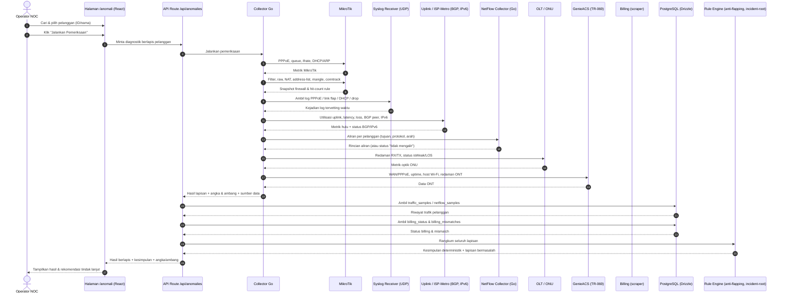
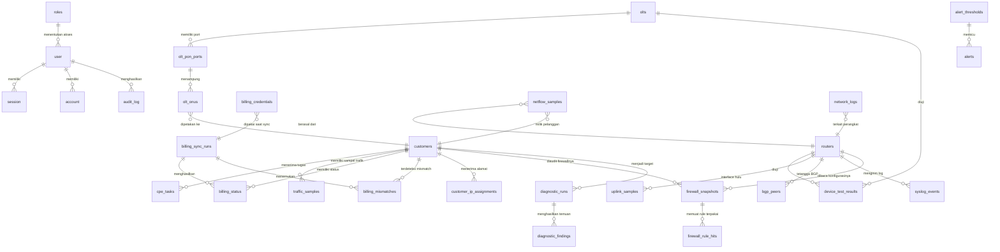

# PRD — Project Requirements Document

## 1. Overview

**Masalah yang diselesaikan**
Operator NOC sering menerima keluhan pelanggan berupa "internet lemot" padahal papan monitoring menunjukkan semua indikator hijau. Penyebabnya biasanya tersembunyi di salah satu lapisan: sesi PPPoE yang tidak normal, queue yang berubah, redaman optik yang menipis, kondisi ONT di rumah pelanggan, tren trafik yang menurun, atau status billing yang ternyata sedang diisolir. Untuk menemukannya, operator harus membuka banyak halaman dan alat secara manual, lalu menyimpulkan sendiri — sehingga lambat, tidak konsisten, dan sulit dipertanggungjawabkan.

**Tujuan utama aplikasi**
NOC SYSTEM adalah aplikasi web operasional terpusat *Network Operations Center* untuk ISP. Tujuan utamanya adalah menyatukan pemantauan, diagnostik, dan otomasi infrastruktur jaringan *real-time* dalam satu tempat — mulai dari router MikroTik, perangkat OLT/ONU, CPE pelanggan (TR-069), pemrosesan alert & insiden, hingga sinkronisasi data billing.

Dalam konteks diagnostik, aplikasi menyediakan satu halaman utama (`/anomali`) yang mampu menjawab keluhan pelanggan dengan menjalankan pemeriksaan berlapis dari hulu ke hilir, menampilkan angka dan ambang yang dipakai di setiap temuan, lalu merangkumnya menjadi satu kesimpulan pasti yang menunjuk lapisan bermasalah — bukan skor kotak hitam.

## 2. Requirements

**Kebutuhan fungsional**
- Operator dapat mencari dan memilih satu pelanggan berdasarkan ID atau nama sebagai target diagnostik.
- Operator dapat memicu rangkaian pemeriksaan berlapis dengan satu aksi, yang menjangkau MikroTik, sisi optik OLT, ONT via TR-069, riwayat trafik, dan status billing.
- **Pemicu manual** — Operator dapat menjalankan diagnosa kapan pun lewat tombol: dari halaman `/anomali`, dari baris pelanggan di papan anomali, maupun dari halaman detail pelanggan. Operator tidak diwajibkan berpindah ke halaman diagnosa lebih dahulu, karena saat menerima telepon keluhan kecepatan berpindah halaman adalah hambatan yang nyata.
- **Pemicu otomatis** — Sistem juga menjalankan diagnosa sendiri tanpa menunggu tombol, ketika muncul kejadian yang menandakan gangguan pada **satu pelanggan tertentu** (mis. sesi PPPoE putus berulang, ONU LOS/`isWeak`, antrean drop, tagihan berubah menjadi isolir, atau keluhan masuk lewat kanal tiket).
- Kedua jalur pemicu menghasilkan **bentuk hasil yang sama** dan disimpan pada tabel yang sama, sehingga hasil diagnosa otomatis dan manual bisa dibandingkan berdampingan. Yang berbeda hanya `trigger_mode` dan alasan pemicunya.
- Hasil pemeriksaan ditampilkan terkelompok per lapisan, urut dari hulu ke hilir, agar mudah dibaca.
- Setiap temuan wajib menampilkan nilai angka dan ambang yang dipakai sehingga kesimpulan dapat diperiksa ulang.
- Sistem menghasilkan kesimpulan deterministik yang menunjuk lapisan paling mungkin menjadi sumber gangguan.
- Hasil pemeriksaan harus stabil dan tidak berubah-ubah antar pemanggilan.

**Kebutuhan integrasi**
- Pembacaan langsung ke router MikroTik (PPPoE, queue, interface, DHCP/ARP, firewall).
- Pembacaan **konfigurasi firewall**: filter rule, NAT (masquerade serta port forward), address-list, mangle, dan connection tracking — untuk mencari rule yang menghalangi atau justru melewati trafik pelanggan.
- Pembacaan **log perangkat MikroTik (syslog RouterOS)** dan penempatannya pada garis waktu kejadian.
- Pembacaan **sisi hulu (upstream)**: utilisasi interface uplink ke ISP/Metro, latency, jitter, dan packet loss ke hop berikutnya — diukur **dari router**, bukan dari browser operator.
- Pembacaan **BGP** (status peer, prefix diterima, flapping) dan **IPv6** (pengalamatan serta delegated prefix pelanggan) dari RouterOS.
- Pembacaan kondisi optik ONU pada perangkat OLT.
- Pembacaan isi ONT pelanggan melalui GenieACS NBI (TR-069).
- Pemanfaatan data `traffic_samples` dan `netflow_samples` yang sudah terkumpul, **dengan syarat jalur pengumpul NetFlow benar-benar mengalirkan data** (lihat Fase 6).
- Pemanfaatan data `billing_status` dan `billing_mismatches`.

**Batasan diagnostik (mengikat)**
- Diagnostik bersifat **hanya-baca**. Halaman `/anomali` tidak mengubah konfigurasi apa pun di MikroTik, OLT, maupun ONT; tindakan perbaikan berada di luar lingkup dan harus menjadi aksi terpisah dengan persetujuan operator.
- **Pengukuran hulu wajib diukur dari router**, bukan dari peramban operator. Latency/loss yang diukur dari browser mengukur jalur operator→server, bukan jalur pelanggan→ISP, sehingga kesimpulannya bisa salah arah.
- Setiap lapisan wajib menyatakan **sumber datanya** (router mana, interface mana, waktu sampel). Kesimpulan tanpa jejak sumber tidak boleh ditampilkan.
- Bila sebuah lapisan tidak dapat diperiksa (perangkat mati, data kosong, integrasi belum aktif), lapisan itu ditandai **"tidak dapat diperiksa"** dengan alasannya — bukan dianggap normal. Lapisan yang dilewati diam-diam adalah sumber kesimpulan palsu.
- **Diagnosa otomatis dilarang menyerbu router.** Pemeriksaan otomatis dibatasi per router (jumlah berjalan bersamaan dan jarak antar-jalan), diberi kunci anti-duplikat per pelanggan dalam jendela waktu tertentu, dan **selalu kalah prioritas** dari permintaan manual. Diagnosa yang memicu beban pada router produksi sampai membuat router sibuk adalah obat yang lebih berbahaya daripada penyakitnya.
- **Diagnosa otomatis tidak dijalankan saat gangguan massal.** Bila banyak pelanggan terganggu pada waktu yang sama (uplink jenuh, peer BGP turun, OLT mati), sistem mendeteksi gangguan bersama itu lebih dahulu dan **menahan** diagnosa otomatis per pelanggan. Menjalankan ratusan diagnosa individual saat hulu tumbang hanya menghasilkan ratusan kesimpulan yang sama, sekaligus membebani router.
- Hasil diagnosa otomatis yang berulang pada pelanggan yang sama dalam jendela singkat **digabung**, bukan ditumpuk menjadi banyak riwayat yang isinya serupa.

**Kebutuhan non-fungsional**
- Akses dibatasi berdasarkan peran (operator/teknisi) melalui modul autentikasi internal.
- Sistem berjalan pada dua mode perangkat: simulator dan fisik, yang dapat dialihkan operator.
- Kredensial sesi portal dan scraper disimpan terenkripsi (AES-256-GCM).
- Data ditampilkan *real-time* dengan pembaruan otomatis, termasuk penanganan saat aliran data terputus.
- Pengujian kualitas dijaga melalui E2E (Playwright) dan linting (ESLint).

## 3. Core Features

_Urutan fase di bawah ini adalah urutan kedalaman pemeriksaan, bukan urutan kepentingan: Fase 1 adalah kerangka dasar yang harus jalan lebih dahulu, fase-fase berikutnya menambah kedalaman lapisan diagnosa, dan fase terakhir adalah perapian._

### Fase 1 — Diagnostik Dasar (prioritas: high)
- **Pilih Pelanggan** — Mencari dan memilih pelanggan berdasarkan ID atau nama sebagai target diagnostik pada halaman utama `/anomali`.
- **Jalankan Pemeriksaan** — Tombol untuk memicu rangkaian pemeriksaan berlapis dari MikroTik sampai billing memakai collector Go dan endpoint `/api/anomalies` yang sudah ada.
- **Hasil Berlapis** — Menampilkan hasil pemeriksaan dikelompokkan per lapisan agar operator mudah membaca urutan hulu ke hilir.
- **Angka & Ambang Terpakai** — Setiap temuan menampilkan nilai angka dan ambang yang dipakai agar kesimpulan bisa diperiksa ulang, bukan skor kotak hitam.
- **Tanda "Tidak Dapat Diperiksa"** — Lapisan yang belum bisa diperiksa ditampilkan beserta alasannya sejak fase ini, agar penambahan lapisan berikutnya tidak pernah menyamar sebagai "normal".

- **Tombol Diagnosa Manual** [high] — Tombol yang memicu diagnosa penuh untuk satu pelanggan, tersedia di tiga tempat: halaman `/anomali`, baris pelanggan pada papan anomali, dan halaman detail pelanggan. Tombol harus **selalu aktif dan langsung memberi umpan balik** — bila pemeriksaan sedang berjalan, tampilkan progres per lapisan, bukan diam tanpa penjelasan. Operator yang menekan tombol untuk kedua kali saat pemeriksaan masih berjalan diarahkan ke pemeriksaan yang sedang berjalan itu, bukan memulai pemeriksaan baru.
- **Pemicu Otomatis per Pelanggan** [high] — Mesin pemicu yang menjalankan diagnosa tanpa campur tangan operator. Yang menentukan pemicu bukan sekadar "jadwal berkala", melainkan **kejadian** yang sudah dikenali sistem:
  - **Pemicu dari alert** — Alert baru untuk satu pelanggan (PPPoE down, ONU LOS/`isWeak`, drop antrean tinggi) memicu diagnosa dengan `trigger_mode = auto`.
  - **Pemicu dari keluhan** — Tiket atau keluhan pelanggan yang masuk memicu diagnosa segera, karena pada saat itulah datanya paling berharga: masih dekat dengan waktu kejadian.
  - **Pemicu dari perubahan status** — Perubahan status yang mengubah kesimpulan secara mendasar (mis. tagihan berubah menjadi isolir) memicu pemeriksaan ulang.
  - **Kebijakan pemicu yang bisa diatur** — Operator dapat mengaktifkan/mematikan pemicu otomatis per jenis kejadian, dan menetapkan jendela anti-duplikat (mis. satu pelanggan maksimal didiagnosa otomatis sekali per 15 menit). Tanpa pengaturan ini, satu pelanggan yang flapping akan memicu puluhan diagnosa per jam.
  - **Penahan saat gangguan massal** — Bila sistem mendeteksi gangguan bersama yang menerpa banyak pelanggan, pemicu otomatis per pelanggan ditahan dan diganti satu diagnosa gangguan bersama. Ini yang mencegah kerumunan diagnosa sia-sia ketika uplink atau OLT yang bermasalah.
  - **Antrean berprioritas** — Permintaan manual selalu didahulukan dari otomatis, dan jumlah pemeriksaan bersamaan dibatasi per router agar pembacaan konfigurasi tidak membebani router produksi.
- **Penanda Asal Diagnosa** [medium] — Setiap hasil menampilkan apakah ia dijalankan **manual** (beserta operator yang menekan) atau **otomatis** (beserta pemicunya), lengkap dengan waktu jalan. Tanpa penanda ini, operator tidak bisa membedakan diagnosa yang ia minta sendiri dari yang muncul dengan sendirinya, dan lama-lama tidak percaya pada isi halaman.

### Fase 2 — Pemeriksaan Perangkat Akses & Pelanggan (prioritas: high)
- **Pemeriksaan MikroTik** [high] — Lapisan utama pembacaan MikroTik yang memetakan kondisi per pelanggan melalui collector Go yang sudah ada, mencakup:
  - **PPPoE Secret & Active** — Memeriksa status PPPoE secret/active milik pelanggan untuk memastikan sesi berjalan normal.
  - **Simple Queue & Dinamika** — Membaca kondisi simple queue beserta perubahannya untuk mendeteksi limit atau dinamika tak wajar.
  - **Utilisasi Interface** — Menampilkan utilisasi antarmuka lewat ifrate agar terlihat apakah jalur sedang penuh atau tidak.
  - **DHCP Lease & ARP** — Memeriksa DHCP lease dan entri ARP pelanggan untuk memastikan perangkat terdaftar di jaringan.
  - **Ringkasan Firewall & Koneksi** — Menghitung firewall-mangle, connection tracking, dan paket drop yang terkait pelanggan. Pembacaan mendalam atas urutan rule, NAT, dan fasttrack berada di Fase 4.
- **Pemeriksaan Optik ONU** [medium] — Lapisan berikutnya memeriksa kondisi optik ONU di OLT untuk mencari penyebab sisi fisik yang sering luput dari monitoring hijau, memakai komponen `optical-badge` yang sudah ada:
  - **Redaman RX/TX** — Menampilkan nilai redaman RX/TX ONU pelanggan.
  - **Status isWeak & LOS** — Menandai bila ONU berstatus isWeak atau LOS sebagai indikasi gangguan optik.
  - **Validasi Ambang Optik** — Membandingkan redaman terhadap ambang optik agar kesimpulan punya dasar angka yang jelas.
- **Pemeriksaan ONT** [medium] — Memeriksa isi ONT pelanggan lewat GenieACS TR-069 untuk melengkapi gambaran di sisi perangkat pelanggan:
  - **Status WAN/PPPoE** — Memeriksa status koneksi WAN dan PPPoE dari sisi ONT pelanggan.
  - **Uptime & Host Wi-Fi** — Menampilkan uptime ONT dan jumlah host Wi-Fi yang terhubung sebagai konteks kondisi perangkat.
  - **Redaman Sisi ONT** — Menampilkan redaman dari sisi ONT untuk dibandingkan dengan pembacaan di OLT.
- **Status Billing & Isolir** [high] — Lapisan administratif yang paling murah diperiksa dan sering menjadi jawaban, sehingga ditempatkan di fase awal agar tidak tenggelam di bawah lapisan teknis:
  - **Cek Status Billing** — Menampilkan status billing pelanggan terkini dari data `billing_status` yang sudah ada.
  - **Deteksi Isolir** — Menandai bila pelanggan sedang terkena isolir sebagai kemungkinan penyebab keluhan.
  - **Padukan Mismatch** — Memakai data `billing_mismatches` agar ketidaksesuaian status pelanggan ikut terbaca dalam kesimpulan.

### Fase 3 — Log MikroTik & Korelasi Waktu (prioritas: high)
- **Log Perangkat (syslog RouterOS)** [high] — Membaca log router yang bersinggungan dengan pelanggan tersebut, bukan sekadar menghitung baris log:
  - **Kegagalan Sesi PPPoE** — Login gagal berulang, `pppoe timeout`, sesi putus-nyambung berkali-kali dalam jendela waktu pendek sebagai indikasi masalah kabel/optik atau kredensial.
  - **Flap Interface & Link** — Kejadian `link down/up` pada port yang dilalui pelanggan, beserta durasi tiap pemutusan.
  - **Bentrok DHCP & ARP** — Alamat ganda, lease kedaluwarsa, perangkat tidak dikenal, atau MAC berpindah port.
  - **Firewall & Drop** — Rule yang memblokir trafik pelanggan tersebut, termasuk raw/filter drop yang tidak terlihat dari papan monitoring.
  - **Penyaringan Derau** — Log terjadwal dan pesan rutin disaring lebih dahulu. Tanpa penyaringan, hitungan log mentah akan menyesatkan dan menenggelamkan kejadian yang benar-benar relevan.
- **Korelasi Waktu** — Setiap kejadian ditempatkan pada garis waktu relatif terhadap waktu keluhan dilaporkan, sehingga terlihat apakah kejadian itu mendahului atau menyusul keluhan.

### Fase 4 — Audit Firewall & NAT (prioritas: high)
- **Audit Firewall Pelanggan** [high] — Membaca konfigurasi firewall router, bukan hanya menghitung paket drop, karena firewall adalah tempat paling sering muncul gangguan yang tidak terlihat di papan monitoring:
  - **Urutan & Tabrakan Rule Filter** — Aturan `accept`/`drop` yang urutannya salah dapat memblokir atau melewati trafik pelanggan. Yang dicari bukan jumlah rule, melainkan **rule mana yang benar-benar mengenai trafik pelanggan tersebut**, beserta posisi dan hit-count-nya.
  - **Raw Drop & Address-List** — Rule `raw` serta entri `address-list` (mis. daftar blokir, daftar isolir) yang memuat IP pelanggan. Pelanggan yang masuk address-list blokir tetap tampak "online" di monitoring, sehingga penyebabnya harus ditunjuk langsung.
  - **NAT (Masquerade & Port Forward)** — Memeriksa aturan `src-nat`/`masquerade` yang berlaku untuk IP pelanggan, serta `dst-nat`/port forward yang bertabrakan. Port forward ganda ke IP yang sama adalah penyebab umum layanan pelanggan tertentu mati sementara yang lain hidup.
  - **Fasttrack vs Queue** — Mendeteksi bila koneksi pelanggan terkena *fasttrack*, karena koneksi yang di-fasttrack **melewati simple queue** sehingga batas kecepatan tidak pernah berlaku. Ini penyebab klasik keluhan "paket saya tidak sesuai": semua indikator hijau, limit tetap terpasang, tetapi tidak pernah dieksekusi.
  - **Connection Tracking** — Memantau `tracking`/`untracked` dan sisa tabel conntrack. Tabel yang penuh membuat koneksi baru gagal secara acak — gejalanya persis "kadang jalan, kadang tidak", dan tidak terlihat dari metrik interface.
  - **Mangle & Connection Mark** — Memeriksa mark yang dipakai queue/traffic shaping agar limit benar-benar mengenai trafik pelanggan, bukan mark milik pelanggan lain atau mark kosong.

### Fase 5 — Hulu: Uplink, Upstream/Metro, BGP, IPv6 (prioritas: high)
- **Jalur Hulu (MikroTik → ISP/Metro)** [high] — Memeriksa apakah keluhan pelanggan sebenarnya berasal dari sisi hulu, bukan dari perangkat pelanggan:
  - **Utilisasi Uplink ke Metro/ISP** — Memakai ifrate pada interface uplink beserta kapasitasnya, agar terlihat apakah jalur hulu sedang jenuh.
  - **Kualitas Jalur Hulu** — Latency, jitter, dan packet loss ke hop ISP/Metro berikutnya, diukur dari router.
  - **Beban Berbagi (Contention)** — Menandai bila penurunan trafik pelanggan bertepatan dengan lonjakan uplink; bila bertepatan, penyebabnya berbagi bandwidth, bukan perangkat pelanggan.
  - **Riwayat Hulu** — Menyimpan sampel uplink agar kondisi "saat ini" bisa dibandingkan dengan kondisi saat keluhan muncul.
- **BGP** [high] — Membaca tetangga BGP pada router: status peer (established/idle), jumlah prefix diterima, riwayat flapping, dan waktu perubahan terakhir. Peer turun atau prefix menyusut berarti gangguan hulu yang menerpa banyak pelanggan sekaligus, dan harus muncul sebagai satu temuan, bukan diratakan sebagai keluhan per pelanggan.
- **IPv6** [medium] — Memeriksa pengalamatan dan delegated prefix IPv6 milik pelanggan. Sebagian layanan (mis. aplikasi seluler tertentu) gagal hanya pada jalur IPv6, sehingga keluhan "lemot" bisa bersumber dari sini walau IPv4 tampak normal.

### Fase 6 — Trafik & NetFlow Per Pelanggan (prioritas: high)
- **Riwayat Trafik Pelanggan** — Menampilkan tren trafik pelanggan dari data `traffic_samples` yang sudah ada untuk melihat pola menurun atau anomali:
  - **Tren Trafik** — Menampilkan grafik riwayat trafik pelanggan dalam periode tertentu.
  - **Deteksi Penurunan** — Menandai pola penurunan atau lonjakan tak wajar pada trafik pelanggan.
  - **Sumber traffic_samples** — Memakai data `traffic_samples` yang sudah terkumpul tanpa menambah data dummy.
- **Aliran NetFlow** [high] — Memakai data NetFlow untuk melihat **ke mana** trafik pelanggan sebenarnya pergi, sesuatu yang tidak terlihat dari total byte:
  - **Rincian Tujuan & Protokol** — Tujuan teratas, port, dan protokol per pelanggan, agar terlihat apakah trafik tersedot ke satu tujuan, seeding, atau pembaruan aplikasi.
  - **Arah Trafik** — Memisahkan unggah dan unduh; keluhan "lemot" sering ternyata unggahan yang jenuh.
  - **Prasyarat Wajib** — Skema `netflow_samples` dan tampilannya sudah ada di repo, namun modul pengumpul NetFlow tidak terlihat pada collector Go. **Jalur masuk data ini harus dipastikan lebih dahulu**; selama belum mengalir, lapisan ini ditandai "tidak dapat diperiksa", bukan ditampilkan kosong seolah normal.

### Fase 7 — Diagnostik Aktif & Baseline Historis (prioritas: medium)
- **Pengukuran Aktif** — Menjalankan ping, traceroute, dan pemeriksaan resolusi DNS **dari router** ke arah pelanggan dan ke arah hop ISP/Metro, karena data pasif saja tidak menangkap latency dan loss.
- **Baseline Per Pelanggan** — Membandingkan kondisi pelanggan dengan **riwayatnya sendiri**, bukan hanya dengan ambang global. Pelanggan 10 Mbps dan 50 Mbps tidak layak dinilai dengan angka yang sama, dan penurunan trafik yang wajar bagi satu pelanggan bisa menjadi anomali bagi pelanggan lain.

### Fase 8 — Kesimpulan Deterministik (prioritas: high)
- **Kesimpulan Deterministik** — Merangkum seluruh lapisan menjadi satu kesimpulan pasti yang menunjuk lapisan bermasalah beserta angka dan ambangnya, memakai rule engine dan pola anti-flapping serta incident-root yang sudah ada:
  - **Penunjuk Lapisan Bermasalah** — Menunjuk lapisan mana (log MikroTik, MikroTik aktif, **firewall/NAT**, uplink/upstream & Metro, optik OLT, ONT, NetFlow/trafik, atau billing) yang paling mungkin menjadi sumber gangguan.
  - **Pembedaan Gangguan Sendiri vs Gangguan Bersama** — Membedakan gangguan yang hanya mengenai pelanggan tersebut dari gangguan hulu yang menerpa banyak pelanggan (uplink jenuh, peer BGP turun). Kesimpulan yang menyalahkan perangkat pelanggan padahal uplink sedang jenuh adalah kesimpulan yang paling merugikan, karena teknisi dikirim ke rumah tanpa hasil.
  - **Angka & Ambang Rinci** — Menyertakan nilai dan ambang yang dipakai di setiap kesimpulan agar hasil dapat diverifikasi operator.
  - **Anti-Flapping & Incident Root** — Memakai pola anti-flapping dan incident-root yang sudah ada agar kesimpulan stabil dan tidak berubah-ubah.

### Fase 9 — Perapian & Pengerasan (prioritas: medium)
- **Riwayat Diagnosa** — Menyimpan setiap pemeriksaan sebagai catatan yang dapat dibandingkan sebelum dan sesudah tindakan, sehingga hasil diagnosa bisa dilampirkan saat eskalasi tiket dan tidak hilang setelah halaman ditutup.
- **Ambang Per Paket** — Menyelaraskan ambang dengan paket pelanggan, bukan hanya ambang global, agar penilaian 10 Mbps dan 50 Mbps tidak memakai angka yang sama.
- **Konsistensi "Tidak Dapat Diperiksa"** — Meninjau seluruh lapisan agar tidak ada satu pun yang bisa lolos diam-diam sebagai "normal" ketika datanya kosong, dan alasannya selalu ikut tampil.
- **Penyelarasan Istilah & Penomoran** — Menyeragamkan istilah lapisan, nama kolom, dan penomoran fase antara PRD, berkas fitur, dan Wiki, sehingga rujukan antar dokumen tidak meleset.
- **Pengujian Menyeluruh** — Menutup alur diagnosa dengan uji E2E (Playwright) dan linting, termasuk kasus lapisan kosong, perangkat mati, dan kesimpulan gangguan bersama.

## 4. User Flow

**A. Alur Diagnostik Pelanggan — Manual (Fase 1 → Fase 9)**
1. Operator membuka halaman `/anomali` dan mencari pelanggan berdasarkan ID atau nama, lalu memilihnya sebagai target diagnostik. **(Fase 1)**
2. Operator menekan tombol jalankan pemeriksaan; sistem memanggil endpoint `/api/anomalies` dan menjalankan collector Go. **(Fase 1)**
3. Sistem memeriksa lapisan MikroTik aktif: PPPoE secret/active, simple queue, utilisasi interface (ifrate), DHCP lease & ARP, serta ringkasan firewall/connection tracking. **(Fase 2)**
4. Sistem memeriksa lapisan optik ONU di OLT: redaman RX/TX, status isWeak/LOS, dibandingkan terhadap ambang optik. **(Fase 2)**
5. Sistem memeriksa lapisan ONT via GenieACS TR-069: status WAN/PPPoE, uptime, jumlah host Wi-Fi, dan redaman sisi ONT. **(Fase 2)**
6. Sistem memeriksa lapisan billing: status dari `billing_status`, indikasi isolir, serta ketidaksesuaian pada `billing_mismatches`. **(Fase 2)**
7. Sistem membaca **log MikroTik (syslog)** untuk pelanggan tersebut, menyaring derau, lalu menempatkan kegagalan PPPoE, flap link, bentrok DHCP/ARP, dan drop firewall pada garis waktu kejadian. **(Fase 3)**
8. Sistem **mengaudit firewall & NAT**: rule filter/raw yang mengenai IP pelanggan, entri address-list blokir, aturan masquerade/port forward yang bertabrakan, koneksi yang terkena *fasttrack* sehingga melewati queue, serta pemakaian tabel connection tracking. **(Fase 4)**
9. Sistem memeriksa **sisi hulu**: utilisasi interface uplink ke Metro/ISP beserta kapasitasnya, latency, jitter, dan packet loss ke hop berikutnya, semuanya diukur dari router. **(Fase 5)**
10. Sistem membaca **BGP** (status peer, prefix diterima, flapping) dan **IPv6** (pengalamatan serta delegated prefix pelanggan). **(Fase 5)**
11. Sistem menampilkan riwayat trafik dari `traffic_samples` dan rincian aliran dari `netflow_samples` (tujuan, protokol, arah), lalu menandai pola penurunan atau lonjakan tak wajar. Bila collector NetFlow belum mengalirkan data, lapisan ini ditandai "tidak dapat diperiksa" beserta alasannya. **(Fase 6)**
12. Sistem menjalankan pengukuran aktif (ping/traceroute/DNS) dari router, lalu membandingkan kondisi pelanggan dengan baseline riwayatnya sendiri, bukan hanya terhadap ambang global. **(Fase 7)**
13. Rule engine merangkum semua lapisan (dengan anti-flapping dan incident-root) menjadi kesimpulan deterministik, termasuk membedakan gangguan milik pelanggan ini dari gangguan hulu yang bersifat bersama. **(Fase 8)**
14. Sistem menyimpan hasil pemeriksaan sebagai riwayat diagnosa agar dapat dibandingkan sebelum dan sesudah tindakan. **(Fase 9)**
15. Operator membaca hasil berlapis, memverifikasi angka/ambang dan sumber datanya, lalu menindaklanjuti (misalnya membuat tiket atau mengeskalasi alert melalui dialog yang sudah ada).

**B. Alur Diagnosa Otomatis (Fase 1 → Fase 9)**
1. Sistem menerima kejadian pemicu untuk satu pelanggan: alert baru, tiket/keluhan masuk, ONU LOS/`isWeak`, PPPoE putus berulang, atau perubahan status billing. **(Fase 1)**
2. Sistem memeriksa lebih dahulu apakah sedang ada gangguan bersama (uplink jenuh, peer BGP turun, OLT mati). Bila ada, diagnosa per pelanggan **ditahan** dan gangguan bersama yang dilaporkan. **(Fase 1, Fase 8)**
3. Bila tidak ada gangguan bersama, sistem menerapkan jendela anti-duplikat dan `dedupe_key` per pelanggan. Bila pelanggan yang sama sudah didiagnosa dalam jendela itu, kejadian baru **digabung** ke hasil yang ada, bukan memulai pemeriksaan baru. **(Fase 1)**
4. Pekerjaan ditaruh pada antrean berprioritas **di bawah** permintaan manual, dengan jumlah pemeriksaan bersamaan dibatasi per router. **(Fase 1, Fase 5)**
5. Rangkaian pemeriksaan lapisan dijalankan sama persis seperti alur manual: MikroTik, optik, ONT, billing, log, firewall, hulu/BGP/IPv6, trafik/NetFlow, lalu pengukuran aktif dan baseline. **(Fase 2 → Fase 7)**
6. Rule engine menyusun kesimpulan deterministik dan menandai apakah ini gangguan pelanggan itu sendiri atau bagian dari gangguan bersama. **(Fase 8)**
7. Hasil disimpan dengan `trigger_mode = auto`, `trigger_reason`, dan `trigger_source_ref` agar bisa ditelusuri ke kejadian pemicunya. **(Fase 9)**
8. Hasil **tidak** membuat alert atau tiket baru. Operator melihatnya di papan diagnosa dengan penanda "otomatis", dan dapat menekan tombol manual bila ingin memeriksa ulang pada saat itu juga. **(Fase 1)**
9. Bila operator menekan tombol manual saat diagnosa otomatis masih berjalan, permintaan manual didahulukan; hasil otomatis tetap disimpan sebagai pembanding bertanda waktu. **(Fase 1, Fase 9)**

**C. Alur Operasional Harian (kemampuan yang sudah ada)**
1. Operator masuk melalui App Shell dan navigasi; hak akses ditentukan oleh peran.
2. Operator memantau alert aktif di papan dashboard, dengan kontrol suara dan ringkasan metrik.
3. Operator mengklik alert untuk membuka dialog penanganan tiket/eskalasi; jika aliran data terputus, banner peringatan muncul dengan tombol sambung ulang.
4. Operator menguji konektivitas perangkat (MikroTik/OLT/GenieACS/Billing) melalui `device-config-board.tsx` → `POST /api/devices/test`; jika gagal, panduan *troubleshoot* tampil otomatis.
5. Operator mengubah konfigurasi Wi-Fi pelanggan melalui form CPE → `POST /api/cpe/tasks`, dan dapat melihat/memutus host terhubung sesuai otorisasi.
6. Operator memantau sinkronisasi billing dan menyelesaikan *mismatch* melalui dialog verifikasi.

## 5. Architecture

Sistem berjalan sebagai aplikasi monolitik Next.js dengan pola berlapis: antarmuka React di sisi klien, rute API internal sebagai orkestrasi, PostgreSQL via Drizzle ORM sebagai penyimpanan, serta sejumlah sistem eksternal (MikroTik, OLT/ONU, GenieACS, portal billing, WhatsApp Gateway). Khusus diagnostik, sistem menambahkan collector Go dan endpoint `/api/anomalies` yang dipanggil dari halaman `/anomali`.

Keterangan tambahan:
- **App Shell & Navigation** menjadi pintu masuk semua alur, dengan **Auth & Role Management** membatasi akses per peran.
- **Device Mode Switch** memungkinkan operator beralih antara mode simulator dan perangkat fisik.
- **Alerting & Notifikasi** dijalankan melalui papan alert dan diteruskan ke WhatsApp Gateway untuk eskalasi.
- Data hasil uji konektivitas dan log jaringan tersimpan melalui Drizzle ORM ke PostgreSQL (`network_logs`, `device_test_results`).
- **Syslog Receiver** menerima aliran log dari router secara terus-menerus (UDP), lalu menyimpannya terstruktur agar dapat dicari per router dan per jendela waktu. Diagnostik **membaca** log tersimpan, bukan meminta router mengirim ulang — karena log kejadian lampau tidak bisa diminta kembali setelah buffer router berputar.
- **Uplink / ISP-Metro** adalah batas tanggung jawab yang harus terlihat jelas pada hasil diagnosa: gangguan di sisi ini **bukan** kesalahan pelanggan maupun perangkat rumah, sehingga temuannya dikelompokkan sebagai gangguan bersama.
- **Audit firewall dibaca sebagai snapshot**, bukan sekadar hitungan: yang disimpan adalah konfigurasi rule yang berlaku untuk IP pelanggan beserta `hit-count` dan waktu pembacaan. Tanpa hit-count, operator tidak bisa membedakan rule yang benar-benar menimpa trafik pelanggan dari rule yang hanya ada di daftar. Snapshot diambil **hanya-baca**; tidak ada penambahan, pengubahan, atau penghapusan rule dari halaman `/anomali`.
- **Dua jalur pemicu berbagi satu mesin pemeriksa.** Tombol manual dan pemicu otomatis tidak boleh punya jalur kode berbeda: keduanya memanggil rangkaian pemeriksaan yang sama, lalu hasilnya dibedakan lewat `trigger_mode`. Kalau dipisah, hasil manual dan otomatis akan menyimpang seiring waktu, dan perbandingan keduanya menjadi tidak sahih.
- **Pemicu otomatis berjalan sebagai pekerjaan latar, bukan di dalam permintaan pengguna.** Ia membaca sumber kejadian (alert, tiket, perubahan status billing), menerapkan jendela anti-duplikat dan status gangguan bersama, lalu menaruh pekerjaan pada antrean berprioritas di bawah permintaan manual.

**Aturan pengikat arsitektur (diagnostik)**
- Semua pengukuran aktif (ping, traceroute, resolusi DNS) dijalankan **dari router**, bukan dari server aplikasi atau peramban. Server aplikasi berada di jaringan yang berbeda dari pelanggan, sehingga hasil ukurnya tidak mewakili jalur pelanggan.
- Diagnostik **tidak menulis** ke perangkat mana pun. Tidak ada perubahan queue, PPPoE, firewall, atau parameter ONT dari halaman `/anomali`.
- Collector Go menandai setiap hasil dengan **asal datanya**: router mana, interface mana, dan waktu sampel. Hasil tanpa jejak asal ditolak oleh rule engine, karena tidak dapat dipertanggungjawabkan saat keluhan berulang.
- Lapisan yang datanya kosong atau integrasinya belum aktif **tidak boleh dianggap normal**; lapisan itu wajib muncul sebagai "tidak dapat diperiksa" beserta alasannya.
- **Fasttrack wajib diperiksa lebih dahulu sebelum menyimpulkan soal queue.** Bila koneksi pelanggan di-fasttrack, kesimpulan "queue sudah benar, berarti masalah di rumah pelanggan" adalah kesimpulan yang salah: limit memang terpasang tetapi tidak pernah dieksekusi. Diagnostik harus menyatakan hal ini secara eksplisit, bukan menyamakannya dengan "queue normal".

- **Diagnosa otomatis tidak boleh menjadi sumber alert baru.** Hasil diagnosa otomatis **tidak** otomatis membuat alert atau tiket; ia hanya mengisi riwayat dan papan diagnosa. Membiarkannya membuat alert akan menciptakan lingkaran: alert memicu diagnosa, diagnosa membuat alert, alert memicu diagnosa lagi.
- **Diagnosa otomatis tidak menggantikan diagnosa manual saat operator memintanya.** Bila operator menekan tombol, ia mendapat pemeriksaan baru, bukan jawaban lama yang disajikan ulang sebagai hasil segar. Hasil lama boleh ditampilkan sebagai pembanding bertanda waktu, tetapi tidak boleh menyamar sebagai hasil yang baru dijalankan.

## 6. Database Schema

Skema diturunkan dari entitas yang benar-benar disebut pada dokumentasi NOC SYSTEM. Dokumentasi memuat daftar tabel beserta fungsinya, namun tidak memuat definisi kolom lengkap; kolom di bawah adalah field utama yang tersirat dari fungsi tiap entitas dan sebaiknya diverifikasi ke berkas migrasi Drizzle (`drizzle/`) sebelum dijadikan acuan final.

**Pengguna & Akses**
- **`user`** — Data pengguna aplikasi. Field utama: `id`, `name`, `email`, `role_id`, `created_at`.
- **`account`** — Akun autentikasi terkait pengguna (kredensial/sesi masuk).
- **`session`** — Sesi aktif pengguna. Field utama: `id`, `user_id`, `expires_at`.
- **`verification`** — Token verifikasi untuk proses akun (verifikasi email/reset).
- **`roles`** — Definisi peran dan hak akses operator/teknisi. Field utama: `id`, `name`, `permissions`.
- **`audit_log`** — Jejak aktivitas pengguna. Field utama: `id`, `user_id`, `action`, `created_at`.
- **`notes`** — Catatan operasional terkait entitas sistem.

**Infrastruktur NOC**
- **`routers`** — Data router MikroTik terdaftar. Field utama: `id`, `name`, `host`, `status`, `last_checked_at`.
- **`olts`** — Data perangkat OLT. Field utama: `id`, `name`, `host`, `status`.
- **`olt_pon_ports`** — Port PON pada OLT. Field utama: `id`, `olt_id`, `port_index`, `status`.
- **`olt_onus`** — Unit ONU beserta metrik optik. Field utama: `id`, `pon_port_id`, `serial`, `status` (online/offline/LOS), `rx_power`, `tx_power`, `is_weak`.
- **`cpe_tasks`** — Tugas konfigurasi CPE via TR-069. Field utama: `id`, `customer_id`, `type` (mis. set SSID/password), `status`, `created_at`.
- **`network_logs`** — Log jaringan yang terkumpul.
- **`device_test_results`** — Hasil pengujian konektivitas perangkat. Field utama: `id`, `device_type`, `device_id`, `status`, `error_code`, `tested_at`.

**Pelanggan & Wilayah**
- **`customers`** — Data pelanggan ISP. Field utama: `id`, `customer_code`, `name`, `address`.
- **`onboarding`** — Proses pendaftaran/aktivasi pelanggan.
- **`whatsapp`** — Data integrasi notifikasi WhatsApp. Field utama: `id`, `phone`, `status`.

**Metrik & Alert**
- **`alerts`** — Alert aktif/historis. Field utama: `id`, `type`, `severity`, `target_ref`, `status`, `created_at`.
- **`alert_thresholds`** — Ambang batas pemicu alert. Field utama: `id`, `metric`, `operator`, `value`.
- **`netflow_samples`** — Sampel NetFlow. Field utama: `id`, `device_ref`, `customer_ref`, `sampled_at`, `bytes`, `packets`, `src_addr`, `dst_addr`, `dst_port`, `protocol`, `direction` (in/out). Penambahan kolom tujuan/arah diperlukan agar aliran bisa dirinci per pelanggan, bukan hanya total byte.
- **`traffic_samples`** — Sampel trafik pelanggan untuk grafik tren. Field utama: `id`, `customer_ref`, `sampled_at`, `in_bytes`, `out_bytes`.

**Jalur Hulu, BGP & Log**
- **`uplink_samples`** — Sampel berkala interface uplink ke ISP/Metro. Field utama: `id`, `router_ref`, `interface_ref`, `sampled_at`, `rx_bps`, `tx_bps`, `capacity_bps`, `utilization_pct`. Wajib menyimpan `capacity_bps` karena ambang utilisasi tanpa kapasitas tidak bermakna.
- **`bgp_peers`** — Kondisi tetangga BGP. Field utama: `id`, `router_ref`, `peer_name`, `remote_as`, `state`, `prefixes_received`, `last_flap_at`, `uptime_sec`.
- **`syslog_events`** — Log RouterOS terstruktur. Field utama: `id`, `router_ref`, `facility`, `severity`, `topic`, `message`, `occurred_at`, `is_noise`. Kolom `is_noise` menandai log rutin yang tersaring agar penyaringan bisa ditinjau ulang, bukan tersembunyi.
- **`customer_ip_assignments`** — Pengalamatan pelanggan untuk IPv4 dan IPv6. Field utama: `id`, `customer_ref`, `family` (v4/v6), `prefix`, `delegated_len`, `enabled`.

**Firewall & NAT**
- **`firewall_snapshots`** — Pembacaan konfigurasi firewall pada satu waktu. Field utama: `id`, `router_ref`, `customer_ref`, `taken_at`, `fasttrack_active`, `conntrack_count`, `conntrack_max`, `raw_drop_matched`, `address_list_matched`. `fasttrack_active` disimpan terpisah karena inilah yang membatalkan berlakunya queue, dan harus bisa ditunjuk sebagai temuan tersendiri.
- **`firewall_rule_hits`** — Rule firewall/NAT yang mengenai trafik pelanggan beserta hitungannya. Field utama: `id`, `snapshot_id`, `table` (filter/raw/nat/mangle), `chain`, `rule_index`, `action` (accept/drop/reject/masquerade/dst-nat), `matched_packets`, `matched_bytes`, `is_stale`. Kolom `rule_index` wajib ada karena urutan rule menentukan hasil akhir, dan `is_stale` menandai rule yang hit-count-nya tidak bergerak sama sekali.

**Diagnostik**
- **`diagnostic_runs`** — Satu pemeriksaan yang dijalankan. Field utama: `id`, `customer_ref`, `trigger_mode` (manual/auto), `triggered_by` (operator, hanya untuk manual), `trigger_reason` (mis. `pppoe_down`, `onu_los`, `ticket`, `billing_isolir`), `trigger_source_ref` (id alert/tiket yang memicu), `dedupe_key` (kunci penggabungan agar pelanggan yang sama tidak didiagnosa berulang dalam jendela singkat), `priority` (manual di atas auto), `started_at`, `finished_at`, `verdict_layer`, `verdict_detail`, `is_shared_fault`. Kolom `trigger_mode` wajib ada karena manual dan otomatis harus bisa dibedakan saat ditampilkan maupun saat ditinjau; `dedupe_key` wajib ada agar pemicu otomatis tidak menumpuk riwayat serupa.
- **`diagnostic_findings`** — Rincian temuan per lapisan dalam satu pemeriksaan. Field utama: `id`, `run_id`, `layer`, `metric`, `value`, `threshold`, `comparator`, `status` (ok/warn/fail/unchecked), `source_ref`, `checked_at`. Kolom `status` memuat `unchecked` agar lapisan yang tidak dapat diperiksa tercatat apa adanya dan tidak menyamar sebagai `ok`.

**Billing**
- **`billing_credentials`** — Kredensial sesi scraper portal billing (terenkripsi AES-256-GCM).
- **`billing_sync_runs`** — Riwayat proses sinkronisasi billing. Field utama: `id`, `started_at`, `finished_at`, `status`.
- **`billing_status`** — Status billing pelanggan terkini. Field utama: `customer_ref`, `status`, `is_isolated`, `updated_at`.
- **`billing_mismatches`** — Ketidaksesuaian data pelanggan antara billing dan sistem jaringan. Field utama: `id`, `customer_ref`, `field`, `billing_value`, `system_value`.

## 7. Tech Stack

Teknologi berikut diambil dari kondisi codebase NOC SYSTEM yang sudah ada (bukan rekomendasi default):

**Aplikasi & Antarmuka**
- **Next.js** (App Router, `next.config.ts`) sebagai kerangka aplikasi monolitik.
- **React** untuk komponen antarmuka modular (dashboard, alert board, CPE board, billing board, panel diagnostik `/anomali`).
- **Tailwind CSS / PostCSS** (`postcss.config.mjs`) untuk styling.
- **SSE / streaming** untuk pembaruan data *real-time* dan banner pemutusan aliran data.

**Backend & Data**
- **Rute API internal Next.js** sebagai orkestrasi (`/api/devices/test`, `/api/cpe/tasks`, `/api/anomalies`).
- **Collector Go** sebagai pengumpul data jaringan untuk pemeriksaan berlapis.
- **Drizzle ORM** + **Drizzle Kit** (`drizzle.config.ts`, migrasi SQL di `drizzle/`) sebagai lapisan akses data.
- **PostgreSQL** sebagai basis data relasional.
- **Rule engine internal** dengan pola anti-flapping dan incident-root untuk kesimpulan deterministik.

**Autentikasi & Keamanan**
- **Modul autentikasi internal Next.js (`AuthModule`)** dengan *role-based access*.
- **Enkripsi AES-256-GCM** untuk kredensial/sesi portal billing (`billing-credentials.ts`).

**Integrasi Eksternal**
- **MikroTik RouterOS** (PPPoE, queue, interface/ifrate, DHCP/ARP, firewall) — termasuk **syslog remote**, **BGP** (`/routing/bgp/peer`), dan **IPv6** (pengalamatan serta delegated prefix). Pembacaan firewall memakai `/ip/firewall/{filter,raw,nat,mangle}`, `/ip/firewall/connection`, dan `/ip/firewall/address-list` untuk menilai rule yang mengenai trafik pelanggan beserta hit-count-nya.
- **Syslog Receiver** — penerima UDP pada collector Go yang menyimpan log RouterOS secara terstruktur untuk dibaca ulang saat diagnosa.
- **NetFlow Collector** — penerima NetFlow/IPFIX pada collector Go. **Prasyarat yang belum terpenuhi:** modul ini tidak terlihat pada indeks collector saat PRD disusun, sehingga harus dibangun dan diaktifkan lebih dahulu; tanpa itu lapisan NetFlow hanya bisa berstatus "tidak dapat diperiksa".
- **Pengukuran aktif dari router** — ping, traceroute, dan pemeriksaan resolusi DNS dijalankan lewat RouterOS agar hasilnya mewakili jalur pelanggan.
- **OLT & ONU** untuk data perangkat dan metrik optik (`optical-badge.tsx`).
- **GenieACS NBI (TR-069)** untuk diagnostik dan konfigurasi CPE/ONT.
- **Portal Billing (scraper)** untuk sinkronisasi status pelanggan dan penanganan *mismatch*.
- **WhatsApp Gateway** untuk notifikasi dan eskalasi alert.

**Kualitas & Pengujian**
- **Playwright** (`playwright.config.ts`) untuk pengujian End-to-End.
- **ESLint** (`eslint.config.mjs`) untuk standarisasi kode.
- **Node.js** dan manajer paket (npm/pnpm/yarn) sebagai runtime pengembangan.