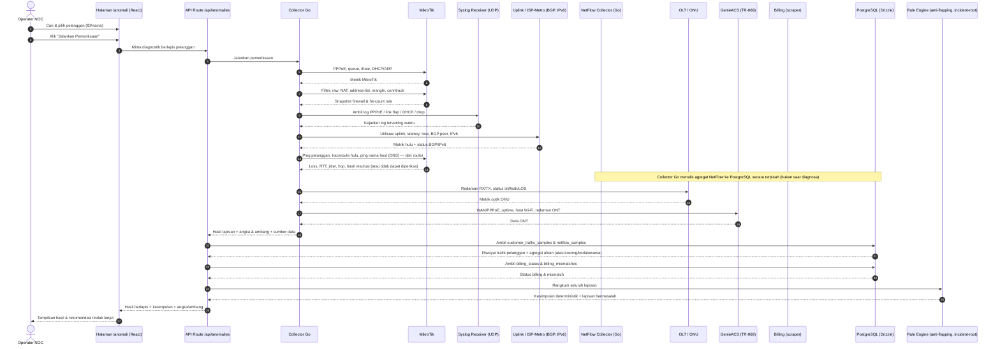
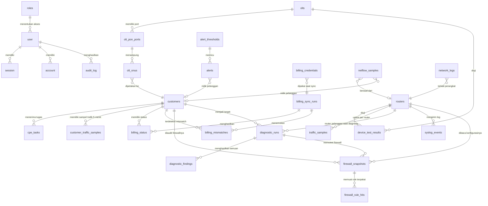

# PRD — Project Requirements Document

## 1. Overview

**Masalah yang diselesaikan**
Operator NOC sering menerima keluhan pelanggan berupa "internet lemot" padahal papan monitoring menunjukkan semua indikator hijau. Penyebabnya biasanya tersembunyi di salah satu lapisan: sesi PPPoE yang tidak normal, queue yang berubah, redaman optik yang menipis, kondisi ONT di rumah pelanggan, tren trafik yang menurun, atau status billing yang ternyata sedang diisolir. Untuk menemukannya, operator harus membuka banyak halaman dan alat secara manual, lalu menyimpulkan sendiri — sehingga lambat, tidak konsisten, dan sulit dipertanggungjawabkan.

**Tujuan utama aplikasi**
NOC SYSTEM adalah aplikasi web operasional terpusat *Network Operations Center* untuk ISP. Tujuan utamanya adalah menyatukan pemantauan, diagnostik, dan otomasi infrastruktur jaringan *real-time* dalam satu tempat — mulai dari router MikroTik, perangkat OLT/ONU, CPE pelanggan (TR-069), pemrosesan alert & insiden, hingga sinkronisasi data billing.

Dalam konteks diagnostik, aplikasi menyediakan satu halaman utama (`/anomali`) yang mampu menjawab keluhan pelanggan dengan menjalankan pemeriksaan berlapis dari hulu ke hilir, menampilkan angka dan ambang yang dipakai di setiap temuan, lalu merangkumnya menjadi satu kesimpulan pasti yang menunjuk lapisan bermasalah — bukan skor kotak hitam.

## 2. Requirements

**Kebutuhan fungsional**
- Operator dapat mencari dan memilih satu pelanggan berdasarkan ID atau nama sebagai target diagnostik.
- Operator dapat memicu rangkaian pemeriksaan berlapis dengan satu aksi, yang menjangkau MikroTik, sisi optik OLT, ONT via TR-069, riwayat trafik, dan status billing.
- **Pemicu manual** — Operator dapat menjalankan diagnosa kapan pun lewat tombol: dari halaman `/anomali`, dari baris pelanggan di papan anomali, maupun dari halaman detail pelanggan. Operator tidak diwajibkan berpindah ke halaman diagnosa lebih dahulu, karena saat menerima telepon keluhan kecepatan berpindah halaman adalah hambatan yang nyata.
- **Pemicu otomatis** — Sistem juga menjalankan diagnosa sendiri tanpa menunggu tombol, ketika muncul kejadian yang menandakan gangguan pada **satu pelanggan tertentu** (mis. sesi PPPoE putus berulang, ONU LOS/`isWeak`, antrean drop, tagihan berubah menjadi isolir, atau keluhan masuk lewat kanal tiket).
- Kedua jalur pemicu menghasilkan **bentuk hasil yang sama** dan disimpan pada tabel yang sama, sehingga hasil diagnosa otomatis dan manual bisa dibandingkan berdampingan. Yang berbeda hanya `trigger_mode` dan alasan pemicunya.
- Hasil pemeriksaan ditampilkan terkelompok per lapisan, urut dari hulu ke hilir, agar mudah dibaca.
- Setiap temuan wajib menampilkan nilai angka dan ambang yang dipakai sehingga kesimpulan dapat diperiksa ulang.
- Sistem menghasilkan kesimpulan deterministik yang menunjuk lapisan paling mungkin menjadi sumber gangguan.
- Hasil pemeriksaan harus stabil dan tidak berubah-ubah antar pemanggilan.

**Kebutuhan integrasi**
- Pembacaan langsung ke router MikroTik (PPPoE, queue, interface, DHCP/ARP, firewall).
- Pembacaan **konfigurasi firewall**: filter rule, NAT (masquerade serta port forward), address-list, mangle, dan connection tracking — untuk mencari rule yang menghalangi atau justru melewati trafik pelanggan.
- Pembacaan **log perangkat MikroTik (syslog RouterOS)** dan penempatannya pada garis waktu kejadian.
- Pembacaan **sisi hulu (upstream)**: utilisasi interface uplink ke ISP/Metro, latency, jitter, dan packet loss ke hop berikutnya — diukur **dari router**, bukan dari browser operator.
- Pembacaan **BGP** (status peer, prefix diterima, flapping) dan **IPv6** (pengalamatan serta delegated prefix pelanggan) dari RouterOS.
- Pembacaan kondisi optik ONU pada perangkat OLT.
- Pembacaan isi ONT pelanggan melalui GenieACS NBI (TR-069).
- Pemanfaatan data `customer_traffic_samples` (tren per pelanggan) dan `netflow_samples` (agregat aliran), **dengan syarat jalur NetFlow benar-benar mengalirkan data per router** (lihat Fase 6).
- Pemanfaatan data `billing_status` dan `billing_mismatches`.

**Batasan diagnostik (mengikat)**
- Diagnostik bersifat **hanya-baca**. Halaman `/anomali` tidak mengubah konfigurasi apa pun di MikroTik, OLT, maupun ONT; tindakan perbaikan berada di luar lingkup dan harus menjadi aksi terpisah dengan persetujuan operator.
- **Pengukuran hulu wajib diukur dari router**, bukan dari peramban operator. Latency/loss yang diukur dari browser mengukur jalur operator→server, bukan jalur pelanggan→ISP, sehingga kesimpulannya bisa salah arah.
- Setiap lapisan wajib menyatakan **sumber datanya** (router mana, interface mana, waktu sampel). Kesimpulan tanpa jejak sumber tidak boleh ditampilkan.
- Bila sebuah lapisan tidak dapat diperiksa (perangkat mati, data kosong, integrasi belum aktif), lapisan itu ditandai **"tidak dapat diperiksa"** dengan alasannya — bukan dianggap normal. Lapisan yang dilewati diam-diam adalah sumber kesimpulan palsu.
- **Diagnosa otomatis dilarang menyerbu router.** Pemeriksaan otomatis dibatasi per router (jumlah berjalan bersamaan dan jarak antar-jalan), diberi kunci anti-duplikat per pelanggan dalam jendela waktu tertentu, dan **selalu kalah prioritas** dari permintaan manual. Diagnosa yang memicu beban pada router produksi sampai membuat router sibuk adalah obat yang lebih berbahaya daripada penyakitnya.
- **Diagnosa otomatis tidak dijalankan saat gangguan massal.** Bila banyak pelanggan terganggu pada waktu yang sama (uplink jenuh, peer BGP turun, OLT mati), sistem mendeteksi gangguan bersama itu lebih dahulu dan **menahan** diagnosa otomatis per pelanggan. Menjalankan ratusan diagnosa individual saat hulu tumbang hanya menghasilkan ratusan kesimpulan yang sama, sekaligus membebani router.
- Hasil diagnosa otomatis yang berulang pada pelanggan yang sama dalam jendela singkat **digabung**, bukan ditumpuk menjadi banyak riwayat yang isinya serupa.

**Kebutuhan non-fungsional**
- Akses dibatasi berdasarkan peran (operator/teknisi) melalui modul autentikasi internal.
- Sistem berjalan pada dua mode perangkat: simulator dan fisik, yang dapat dialihkan operator.
- Kredensial sesi portal dan scraper disimpan terenkripsi (AES-256-GCM).
- Data ditampilkan *real-time* dengan pembaruan otomatis, termasuk penanganan saat aliran data terputus.
- Pengujian kualitas dijaga melalui E2E (Playwright) dan linting (ESLint).

## 3. Core Features

_Urutan fase di bawah ini adalah urutan kedalaman pemeriksaan, bukan urutan kepentingan: Fase 1 adalah kerangka dasar yang harus jalan lebih dahulu, fase-fase berikutnya menambah kedalaman lapisan diagnosa, dan fase terakhir adalah perapian._

### Fase 1 — Diagnostik Dasar (prioritas: high)
- **Pilih Pelanggan** — Mencari dan memilih pelanggan berdasarkan ID atau nama sebagai target diagnostik pada halaman utama `/anomali`.
- **Jalankan Pemeriksaan** — Tombol untuk memicu rangkaian pemeriksaan berlapis dari MikroTik sampai billing memakai collector Go dan endpoint `/api/anomalies` yang sudah ada.
- **Hasil Berlapis** — Menampilkan hasil pemeriksaan dikelompokkan per lapisan agar operator mudah membaca urutan hulu ke hilir.
- **Angka & Ambang Terpakai** — Setiap temuan menampilkan nilai angka dan ambang yang dipakai agar kesimpulan bisa diperiksa ulang, bukan skor kotak hitam.
- **Tanda "Tidak Dapat Diperiksa"** — Lapisan yang belum bisa diperiksa ditampilkan beserta alasannya sejak fase ini, agar penambahan lapisan berikutnya tidak pernah menyamar sebagai "normal".

- **Tombol Diagnosa Manual** [high] — Tombol yang memicu diagnosa penuh untuk satu pelanggan, tersedia di tiga tempat: halaman `/anomali`, baris pelanggan pada papan anomali, dan halaman detail pelanggan. Tombol harus **selalu aktif dan langsung memberi umpan balik** — bila pemeriksaan sedang berjalan, tampilkan progres per lapisan, bukan diam tanpa penjelasan. Operator yang menekan tombol untuk kedua kali saat pemeriksaan masih berjalan diarahkan ke pemeriksaan yang sedang berjalan itu, bukan memulai pemeriksaan baru.
- **Pemicu Otomatis per Pelanggan** [high] — Mesin pemicu yang menjalankan diagnosa tanpa campur tangan operator. Yang menentukan pemicu bukan sekadar "jadwal berkala", melainkan **kejadian** yang sudah dikenali sistem:
  - **Pemicu dari alert** — Alert baru untuk satu pelanggan (PPPoE down, ONU LOS/`isWeak`, drop antrean tinggi) memicu diagnosa dengan `trigger_mode = auto`.
  - **Pemicu dari keluhan** — Tiket atau keluhan pelanggan yang masuk memicu diagnosa segera, karena pada saat itulah datanya paling berharga: masih dekat dengan waktu kejadian.
  - **Pemicu dari perubahan status** — Perubahan status yang mengubah kesimpulan secara mendasar (mis. tagihan berubah menjadi isolir) memicu pemeriksaan ulang.
  - **Kebijakan pemicu yang bisa diatur** — Operator dapat mengaktifkan/mematikan pemicu otomatis per jenis kejadian, dan menetapkan jendela anti-duplikat (mis. satu pelanggan maksimal didiagnosa otomatis sekali per 15 menit). Tanpa pengaturan ini, satu pelanggan yang flapping akan memicu puluhan diagnosa per jam.
  - **Penahan saat gangguan massal** — Bila sistem mendeteksi gangguan bersama yang menerpa banyak pelanggan, pemicu otomatis per pelanggan ditahan dan diganti satu diagnosa gangguan bersama. Ini yang mencegah kerumunan diagnosa sia-sia ketika uplink atau OLT yang bermasalah.
  - **Antrean berprioritas** — Permintaan manual selalu didahulukan dari otomatis, dan jumlah pemeriksaan bersamaan dibatasi per router agar pembacaan konfigurasi tidak membebani router produksi.
- **Penanda Asal Diagnosa** [medium] — Setiap hasil menampilkan apakah ia dijalankan **manual** (beserta operator yang menekan) atau **otomatis** (beserta pemicunya), lengkap dengan waktu jalan. Tanpa penanda ini, operator tidak bisa membedakan diagnosa yang ia minta sendiri dari yang muncul dengan sendirinya, dan lama-lama tidak percaya pada isi halaman.

### Fase 2 — Pemeriksaan Perangkat Akses & Pelanggan (prioritas: high)
- **Pemeriksaan MikroTik** [high] — Lapisan utama pembacaan MikroTik yang memetakan kondisi per pelanggan melalui collector Go yang sudah ada, mencakup:
  - **PPPoE Secret & Active** — Memeriksa status PPPoE secret/active milik pelanggan untuk memastikan sesi berjalan normal.
  - **Simple Queue & Dinamika** — Membaca kondisi simple queue beserta perubahannya untuk mendeteksi limit atau dinamika tak wajar.
  - **Utilisasi Interface** — Menampilkan utilisasi antarmuka lewat ifrate agar terlihat apakah jalur sedang penuh atau tidak.
  - **DHCP Lease & ARP** — Memeriksa DHCP lease dan entri ARP pelanggan untuk memastikan perangkat terdaftar di jaringan.
  - **Ringkasan Firewall & Koneksi** — Menghitung firewall-mangle, connection tracking, dan paket drop yang terkait pelanggan. Pembacaan mendalam atas urutan rule, NAT, dan fasttrack berada di Fase 4.
- **Pemeriksaan Optik ONU** [medium] — Lapisan berikutnya memeriksa kondisi optik ONU di OLT untuk mencari penyebab sisi fisik yang sering luput dari monitoring hijau, memakai komponen `optical-badge` yang sudah ada:
  - **Redaman RX/TX** — Menampilkan nilai redaman RX/TX ONU pelanggan.
  - **Status isWeak & LOS** — Menandai bila ONU berstatus isWeak atau LOS sebagai indikasi gangguan optik.
  - **Validasi Ambang Optik** — Membandingkan redaman terhadap ambang optik agar kesimpulan punya dasar angka yang jelas.
- **Pemeriksaan ONT** [medium] — Memeriksa isi ONT pelanggan lewat GenieACS TR-069 untuk melengkapi gambaran di sisi perangkat pelanggan:
  - **Status WAN/PPPoE** — Memeriksa status koneksi WAN dan PPPoE dari sisi ONT pelanggan.
  - **Uptime & Host Wi-Fi** — Menampilkan uptime ONT dan jumlah host Wi-Fi yang terhubung sebagai konteks kondisi perangkat.
  - **Redaman Sisi ONT** — Menampilkan redaman dari sisi ONT untuk dibandingkan dengan pembacaan di OLT.
- **Status Billing & Isolir** [high] — Lapisan administratif yang paling murah diperiksa dan sering menjadi jawaban, sehingga ditempatkan di fase awal agar tidak tenggelam di bawah lapisan teknis:
  - **Cek Status Billing** — Menampilkan status billing pelanggan terkini dari data `billing_status` yang sudah ada.
  - **Deteksi Isolir** — Menandai bila pelanggan sedang terkena isolir sebagai kemungkinan penyebab keluhan.
  - **Padukan Mismatch** — Memakai data `billing_mismatches` agar ketidaksesuaian status pelanggan ikut terbaca dalam kesimpulan.

### Fase 3 — Log MikroTik & Korelasi Waktu (prioritas: high)
- **Log Perangkat (syslog RouterOS)** [high] — Membaca log router yang bersinggungan dengan pelanggan tersebut, bukan sekadar menghitung baris log:
  - **Kegagalan Sesi PPPoE** — Login gagal berulang, `pppoe timeout`, sesi putus-nyambung berkali-kali dalam jendela waktu pendek sebagai indikasi masalah kabel/optik atau kredensial.
  - **Flap Interface & Link** — Kejadian `link down/up` pada port yang dilalui pelanggan, beserta durasi tiap pemutusan.
  - **Bentrok DHCP & ARP** — Alamat ganda, lease kedaluwarsa, perangkat tidak dikenal, atau MAC berpindah port.
  - **Firewall & Drop** — Rule yang memblokir trafik pelanggan tersebut, termasuk raw/filter drop yang tidak terlihat dari papan monitoring.
  - **Penyaringan Derau** — Log terjadwal dan pesan rutin disaring lebih dahulu. Tanpa penyaringan, hitungan log mentah akan menyesatkan dan menenggelamkan kejadian yang benar-benar relevan.
- **Korelasi Waktu** — Setiap kejadian ditempatkan pada garis waktu relatif terhadap waktu keluhan dilaporkan, sehingga terlihat apakah kejadian itu mendahului atau menyusul keluhan.

### Fase 4 — Audit Firewall & NAT (prioritas: high)
- **Audit Firewall Pelanggan** [high] — Membaca konfigurasi firewall router, bukan hanya menghitung paket drop, karena firewall adalah tempat paling sering muncul gangguan yang tidak terlihat di papan monitoring:
  - **Urutan & Tabrakan Rule Filter** — Aturan `accept`/`drop` yang urutannya salah dapat memblokir atau melewati trafik pelanggan. Yang dicari bukan jumlah rule, melainkan **rule mana yang benar-benar mengenai trafik pelanggan tersebut**, beserta posisi dan hit-count-nya.
  - **Raw Drop & Address-List** — Rule `raw` serta entri `address-list` (mis. daftar blokir, daftar isolir) yang memuat IP pelanggan. Pelanggan yang masuk address-list blokir tetap tampak "online" di monitoring, sehingga penyebabnya harus ditunjuk langsung.
  - **NAT (Masquerade & Port Forward)** — Memeriksa aturan `src-nat`/`masquerade` yang berlaku untuk IP pelanggan, serta `dst-nat`/port forward yang bertabrakan. Port forward ganda ke IP yang sama adalah penyebab umum layanan pelanggan tertentu mati sementara yang lain hidup.
  - **Fasttrack vs Queue** — Mendeteksi bila koneksi pelanggan terkena *fasttrack*, karena koneksi yang di-fasttrack **melewati simple queue** sehingga batas kecepatan tidak pernah berlaku. Ini penyebab klasik keluhan "paket saya tidak sesuai": semua indikator hijau, limit tetap terpasang, tetapi tidak pernah dieksekusi.
  - **Connection Tracking** — Memantau `tracking`/`untracked` dan sisa tabel conntrack. Tabel yang penuh membuat koneksi baru gagal secara acak — gejalanya persis "kadang jalan, kadang tidak", dan tidak terlihat dari metrik interface.
  - **Mangle & Connection Mark** — Memeriksa mark yang dipakai queue/traffic shaping agar limit benar-benar mengenai trafik pelanggan, bukan mark milik pelanggan lain atau mark kosong.

### Fase 5 — Hulu: Uplink, Upstream/Metro, BGP, IPv6 (prioritas: high)
- **Jalur Hulu (MikroTik → ISP/Metro)** [high] — Memeriksa apakah keluhan pelanggan sebenarnya berasal dari sisi hulu, bukan dari perangkat pelanggan:
  - **Utilisasi Uplink ke Metro/ISP** — Memakai ifrate pada interface uplink beserta kapasitasnya, agar terlihat apakah jalur hulu sedang jenuh.
  - **Kualitas Jalur Hulu** — Latency, jitter, dan packet loss ke hop ISP/Metro berikutnya, diukur dari router.
  - **Beban Berbagi (Contention)** — Menandai bila penurunan trafik pelanggan bertepatan dengan lonjakan uplink; bila bertepatan, penyebabnya berbagi bandwidth, bukan perangkat pelanggan.
  - **Riwayat Hulu** — Menyimpan sampel uplink agar kondisi "saat ini" bisa dibandingkan dengan kondisi saat keluhan muncul.
- **BGP** [high] — Membaca tetangga BGP pada router: status peer (established/idle), jumlah prefix diterima, riwayat flapping, dan waktu perubahan terakhir. Peer turun atau prefix menyusut berarti gangguan hulu yang menerpa banyak pelanggan sekaligus, dan harus muncul sebagai satu temuan, bukan diratakan sebagai keluhan per pelanggan.
- **IPv6** [medium] — Memeriksa pengalamatan dan delegated prefix IPv6 milik pelanggan. Sebagian layanan (mis. aplikasi seluler tertentu) gagal hanya pada jalur IPv6, sehingga keluhan "lemot" bisa bersumber dari sini walau IPv4 tampak normal.

### Fase 6 — Trafik & NetFlow Per Pelanggan (prioritas: high)
- **Riwayat Trafik Pelanggan** — Menampilkan tren trafik pelanggan dari `customer_traffic_samples` (bucket 5 menit, retensi 400 hari), **bukan** `traffic_samples` yang berisi uplink per router dan dipakai Fase 5. Byte pada tabel ini adalah perkiraan dari laju simple queue `<pppoe-USERNAME>`, bukan counter asli:
  - **Tren Trafik** — Memakai ulang grafik dan API trafik pelanggan yang sudah ada (`GET /api/customers/{id}/traffic`), tanpa data dummy.
  - **Deteksi Penurunan** — Membandingkan rata-rata unduh pada jendela ±30 menit di sekitar waktu keluhan dengan kebiasaan **jam yang sama (±1 jam WIB) selama 7 hari**. Turun di bawah **50%** kebiasaan = penurunan; naik di atas **3×** = lonjakan. Bila kebiasaan di bawah **1 Mbps** atau belum ada data jam itu, penurunan **tidak dinilai** (bukan dianggap normal). Ini berbeda dengan perhitungan contention Fase 5 yang memakai rata-rata 24 jam karena tujuannya mengaitkan dengan uplink jenuh. Lapisan `trafik` adalah **satu-satunya pemilik** baseline jam-sama 7 hari dan temuan penurunan/lonjakan; Fase 7 tidak mengulanginya, melainkan menambah pembanding laju terhadap batas paket dan puncak historis pelanggan itu sendiri.
- **Aliran NetFlow** [high] — Memakai data NetFlow untuk melihat **ke mana** trafik pelanggan sebenarnya pergi, sesuatu yang tidak terlihat dari total byte:
  - **Bentuk Data** — `netflow_samples` berisi agregat, bukan flow mentah: per pelanggan per arah per bucket 5 menit (`captured_at` = awal bucket, dihitung dari waktu terima), 10 lawan teratas plus satu baris `lainnya`. Hanya NetFlow v5 dan IPv4; trafik IPv6 tidak terlihat. Hanya bucket yang sudah selesai yang ditulis (setiap menit), sehingga data terbaru berumur ±5–11 menit dan keluhan dalam ±6 menit terakhir belum melihat datanya. Retensi 7 hari. Pelanggan dipetakan dari IP sesi `/ppp/active` (disegarkan tiap 30 detik; sesi baru bisa belum terpetakan sampai 30 detik), hanya pelanggan PPPoE.
  - **Penulis Tunggal** — Agregator Go adalah **satu-satunya penulis** `netflow_samples`; tidak ada jalur tulis lewat API Next.js, agar pengguna biasa tidak dapat menyisipkan baris palsu.
  - **Verifikasi Runtime** — Modul pengumpul sudah ada di collector Go, tetapi aliran data bergantung pada konfigurasi tiap router dan harus diverifikasi saat berjalan: `traffic-flow` aktif di router (target ke collector, versi 5), router terdaftar pada `NETFLOW_SOURCE_MAP`, dan UDP 2055 dipublikasikan oleh container. Diperiksa **per router**, bukan sekali untuk seluruh jaringan.
  - **Tidak Dapat Diperiksa** — Tiga keadaan dibedakan dengan alasan masing-masing: (1) **collector/router diam** — tidak ada baris ber-`customer_id` dari router itu dalam 15 menit terakhir (kesegaran per router); (2) **router mengalir tetapi tidak ada baris untuk pelanggan ini** — mis. belum terpetakan, IPv6, atau tidak berkomunikasi; (3) **data kedaluwarsa** — di luar retensi 7 hari. Tidak satu pun ditampilkan sebagai kosong seolah normal.
  - **Tujuan Teratas** — Bila ≥ **80%** byte menuju satu lawan, angka lawan dan persentasenya dilaporkan. Sistem **tidak menyimpulkan maksud** (unduhan, pembaruan, seeding) — hanya melaporkan angka.
  - **Arah Trafik** — Memisahkan unggah dan unduh; temuan muncul bila unggah ≥ **50%** total byte. Sebelum Fase 9 ambang ini **tidak dibandingkan dengan batas unggah paket**; sejak Fase 9 pembandingnya adalah batas unggah paket (lihat "Ambang Per Paket" di Fase 9). Bila batas unggah tidak diketahui, aturan lama (pembagian 50%) dipakai dengan keterangan "belum dibandingkan" dan tetap tidak boleh dibaca sebagai "saluran unggah jenuh".
  - **Pola Banyak Lawan Kecil** — Heuristik tambahan di luar PRD awal: bila ≥ **60%** byte berada di luar 10 lawan teratas dan jumlah flow ≥ **500**, polanya menyerupai P2P. Hanya indikasi, bukan bukti.
  - **Bukti Pendukung** — Temuan trafik/NetFlow adalah bukti pendukung, **bukan akar masalah** dengan sendirinya; kesimpulan ditentukan kesimpulan deterministik Fase 8.
  - **Catatan Fasttrack** — Koneksi yang di-fasttrack mungkin tidak tercatat penuh oleh NetFlow sehingga byte bisa terhitung lebih rendah [perlu verifikasi ke dokumentasi MikroTik].
  - **Izin & Sensitivitas** — Dibaca lewat izin diagnostik yang sudah ada. Alamat IP tujuan adalah data sensitif dan hanya ditampilkan kepada pengguna yang berhak menjalankan diagnosa.

### Fase 7 — Diagnostik Aktif & Baseline Historis (prioritas: medium)
Seluruh pembacaan Fase 7 berada pada satu lapisan baru, **`aktif`** ("Pengukuran aktif & baseline"), diurutkan tepat setelah `trafik` dan sebelum `billing`. Hasilnya adalah **bukti pendukung**, bukan akar masalah dengan sendirinya; kesimpulan tetap ditentukan Fase 8. Lapisan ini dibaca walau pelanggan sedang offline: probe yang tidak bergantung pada pelanggan tetap berjalan, sedangkan probe yang diarahkan ke pelanggan ditandai **"tidak dapat diperiksa"** beserta alasannya (bukan dianggap normal).
- **Pengukuran Aktif** — Menjalankan ping, traceroute, dan pemeriksaan resolusi DNS **dari router**, karena data pasif saja tidak menangkap latency dan loss. Semuanya **hanya-baca** lewat allowlist klien REST MikroTik (`/tool/ping`, `/tool/traceroute`, `/interface/ethernet/monitor`); tidak ada jalur tulis atau eksekusi baru:
  - **Ping ke Pelanggan (`ping_customer`)** — Ping dari router ke alamat PPPoE pelanggan: loss %, RTT rata-rata/maksimum, dan jitter. Loss ≥ **2%** = peringatan, ≥ **10%** = gagal; RTT rata-rata ≥ **80 ms** = peringatan. Tanpa sesi `/ppp/active` atau alamat, temuan ini **tidak dapat diperiksa**.
  - **Traceroute Hulu (`traceroute_upstream`)** — Traceroute dari router ke `INTERNET_PROBE` (8.8.8.8): jumlah hop, hop pertama yang loss-nya ≥ **20%**, dan lonjakan RTT terbesar antar-hop. Gagal atau tidak didukung router = **tidak dapat diperiksa** beserta alasannya.
  - **Resolusi DNS (`dns_resolve`)** — Apakah router dapat me-resolve nama. Allowlist tidak menyertakan alat DNS-lookup hanya-baca, sehingga pemeriksaan dilakukan dengan **ping dari router ke nama host** (`google.com`, 1–2 paket): berhasil bila ada balasan, gagal bila router melaporkan kegagalan resolusi, **tidak dapat diperiksa** bila pembacaan gagal. Nilai yang dicatat adalah hasil resolusi dan RTT-nya. Ini menguji resolver **router**, bukan resolver yang dipakai perangkat pelanggan.
  - **Biaya & Antrean** — Probe aktif menambah beberapa detik pada setiap pemeriksaan dan tunduk pada pembatas per router yang sama dengan pembacaan lain; diagnosa otomatis tetap berprioritas lebih rendah dari manual.
  - **Ambang Global** — Ambang loss/RTT/hop di atas berlaku sama untuk semua pelanggan dan **tetap global** setelah Fase 9: latensi dan loss adalah sifat jalur fisik, bukan sifat paket (lihat "Ambang Per Paket" di Fase 9).
- **Baseline Per Pelanggan** — Membandingkan kondisi pelanggan dengan **riwayatnya sendiri** dan **batas paketnya sendiri**, bukan dengan ambang global. Pelanggan 10 Mbps dan 50 Mbps tidak layak dinilai dengan angka yang sama; semua ambang di bawah relatif terhadap batas paket (max-limit simple queue) dan riwayat pelanggan itu:
  - **Sumber Riwayat** — `customer_traffic_samples`: **p95 `download_mbps_max`/`upload_mbps_max` selama 14 hari sebelum keluhan**, hanya bucket di atas **0,1 Mbps**. Butuh minimal **24 bucket**; kurang dari itu temuan **tidak dapat diperiksa** ("riwayat kurang"). Laju saat ini adalah rata-rata unduh/unggah pada jendela ±30 menit di sekitar waktu keluhan.
  - **Laju terhadap Batas Paket (`rate_baseline`)** — Melaporkan laju saat ini sebagai % dari batas paket dan rasio terhadap p95 milik sendiri. Bila puncak saat ini ≥ **90%** batas paket, status peringatan: **paket jenuh** (keluhan lambat wajar karena batas tercapai). Batas paket tidak diketahui = perbandingan dengan paket **tidak dinilai**, bukan dianggap normal.
  - **Paket Tidak Terpakai (`rate_unused`)** — Bila p95 milik sendiri selama 14 hari < **30%** batas paket sementara pelanggan mengeluh lambat, temuan peringatan **"paket tidak terpakai/terhambat di bawah paket"**: pelanggan tidak pernah mendekati batas, sehingga hambatan kemungkinan di luar paket (Wi-Fi, ONT, hulu).
  - **Batas dengan Fase 6** — Penurunan/lonjakan terhadap kebiasaan jam-sama 7 hari tetap milik lapisan `trafik`; Fase 7 hanya memiliki laju-vs-batas-paket dan puncak historis sendiri, serta pengukuran aktif.

### Fase 8 — Kesimpulan Deterministik (prioritas: high)
- **Kesimpulan Deterministik** — Merangkum seluruh lapisan menjadi satu kesimpulan pasti yang menunjuk lapisan bermasalah beserta angka dan ambangnya. Seluruhnya dihitung oleh satu fungsi murni `decideVerdict` (TypeScript, `src/lib/diagnostics.ts`; menggantikan pemilihan "temuan non-ok pertama menurut urutan lapisan" dari Fase 1) dari temuan run ini, bukti pelanggan lain, dan kesimpulan sebelumnya. Hasilnya deterministik: input yang sama selalu menghasilkan kesimpulan yang sama, dan urutan temuan tidak berpengaruh:
  - **Penunjuk Lapisan Bermasalah & Hierarki Sebab** — Kandidat = temuan non-ok terbaik menurut tingkat (gagal > peringatan), lalu hierarki **sebab sebelum akibat**: billing (hanya gagal) > hulu > optik > ONT > MikroTik > firewall/NAT > log > trafik > aktif; billing peringatan paling akhir. Gejala hilir tidak boleh mengalahkan penyebab hulunya, sehingga ada aturan penekanan: billing gagal (mis. isolir) membuat semua lapisan lain berstatus akibat; hulu non-ok membuat semua lapisan lain berstatus akibat; optik gagal/peringatan (LOS, redaman lemah) menjadikan temuan MikroTik/ONT/aktif/trafik sebagai akibat. Lapisan trafik dan aktif adalah **bukti pendukung**, bukan akar masalah dengan sendirinya.
  - **Temuan Terkait (Secondary)** — Semua temuan non-ok lain yang tidak terpilih ditampilkan terurut menurut hierarki, **maksimal 6**, masing-masing dengan nilai dan ambangnya, agar operator melihat bukti yang mendukung (atau akibat dari) penyebab yang ditunjuk.
  - **Pembedaan Gangguan Sendiri vs Gangguan Bersama** — Menentukan `verdict_scope` dengan bukti dari **pelanggan lain** (pelanggan yang didiagnosa dikecualikan) pada jendela kebijakan alert: **`shared`** bila (a) kandidatnya lapisan hulu, atau (b) pada router yang sama ≥ **3** pelanggan lain terdampak (alert baru offline/optik/queue) **dan** ≥ **20%** dari pelanggan yang dilayani router itu, atau (c) pada port PON yang sama ≥ **3** ONU lain terdampak (alert offline/optik) **dan** ≥ **30%** dari ONU di port itu. **`own`** bila bukti tersedia dan tidak ada ambang yang terpenuhi. **`unknown`** bila bukti router tidak ada: sistem **tidak diam-diam menganggapnya `own`** dan menyatakannya di kesimpulan. Kesimpulan yang menyalahkan perangkat pelanggan padahal router/uplink/PON sedang bermasalah adalah kesimpulan yang paling merugikan karena teknisi dikirim ke rumah tanpa hasil; karena itu pada scope `shared`, kesimpulan **diawali** "Gangguan bersama: X dari Y pelanggan ..." dan temuan lokal pelanggan (ONT, aktif, trafik, sesi MikroTik) dinyatakan kemungkinan hanya akibat. Billing gagal selalu `own` karena fakta per pelanggan.
  - **Incident Root** — Setiap kesimpulan membawa deskriptor akar (`verdict_root`) memakai kosakata `src/lib/dashboard/incident-root.ts` yang sudah ada: `customer` (gangguan sendiri, 1 dari 1; nama diisi layanan, fungsi murni hanya mengembalikan nama kosong), `odp` (bukti PON, bernama port PON), `router` (bukti router), dan `uplink` (kandidat hulu, bernama router) — beserta `affected` dan `served`.
  - **Angka & Ambang Rinci** — Kalimat kesimpulan memuat awalan scope, lapisan, label temuan, nilai, dan ambang ("Bermasalah di <lapisan>: <temuan> <nilai> (ambang <pembanding> <ambang>)"), detail temuan, dan daftar lapisan terkait, agar hasil dapat diverifikasi operator. Bila semua lapisan ok atau tidak ada yang dapat diperiksa, pesan tidak berubah dari sebelumnya ("Tidak ada temuan bermasalah ..." / "Tidak ada lapisan yang dapat diperiksa ...") dengan scope `own`/`unknown` menurut ketersediaan bukti dan tanpa akar.
  - **Anti-Flapping (Penahan 15 Menit)** — Bila diagnosa selesai terakhir pelanggan itu (mode apa pun) berumur ≤ **15 menit** dan menunjuk lapisan P, serta kandidat baru C ≠ P sedangkan P **masih punya temuan non-ok**, maka **P dipertahankan** (`verdict_held` = true), C dipindah ke temuan terkait, dan kesimpulan ditutup "Kesimpulan dipertahankan dari diagnosa sebelumnya (anti-flapping)." **Pengecualian:** penahan tidak pernah mengalahkan kandidat yang lebih parah — bila C berstatus gagal sedangkan temuan terburuk P hanya peringatan, C yang dipakai. Billing gagal dan hulu gagal karenanya tidak pernah tertahan oleh temuan yang lebih ringan.
  - **Penyimpanan** — Hasil disimpan pada kolom `verdict_layer`, `verdict_detail`, `verdict_scope`, `verdict_root`, `verdict_secondary`, `verdict_held`; `is_shared_fault` = (`verdict_scope` = `shared`). Diagnosa otomatis tetap **ditahan** saat gangguan massal (Fase 1, tabel `alerts`); Fase 8 hanya menentukan scope untuk run yang tetap berjalan (manual, atau otomatis di bawah ambang massal).
  - **Batasan yang Diketahui** — (1) Bukti scope diturunkan dari **tabel `alerts`** pelanggan lain, bukan dari probe langsung ke pelanggan lain; gangguan yang belum melahirkan alert tidak terlihat. (2) Ambang (3 pelanggan, 20%, 30%, 15 menit) bersifat **global**, belum per router/OLT. (3) **Penyimpangan sengaja dari PRD awal:** kalimat "memakai rule engine ... yang sudah ada" tidak diikuti. Rule engine Go tidak dipakai untuk kesimpulan per pelanggan; `decideVerdict` di TypeScript adalah **satu-satunya** implementasi deterministik agar manual dan otomatis tidak menyimpang. Pola anti-flapping dan kosakata incident-root dipakai ulang secara konsep, bukan lewat pemanggilan kode Go.

### Fase 9 — Perapian & Pengerasan (prioritas: medium)
- **Riwayat Diagnosa** — Setiap pemeriksaan sudah tersimpan di `diagnostic_runs`/`diagnostic_findings` sejak Fase 1; Fase 9 menambah cara memakainya per pelanggan (daftar `GET /api/anomalies/diagnostics?customerId=&limit=`):
  - **Banding Sebelum/Sesudah** — Dua run milik **pelanggan yang sama** dibandingkan temuan demi temuan (kunci: lapisan + metrik) oleh fungsi murni `compareRuns` (`src/lib/diagnostics.ts`), lewat `GET /api/anomalies/diagnostics/compare?before=&after=`. Run beda pelanggan ditolak (422). Setiap perubahan diberi jenis: `worse` (ok→peringatan/gagal, peringatan→gagal), `better` (gagal→peringatan/ok, peringatan→ok), `changed` (ke atau dari `unchecked`, atau ambangnya berubah), `new` (temuan hanya ada di run sesudah), `gone` (hanya ada di run sebelum), `same` (status dan ambang sama; selisih nilai saja **tidak dihitung perubahan** karena nilai pengukuran berfluktuasi). Hasil juga memuat perubahan kesimpulan (lapisan dan scope), diurutkan menurut urutan lapisan lalu metrik; temuan `same` hanya dihitung jumlahnya.
  - **Ringkasan Teks** — `runSummaryText` menghasilkan teks polos berbahasa Indonesia yang deterministik dan dapat disalin: pelanggan, waktu, asal (manual/otomatis beserta pemicu), kesimpulan (lapisan, cakupan, detail), temuan non-ok per lapisan beserta nilai dan ambangnya, serta lapisan yang tidak dapat diperiksa beserta alasannya. Tidak memuat rahasia (kredensial, token).
  - **Lampirkan ke Tiket (Eskalasi)** — `POST /api/anomalies/diagnostics/{runId}/attach` dengan `{ alertId }` menambahkan ringkasan (diawali baris `[Diagnosa <runId> · <waktu ISO> · <nama pengguna>]`) ke `alerts.ticket_notes`. Hanya untuk pengguna berizin **`alert:handle`** (izin yang sama dengan menangani alert); alert harus milik pelanggan run itu (selain itu 422). **Idempoten**: bila penanda id run sudah ada di catatan, tidak ditambahkan lagi. Diagnosa tetap hanya-baca terhadap perangkat; yang ditulis hanya catatan tiket di database aplikasi, atas aksi operator.
- **Ambang Per Paket** — Ambang yang memang bergantung pada paket dibuat relatif terhadap batas paket pelanggan (`max-limit` simple queue `<pppoe-USERNAME>`, dibaca dari router saat diagnosa; dilaporkan dalam nilai temuan agar operator melihat pembandingnya):
  - **Sudah relatif sejak Fase 7** — `rate_baseline` (puncak ≥ 90% batas paket) dan `rate_unused` (p95 14 hari < 30% batas paket).
  - **Dominasi Unggah** — Temuan unggah ≥ 50% byte (Fase 6) hanya berstatus peringatan bila **puncak unggah pada jendela keluhan ≥ 90% batas unggah paket** (`UPLOAD_NEAR_PLAN_PCT`). Bila batas unggah **tidak diketahui**, aturan lama (pembagian 50%) dipakai dengan kata "belum dibandingkan" sehingga tidak diklaim sebagai saluran jenuh.
  - **Baseline Minimum Trafik** — Kebiasaan jam-sama (Fase 6) baru dinilai bila ≥ `max(0,5; 2% × batas unduh paket)` Mbps (`TRAFFIC_MIN_BASELINE_PLAN_PCT` = 2, fungsi `trafficMinBaselineMbps`). Contoh: paket 10 Mbps → 0,5 Mbps; paket 100 Mbps → 2 Mbps. Batas unduh tidak diketahui → tetap 1 Mbps (`TRAFFIC_MIN_BASELINE_MBPS`).
  - **Tetap Global (disengaja)** — RTT, loss, loss per hop, ambang redaman optik, pemakaian conntrack, dan utilisasi uplink **tidak** dibuat per paket: semuanya sifat fisik jalur/perangkat atau kapasitas bersama, bukan sifat paket satu pelanggan. Pelanggan 10 Mbps dan 50 Mbps yang kehilangan 5% paket sama-sama bermasalah.
  - **Batasan yang Diketahui** — Batas paket **hanya** berasal dari `max-limit` simple queue di router; bila router tidak terjangkau, pelanggan tanpa queue, atau `max-limit` tidak terbaca, batas dianggap **tidak diketahui** dan ambang relatif jatuh ke perilaku lama atau "tidak dinilai", bukan dianggap normal. Kolom paket di billing (`runsnet_customers.service_profile`) tidak dipakai.
- **Konsistensi "Tidak Dapat Diperiksa"** — Aturan yang kini dijaga kode dan uji, bukan sekadar kebiasaan:
  - **Alasan wajib** — Setiap temuan `unchecked` membawa `detail` (alasan) yang tidak kosong.
  - **Penjaga lapisan kosong** — Bila langkah pemeriksaan sebuah lapisan menghasilkan **nol temuan** (data kosong), sistem menambahkan satu temuan `unchecked` beserta alasannya; lapisan tidak boleh diam-diam hilang atau terbaca "normal".
  - **Uji invarian** — Uji tanpa database (`node --test` di `tests/`) memastikan: setiap lapisan di `diagnosticLayers` selalu punya sedikitnya satu temuan (kosong → `unchecked`); setiap temuan `unchecked` beralasan tidak kosong; urutan temuan tidak mengubah kesimpulan.
- **Penyelarasan Istilah & Penomoran** — Glosarium di bawah menjadi acuan satu-satunya antara kata di PRD, `id` lapisan di kode, label tampilan, dan fase. Nama kolom di bagian Database Schema sudah disamakan dengan skema Drizzle (`src/db/schema/diagnostics.ts`, migrasi `drizzle/0033`–`0037`); tabel yang di PRD awal diasumsikan namun tidak ada di repo (`uplink_samples`, `bgp_peers`, `customer_ip_assignments`) dikoreksi. Rujukan "Wiki" pada PRD awal **tidak ditemukan di repo** dan tidak tercakup; dokumen yang diselaraskan adalah PRD ini, `AGENTS.md`, dan komentar kode.

  **Glosarium Lapisan & Istilah**

  | Istilah di PRD | `id` lapisan (kode) | Label tampilan (`diagnosticLayers`) | Fase |
  |---|---|---|---|
  | Jalur hulu, uplink, upstream/metro, BGP, IPv6 | `hulu` | Hulu (uplink, BGP, IPv6) | 5 |
  | Pemeriksaan MikroTik (PPPoE, simple queue, ifrate, DHCP/ARP) | `mikrotik` | MikroTik (PPPoE, queue, interface) | 2 |
  | Log perangkat / syslog RouterOS, korelasi waktu | `log` | Log MikroTik | 3 |
  | Audit firewall & NAT, fasttrack, conntrack | `firewall` | Firewall & NAT | 4 |
  | Pemeriksaan optik ONU (redaman, isWeak/LOS) | `optik` | Optik OLT/ONU | 2 |
  | Pemeriksaan ONT (GenieACS/TR-069) | `ont` | ONT (TR-069) | 2 |
  | Riwayat trafik pelanggan & aliran NetFlow | `trafik` | Trafik & NetFlow | 6 |
  | Diagnostik aktif & baseline per pelanggan (ping, traceroute, DNS dari router; `rate_baseline`, `rate_unused`) | `aktif` | Pengukuran aktif & baseline | 7 |
  | Status billing & isolir | `billing` | Billing & isolir | 2 |

  Urutan baris = urutan tampil hulu→hilir (`diagnosticLayers`). **"Aktif" selalu berarti lapisan `aktif` (pengukuran aktif)**, bukan "MikroTik aktif"; pembacaan MikroTik adalah lapisan `mikrotik`. Urutan **hierarki sebab** Fase 8 (billing gagal > hulu > optik > ONT > MikroTik > firewall/NAT > log > trafik > aktif) adalah urutan lain dan hanya dipakai `decideVerdict`. Status temuan: `ok` = normal, `warn` = peringatan, `fail` = gagal, `unchecked` = tidak dapat diperiksa. Pemicu: `trigger_mode` `manual`/`auto`. Kesimpulan: `verdict_scope` `own` (sendiri) / `shared` (bersama) / `unknown` (belum dapat dipastikan).
- **Pengujian Menyeluruh** — Dua lapis: uji invarian murni (`node --test`, `tests/`) dan E2E Playwright `e2e/diagnostics.spec.ts` (build produksi, port 3101, `STARTER_TEST_DATABASE_URL`), dengan data diagnosa disisipkan langsung ke database agar tidak bergantung pada router fisik. Kasus yang wajib ada: **lapisan kosong** (lapisan tanpa data tampil "tidak dapat diperiksa" beserta alasan, bukan normal), **perangkat mati** (router/OLT tak terjangkau → lapisannya `unchecked`, bukan `ok`), **gangguan bersama** (kesimpulan bercakupan `shared` ditampilkan dengan penanda gangguan bersama), **riwayat banding** (dua run pelanggan yang sama menampilkan perubahan `worse`/`better`), dan **izin attach** (pengguna tanpa `alert:handle` ditolak 403; dengan izin, catatan tiket bertambah sekali walau ditekan dua kali). Linting (ESLint) dijalankan bersama, tidak digantikan oleh uji ini.

## 4. User Flow

**A. Alur Diagnostik Pelanggan — Manual (Fase 1 → Fase 9)**
1. Operator membuka halaman `/anomali` dan mencari pelanggan berdasarkan ID atau nama, lalu memilihnya sebagai target diagnostik. **(Fase 1)**
2. Operator menekan tombol jalankan pemeriksaan; sistem memanggil endpoint `/api/anomalies` dan menjalankan collector Go. **(Fase 1)**
3. Sistem memeriksa lapisan MikroTik (`mikrotik`): PPPoE secret/active, simple queue, utilisasi interface (ifrate), DHCP lease & ARP, serta ringkasan firewall/connection tracking. **(Fase 2)**
4. Sistem memeriksa lapisan optik ONU di OLT: redaman RX/TX, status isWeak/LOS, dibandingkan terhadap ambang optik. **(Fase 2)**
5. Sistem memeriksa lapisan ONT via GenieACS TR-069: status WAN/PPPoE, uptime, jumlah host Wi-Fi, dan redaman sisi ONT. **(Fase 2)**
6. Sistem memeriksa lapisan billing: status dari `billing_status`, indikasi isolir, serta ketidaksesuaian pada `billing_mismatches`. **(Fase 2)**
7. Sistem membaca **log MikroTik (syslog)** untuk pelanggan tersebut, menyaring derau, lalu menempatkan kegagalan PPPoE, flap link, bentrok DHCP/ARP, dan drop firewall pada garis waktu kejadian. **(Fase 3)**
8. Sistem **mengaudit firewall & NAT**: rule filter/raw yang mengenai IP pelanggan, entri address-list blokir, aturan masquerade/port forward yang bertabrakan, koneksi yang terkena *fasttrack* sehingga melewati queue, serta pemakaian tabel connection tracking. **(Fase 4)**
9. Sistem memeriksa **sisi hulu**: utilisasi interface uplink ke Metro/ISP beserta kapasitasnya, latency, jitter, dan packet loss ke hop berikutnya, semuanya diukur dari router. **(Fase 5)**
10. Sistem membaca **BGP** (status peer, prefix diterima, flapping) dan **IPv6** (pengalamatan serta delegated prefix pelanggan). **(Fase 5)**
11. Sistem menampilkan riwayat trafik dari `customer_traffic_samples` dan rincian aliran dari `netflow_samples` (tujuan, protokol, arah), lalu menandai pola penurunan atau lonjakan tak wajar. Bila collector/router tidak mengirim NetFlow, pelanggan belum punya data, atau data sudah kedaluwarsa, lapisan NetFlow ditandai "tidak dapat diperiksa" beserta alasannya. **(Fase 6)**
12. Sistem menjalankan pengukuran aktif dari router (ping ke pelanggan, traceroute hulu, resolusi DNS; pelanggan offline = probe ke arah pelanggan "tidak dapat diperiksa"), lalu membandingkan laju pelanggan dengan batas paket dan riwayat puncaknya sendiri, bukan hanya terhadap ambang global. **(Fase 7)**
13. Kesimpulan deterministik (`decideVerdict`, dengan anti-flapping dan incident-root) merangkum semua lapisan menjadi satu kesimpulan: lapisan sebab beserta angka dan ambangnya, temuan akibat, dan pembedaan gangguan milik pelanggan ini (`own`) dari gangguan bersama pada router/PON yang sama (`shared`) atau belum dapat dipastikan (`unknown`). **(Fase 8)**
14. Sistem menyimpan hasil pemeriksaan sebagai riwayat diagnosa (sejak Fase 1); operator membandingkan dua run pelanggan yang sama sebelum dan sesudah tindakan (perubahan `worse`/`better`/`changed`/`new`/`gone`), menyalin ringkasan teksnya, dan — bila berizin `alert:handle` — melampirkan ringkasan itu ke catatan tiket alert pelanggan tersebut saat eskalasi. Ambang yang bergantung pada paket (dominasi unggah, baseline minimum trafik) dinilai terhadap batas paket pelanggan itu. **(Fase 9)**
15. Operator membaca hasil berlapis, memverifikasi angka/ambang dan sumber datanya, lalu menindaklanjuti (misalnya membuat tiket atau mengeskalasi alert melalui dialog yang sudah ada).

**B. Alur Diagnosa Otomatis (Fase 1 → Fase 9)**
1. Sistem menerima kejadian pemicu untuk satu pelanggan: alert baru, tiket/keluhan masuk, ONU LOS/`isWeak`, PPPoE putus berulang, atau perubahan status billing. **(Fase 1)**
2. Sistem memeriksa lebih dahulu apakah sedang ada gangguan bersama (uplink jenuh, peer BGP turun, OLT mati). Bila ada, diagnosa per pelanggan **ditahan** dan gangguan bersama yang dilaporkan. **(Fase 1; kesimpulan bersama per run: Fase 8)**
3. Bila tidak ada gangguan bersama, sistem menerapkan jendela anti-duplikat dan `dedupe_key` per pelanggan. Bila pelanggan yang sama sudah didiagnosa dalam jendela itu, kejadian baru **digabung** ke hasil yang ada, bukan memulai pemeriksaan baru. **(Fase 1)**
4. Pekerjaan ditaruh pada antrean berprioritas **di bawah** permintaan manual, dengan jumlah pemeriksaan bersamaan dibatasi per router. **(Fase 1, Fase 5)**
5. Rangkaian pemeriksaan lapisan dijalankan sama persis seperti alur manual: MikroTik, optik, ONT, billing, log, firewall, hulu/BGP/IPv6, trafik/NetFlow, lalu pengukuran aktif dan baseline (`aktif`). **(Fase 2 → Fase 7)**
6. Kesimpulan deterministik (`decideVerdict`) menyusun lapisan bermasalah menurut hierarki sebab, menilai bukti dari pelanggan lain, dan menandai apakah ini gangguan pelanggan itu sendiri, gangguan bersama, atau belum dapat dipastikan. **(Fase 8)**
7. Hasil disimpan dengan `trigger_mode = auto`, `trigger_reason`, dan `trigger_source_ref` agar bisa ditelusuri ke kejadian pemicunya. **(Fase 1)**
8. Hasil **tidak** membuat alert atau tiket baru. Operator melihatnya di papan diagnosa dengan penanda "otomatis", dan dapat menekan tombol manual bila ingin memeriksa ulang pada saat itu juga. **(Fase 1)**
9. Bila operator menekan tombol manual saat diagnosa otomatis masih berjalan, permintaan manual didahulukan; hasil otomatis tetap disimpan sebagai pembanding bertanda waktu. **(Fase 1, Fase 9)**

**C. Alur Operasional Harian (kemampuan yang sudah ada)**
1. Operator masuk melalui App Shell dan navigasi; hak akses ditentukan oleh peran.
2. Operator memantau alert aktif di papan dashboard, dengan kontrol suara dan ringkasan metrik.
3. Operator mengklik alert untuk membuka dialog penanganan tiket/eskalasi; jika aliran data terputus, banner peringatan muncul dengan tombol sambung ulang.
4. Operator menguji konektivitas perangkat (MikroTik/OLT/GenieACS/Billing) melalui `device-config-board.tsx` → `POST /api/devices/test`; jika gagal, panduan *troubleshoot* tampil otomatis.
5. Operator mengubah konfigurasi Wi-Fi pelanggan melalui form CPE → `POST /api/cpe/tasks`, dan dapat melihat/memutus host terhubung sesuai otorisasi.
6. Operator memantau sinkronisasi billing dan menyelesaikan *mismatch* melalui dialog verifikasi.

## 5. Architecture

Sistem berjalan sebagai aplikasi monolitik Next.js dengan pola berlapis: antarmuka React di sisi klien, rute API internal sebagai orkestrasi, PostgreSQL via Drizzle ORM sebagai penyimpanan, serta sejumlah sistem eksternal (MikroTik, OLT/ONU, GenieACS, portal billing, WhatsApp Gateway). Khusus diagnostik, sistem menambahkan collector Go dan endpoint `/api/anomalies` yang dipanggil dari halaman `/anomali`.

Keterangan tambahan:
- **App Shell & Navigation** menjadi pintu masuk semua alur, dengan **Auth & Role Management** membatasi akses per peran.
- **Device Mode Switch** memungkinkan operator beralih antara mode simulator dan perangkat fisik.
- **Alerting & Notifikasi** dijalankan melalui papan alert dan diteruskan ke WhatsApp Gateway untuk eskalasi.
- Data hasil uji konektivitas dan log jaringan tersimpan melalui Drizzle ORM ke PostgreSQL (`network_logs`, `device_test_results`).
- **Syslog Receiver** menerima aliran log dari router secara terus-menerus (UDP), lalu menyimpannya terstruktur agar dapat dicari per router dan per jendela waktu. Diagnostik **membaca** log tersimpan, bukan meminta router mengirim ulang — karena log kejadian lampau tidak bisa diminta kembali setelah buffer router berputar.
- **Uplink / ISP-Metro** adalah batas tanggung jawab yang harus terlihat jelas pada hasil diagnosa: gangguan di sisi ini **bukan** kesalahan pelanggan maupun perangkat rumah, sehingga temuannya dikelompokkan sebagai gangguan bersama.
- **Audit firewall dibaca sebagai snapshot**, bukan sekadar hitungan: yang disimpan adalah konfigurasi rule yang berlaku untuk IP pelanggan beserta `hit-count` dan waktu pembacaan. Tanpa hit-count, operator tidak bisa membedakan rule yang benar-benar menimpa trafik pelanggan dari rule yang hanya ada di daftar. Snapshot diambil **hanya-baca**; tidak ada penambahan, pengubahan, atau penghapusan rule dari halaman `/anomali`.
- **Dua jalur pemicu berbagi satu mesin pemeriksa.** Tombol manual dan pemicu otomatis tidak boleh punya jalur kode berbeda: keduanya memanggil rangkaian pemeriksaan yang sama, lalu hasilnya dibedakan lewat `trigger_mode`. Kalau dipisah, hasil manual dan otomatis akan menyimpang seiring waktu, dan perbandingan keduanya menjadi tidak sahih.
- **Pemicu otomatis berjalan sebagai pekerjaan latar, bukan di dalam permintaan pengguna.** Ia membaca sumber kejadian (alert, tiket, perubahan status billing), menerapkan jendela anti-duplikat dan status gangguan bersama, lalu menaruh pekerjaan pada antrean berprioritas di bawah permintaan manual.

**Aturan pengikat arsitektur (diagnostik)**
- Semua pengukuran aktif (ping, traceroute, resolusi DNS) dijalankan **dari router**, bukan dari server aplikasi atau peramban. Server aplikasi berada di jaringan yang berbeda dari pelanggan, sehingga hasil ukurnya tidak mewakili jalur pelanggan.
- Diagnostik **tidak menulis** ke perangkat mana pun. Tidak ada perubahan queue, PPPoE, firewall, atau parameter ONT dari halaman `/anomali`.
- Collector Go menandai setiap hasil dengan **asal datanya**: router mana, interface mana, dan waktu sampel. Hasil tanpa jejak asal ditolak oleh rule engine, karena tidak dapat dipertanggungjawabkan saat keluhan berulang.
- Lapisan yang datanya kosong atau integrasinya belum aktif **tidak boleh dianggap normal**; lapisan itu wajib muncul sebagai "tidak dapat diperiksa" beserta alasannya.
- **Fasttrack wajib diperiksa lebih dahulu sebelum menyimpulkan soal queue.** Bila koneksi pelanggan di-fasttrack, kesimpulan "queue sudah benar, berarti masalah di rumah pelanggan" adalah kesimpulan yang salah: limit memang terpasang tetapi tidak pernah dieksekusi. Diagnostik harus menyatakan hal ini secara eksplisit, bukan menyamakannya dengan "queue normal".

- **Diagnosa otomatis tidak boleh menjadi sumber alert baru.** Hasil diagnosa otomatis **tidak** otomatis membuat alert atau tiket; ia hanya mengisi riwayat dan papan diagnosa. Membiarkannya membuat alert akan menciptakan lingkaran: alert memicu diagnosa, diagnosa membuat alert, alert memicu diagnosa lagi.
- **Diagnosa otomatis tidak menggantikan diagnosa manual saat operator memintanya.** Bila operator menekan tombol, ia mendapat pemeriksaan baru, bukan jawaban lama yang disajikan ulang sebagai hasil segar. Hasil lama boleh ditampilkan sebagai pembanding bertanda waktu, tetapi tidak boleh menyamar sebagai hasil yang baru dijalankan.

## 6. Database Schema

Skema diturunkan dari entitas yang benar-benar disebut pada dokumentasi NOC SYSTEM. Dokumentasi memuat daftar tabel beserta fungsinya, namun tidak memuat definisi kolom lengkap; kolom di bawah adalah field utama yang tersirat dari fungsi tiap entitas dan sebaiknya diverifikasi ke berkas migrasi Drizzle (`drizzle/`) sebelum dijadikan acuan final. **Pengecualian:** bagian Metrik & Alert (`alerts`, `alert_thresholds`), Jalur Hulu & Log, Firewall & NAT, Diagnostik, dan Billing sudah diverifikasi terhadap skema Drizzle (`src/db/schema/`) dan migrasi `drizzle/0033`–`0037`; nama kolomnya adalah nama sebenarnya (mis. `customer_id`, bukan `customer_ref`).

**Pengguna & Akses**
- **`user`** — Data pengguna aplikasi. Field utama: `id`, `name`, `email`, `role_id`, `created_at`.
- **`account`** — Akun autentikasi terkait pengguna (kredensial/sesi masuk).
- **`session`** — Sesi aktif pengguna. Field utama: `id`, `user_id`, `expires_at`.
- **`verification`** — Token verifikasi untuk proses akun (verifikasi email/reset).
- **`roles`** — Definisi peran dan hak akses operator/teknisi. Field utama: `id`, `name`, `permissions`.
- **`audit_log`** — Jejak aktivitas pengguna. Field utama: `id`, `user_id`, `action`, `created_at`.
- **`notes`** — Catatan operasional terkait entitas sistem.

**Infrastruktur NOC**
- **`routers`** — Data router MikroTik terdaftar. Field utama: `id`, `name`, `host`, `status`, `last_checked_at`.
- **`olts`** — Data perangkat OLT. Field utama: `id`, `name`, `host`, `status`.
- **`olt_pon_ports`** — Port PON pada OLT. Field utama: `id`, `olt_id`, `port_index`, `status`.
- **`olt_onus`** — Unit ONU beserta metrik optik. Field utama: `id`, `pon_port_id`, `serial`, `status` (online/offline/LOS), `rx_power`, `tx_power`, `is_weak`.
- **`cpe_tasks`** — Tugas konfigurasi CPE via TR-069. Field utama: `id`, `customer_id`, `type` (mis. set SSID/password), `status`, `created_at`.
- **`network_logs`** — Log jaringan yang terkumpul.
- **`device_test_results`** — Hasil pengujian konektivitas perangkat. Field utama: `id`, `device_type`, `device_id`, `status`, `error_code`, `tested_at`.

**Pelanggan & Wilayah**
- **`customers`** — Data pelanggan ISP. Field utama: `id`, `customer_code`, `name`, `address`.
- **`onboarding`** — Proses pendaftaran/aktivasi pelanggan.
- **`whatsapp`** — Data integrasi notifikasi WhatsApp. Field utama: `id`, `phone`, `status`.

**Metrik & Alert**
- **`alerts`** — Alert aktif/historis. Field utama: `id`, `router_id`, `customer_id`, `type`, `severity`, `status`, `title`, `message`, `started_at`, `detected_at`, `ended_at`, `detail` (jsonb), `ticket_status`, `ticket_priority`, `ticket_notes` (catatan tiket; tempat ringkasan diagnosa dilampirkan di Fase 9), `handled_by`, `created_at`. Tidak ada kolom `target_ref`; sasaran alert dibaca dari `router_id`/`customer_id`.
- **`alert_thresholds`** — Ambang batas pemicu alert. Field utama: `id`, `rule_kind` (`queue`/`cpu`/`port`/`optical`/`offline`, unik), `threshold`, `for_seconds`, `updated_by`, `updated_at`. Ambang ini milik alert, terpisah dari ambang diagnosa yang tertanam di `src/lib/diagnostics.ts`.
- **`netflow_samples`** — Agregat NetFlow per pelanggan per bucket 5 menit, ditulis hanya oleh Aggregator Go. Field utama: `id`, `router_id`, `customer_id`, `direction` (`up` = dari pelanggan, `down` = ke pelanggan), `src_ip`, `dst_ip`, `src_port` (selalu 0), `dst_port` (port layanan lawan untuk kedua arah), `protocol`, `bytes`, `packets`, `flows`, `captured_at` (= awal bucket). Per pelanggan per arah per bucket tersimpan 10 lawan teratas plus satu baris `lainnya` (`dst_ip` 0.0.0.0, port 0, protokol `lainnya`). Retensi bawaan 7 hari (`NETFLOW_RETENTION_DAYS`).
- **`customer_traffic_samples`** — Sampel trafik per pelanggan untuk grafik tren dan baseline. Kunci: `customer_id` + `bucket_start` (bucket 5 menit). Field utama: `samples`, `download_mbps_avg`, `upload_mbps_avg`, `download_mbps_max`, `upload_mbps_max`, `download_bytes`, `upload_bytes`. Diisi Go dari laju simple queue dinamis `<pppoe-USERNAME>`, sehingga byte adalah **perkiraan** dari laju, bukan hitungan counter. Retensi 400 hari. (`traffic_samples` adalah data per **router** — uplink per detik — dan dipakai Fase 5, bukan Fase 6.)

**Jalur Hulu, BGP & Log**
- **`traffic_samples`** — Sampel uplink per **router** (arsip Go dari interface ber-comment `UPLINK`). Kunci: `router_id` + `sampled_at`. Field utama: `rx_mbps` (= unduh), `tx_mbps`. Retensi bawaan 30 hari. Kapasitas uplink tidak disimpan; dibaca langsung dari router (`/interface/ethernet/monitor`) saat diagnosa, sehingga utilisasi selalu dihitung terhadap kapasitas saat itu.
- **BGP dan IPv6 tidak punya tabel.** PRD awal mengasumsikan `bgp_peers` dan `customer_ip_assignments`, tetapi keduanya **tidak ada** di repo: status peer (`/routing/bgp/{connection,session}`) dan pengalamatan/delegated prefix IPv6 dibaca langsung dari router pada setiap diagnosa dan hanya tersimpan sebagai temuan di `diagnostic_findings`. Konsekuensinya, riwayat flapping BGP tidak dapat ditelusuri lebih jauh dari yang dilaporkan router.
- **`syslog_events`** — Log RouterOS yang diterima syslog Go. Field utama: `id`, `router_id`, `received_at` (waktu terima backend, bukan jam router), `facility`, `severity`, `topics`, `message`. Tidak ada kolom `is_noise`: penyaringan derau dilakukan **saat dibaca** (`classifyLogLine`), sehingga baris rutin tetap tersimpan dan aturannya bisa ditinjau ulang. Retensi bawaan 14 hari (`SYSLOG_RETENTION_DAYS`).

**Firewall & NAT**
- **`firewall_snapshots`** — Potret firewall router untuk satu pelanggan pada satu run diagnosa. Field utama: `id`, `run_id` (→ `diagnostic_runs`, cascade), `router_id`, `customer_id`, `taken_at`, `customer_ip`, `fasttrack_active`, `conntrack_count`, `conntrack_total`, `conntrack_max`, `raw_drop_matched`, `address_list_matched` (array teks). `fasttrack_active` disimpan terpisah karena inilah yang membatalkan berlakunya queue, dan harus bisa ditunjuk sebagai temuan tersendiri.
- **`firewall_rule_hits`** — Rule firewall/NAT yang mengenai trafik pelanggan beserta hitungannya. Field utama: `id`, `snapshot_id`, `table` (`filter`/`raw`/`nat`/`mangle`), `chain`, `rule_index`, `rule_id`, `action`, `scope` (`khusus`/`umum`/`mungkin`), `summary`, `comment`, `disabled`, `matched_packets`, `matched_bytes`, `is_stale`. Kolom `rule_index` wajib ada karena urutan rule menentukan hasil akhir, dan `is_stale` menandai rule aktif khusus pelanggan yang hit-count-nya nol.

**Diagnostik**
- **`diagnostic_runs`** — Satu pemeriksaan yang dijalankan (manual dan otomatis, tabel yang sama). Field utama: `id`, `customer_id` (boleh kosong: catatan gangguan bersama yang ditahan bukan milik satu pelanggan), `router_id`, `trigger_mode` (`manual`/`auto`), `triggered_by` dan `triggered_by_user_id` (operator, hanya manual), `trigger_reason` (mis. `pppoe_down`, `onu_los`, `ticket`, `billing_isolir`), `trigger_source_ref` (id alert/tiket pemicu), `dedupe_key` (unik; kunci penggabungan jendela singkat), `merged_count`, `last_merged_at`, `priority` (manual 0, otomatis 10; angka kecil didahulukan), `status` (`queued`/`running`/`done`/`failed`), `error`, `created_at`, `started_at`, `finished_at`, `complaint_at` (acuan garis waktu), `timeline` (jsonb), serta kolom kesimpulan Fase 8: `verdict_layer`, `verdict_detail`, `is_shared_fault` (= `verdict_scope` `shared`), `verdict_scope` (`own`/`shared`/`unknown`), `verdict_root` (jsonb: `kind` `customer`/`odp`/`router`/`uplink`, `name`, `affected`, `served`), `verdict_secondary` (jsonb array, default `[]`: temuan pendukung/akibat beserta nilai dan ambang), `verdict_held` (boolean, default `false`: dipertahankan anti-flapping). Indeks unik parsial `diagnostic_runs_manual_active_unique` menjamin satu run manual aktif per pelanggan (tombol ditekan dua kali diarahkan ke run yang berjalan). `trigger_mode` wajib ada agar manual dan otomatis dapat dibedakan; `dedupe_key` wajib ada agar pemicu otomatis tidak menumpuk riwayat serupa.
- **`diagnostic_findings`** — Rincian temuan per lapisan dalam satu pemeriksaan. Field utama: `id`, `run_id` (cascade), `layer` (salah satu `id` pada Glosarium), `metric`, `label`, `value`, `threshold`, `comparator`, `status` (`ok`/`warn`/`fail`/`unchecked`), `detail` (penjelasan operator; untuk `unchecked` berisi alasan, wajib tidak kosong), `source_ref`, `sampled_at`, `checked_at`. Kolom `status` memuat `unchecked` agar lapisan yang tidak dapat diperiksa tercatat apa adanya dan tidak menyamar sebagai `ok`.
- **`diagnostic_policy`** — Kebijakan pemicu otomatis, satu baris (`id` = 1): `trigger_alert`, `trigger_ticket`, `trigger_billing`, `dedupe_minutes`, `mass_threshold`, `mass_window_minutes`, `updated_by`, `updated_at`.

**Billing**
- **`billing_credentials`** — Kredensial sesi scraper portal billing (terenkripsi AES-256-GCM).
- **`billing_sync_runs`** — Riwayat proses sinkronisasi billing. Field utama: `id`, `started_at`, `finished_at`, `status`, `trigger`, `error_message`, serta hitungan pencocokan (`invoices_total`, `matched_exact`, `matched_normalized`, `unmatched_*`, `statuses_changed`).
- **`billing_status`** — Status billing pelanggan terkini, satu baris per pelanggan. Field utama: `customer_id` (unik), `status` (`lunas`/`isolir`), `invoice_ref`, `synced_at`, `match_kind`, `billing_name`, `run_id`. Tidak ada kolom `is_isolated`/`updated_at`; isolir = `status` `isolir`.
- **`billing_mismatches`** — Tagihan yang tidak cocok dengan pelanggan jaringan. Field utama: `id`, `run_id`, `invoice_name`, `invoice_ref`, `invoice_status`, `reason` (`unknown`/`duplicate`/`ambiguous`), `customer_ids` (array uuid kandidat), `created_at`. Tidak ada kolom `customer_ref`/`field`/`billing_value`/`system_value`.
- **`runsnet_customers`** / **`runsnet_invoices`** — Salinan data portal RunsNet. **Lapisan `billing` di diagnosa membaca keduanya** (ID RunsNet = username PPPoE tanpa `@domain`), karena `billing_status` dan `billing_sync_runs` masih kosong di produksi.

## 7. Tech Stack

Teknologi berikut diambil dari kondisi codebase NOC SYSTEM yang sudah ada (bukan rekomendasi default):

**Aplikasi & Antarmuka**
- **Next.js** (App Router, `next.config.ts`) sebagai kerangka aplikasi monolitik.
- **React** untuk komponen antarmuka modular (dashboard, alert board, CPE board, billing board, panel diagnostik `/anomali`).
- **Tailwind CSS / PostCSS** (`postcss.config.mjs`) untuk styling.
- **SSE / streaming** untuk pembaruan data *real-time* dan banner pemutusan aliran data.

**Backend & Data**
- **Rute API internal Next.js** sebagai orkestrasi (`/api/devices/test`, `/api/cpe/tasks`, `/api/anomalies`).
- **Collector Go** sebagai pengumpul data jaringan untuk pemeriksaan berlapis.
- **Drizzle ORM** + **Drizzle Kit** (`drizzle.config.ts`, migrasi SQL di `drizzle/`) sebagai lapisan akses data.
- **PostgreSQL** sebagai basis data relasional.
- **Rule engine internal** dengan pola anti-flapping dan incident-root untuk kesimpulan deterministik.

**Autentikasi & Keamanan**
- **Modul autentikasi internal Next.js (`AuthModule`)** dengan *role-based access*.
- **Enkripsi AES-256-GCM** untuk kredensial/sesi portal billing (`billing-credentials.ts`).

**Integrasi Eksternal**
- **MikroTik RouterOS** (PPPoE, queue, interface/ifrate, DHCP/ARP, firewall) — termasuk **syslog remote**, **BGP** (`/routing/bgp/peer`), dan **IPv6** (pengalamatan serta delegated prefix). Pembacaan firewall memakai `/ip/firewall/{filter,raw,nat,mangle}`, `/ip/firewall/connection`, dan `/ip/firewall/address-list` untuk menilai rule yang mengenai trafik pelanggan beserta hit-count-nya.
- **Syslog Receiver** — penerima UDP pada collector Go yang menyimpan log RouterOS secara terstruktur untuk dibaca ulang saat diagnosa.
- **NetFlow Collector** — penerima **NetFlow v5 (IPv4)** pada collector Go (`backend/internal/netflow`, UDP 2055). `Aggregator` Go adalah **satu-satunya penulis** `netflow_samples`: ia mengagregat per pelanggan per bucket 5 menit dan menyimpan ke PostgreSQL. Penulisan lewat API Next.js tidak disediakan. NetFlow v9/IPFIX belum didukung. Tanpa `DATABASE_URL` agregator hanya menghitung, tanpa menyimpan.
- **Pengukuran aktif dari router** — ping, traceroute, dan pemeriksaan resolusi DNS dijalankan lewat RouterOS agar hasilnya mewakili jalur pelanggan.
- **OLT & ONU** untuk data perangkat dan metrik optik (`optical-badge.tsx`).
- **GenieACS NBI (TR-069)** untuk diagnostik dan konfigurasi CPE/ONT.
- **Portal Billing (scraper)** untuk sinkronisasi status pelanggan dan penanganan *mismatch*.
- **WhatsApp Gateway** untuk notifikasi dan eskalasi alert.

**Kualitas & Pengujian**
- **Playwright** (`playwright.config.ts`) untuk pengujian End-to-End.
- **ESLint** (`eslint.config.mjs`) untuk standarisasi kode.
- **Node.js** dan manajer paket (npm/pnpm/yarn) sebagai runtime pengembangan.