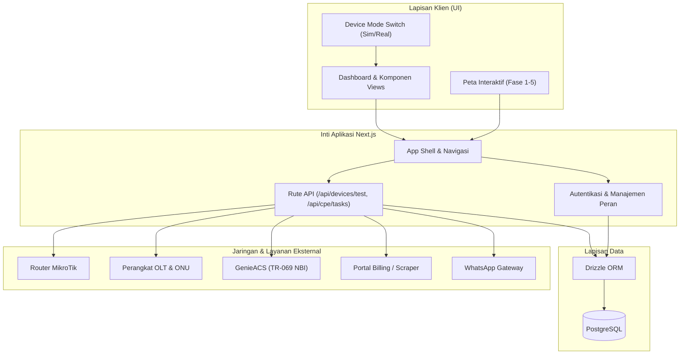
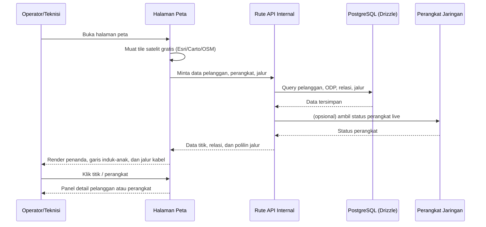
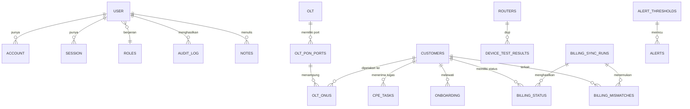

# PRD — Project Requirements Document

## 1. Overview

**NOC SYSTEM** (`ngodingpakeai-starter`) adalah aplikasi web operasional terpusat *Network Operations Center* untuk penyedia layanan internet (ISP), dibangun di atas Next.js. Aplikasi ini menyatukan pemantauan, diagnostik, dan otomasi infrastruktur jaringan *real-time* ke dalam satu dashboard.

**Masalah yang diselesaikan**
Operator dan teknisi saat ini harus berpindah-pindah antar sistem terpisah untuk memantau router MikroTik, perangkat OLT/ONU, perangkat pelanggan (CPE/TR-069), tiket insiden, serta sinkronisasi tagihan (billing). Kondisi ini menyulitkan deteksi dini gangguan dan memperlambat respons lapangan.

**Tujuan utama**
- Menyediakan satu antarmuka terpadu untuk memantau perangkat jaringan, alert, dan insiden.
- Mempercepat diagnostik dan tindakan perbaikan (pengujian koneksi, konfigurasi Wi-Fi pelanggan, pemetaan ONU ke pelanggan).
- Menyelaraskan data operasional jaringan dengan data tagihan pelanggan.
- Menambahkan **pemetaan jaringan interaktif** agar sebaran pelanggan, perangkat (server, ODC, ODP, tiang), dan jalur kabel terlihat langsung di atas peta — sebagai pengembangan lanjutan dari komponen peta yang sudah ada.
- Membuat **setiap titik di peta dapat dibuka** menjadi data pelanggan atau perangkat yang nyata, sehingga operator dapat memeriksa pelanggan terdampak tanpa berpindah halaman.

**Lingkup siklus ini**
- Fokusnya adalah **halaman peta** beserta pengelolaan titik, relasi, dan jalur kabel. Halaman dan modul NOC lain hanya dipakai sebagai sumber data, bukan didesain ulang.
- **Kondisi awal (terverifikasi)**: komponen peta sudah ada tetapi masih terbatas — `src/components/dashboard/customer-map.tsx`, `map-onu-dialog.tsx`, `highlight-on-map.tsx`, dan `map-focus-from-url.tsx`. **Leaflet belum terpasang** di repositori, sehingga pemasangan pustaka peta adalah pekerjaan baru pada siklus ini.
- **Ketergantungan**: data nyata peta (Fase 4) bersandar pada integrasi perangkat dan `data_source_registry` dari plan **"Go-Live Data Nyata & Deploy Otomatis"**. Peta harus tetap dapat dipakai selama integrasi tersebut belum selesai, dengan penanda sumber data yang jelas.
- **LeaferJS bukan penyedia peta**: ia adalah pustaka gambar 2D dan hanya dipakai sebagai lapisan anotasi (Fase 5), bukan dasar peta.

**Aturan Nol Data Tiruan (berlaku di seluruh fase)**
- Siklus ini **tidak boleh** membangun, menampilkan, atau menyimpan data tiruan/*dummy*/*mock*. Seluruh halaman peta, panel, dan tabel membaca **data nyata dari backend** (PostgreSQL via Drizzle) serta perangkat nyata.
- **Tidak ada mode `dummy`** pada siklus ini: mode data selalu `nyata`. Sisa kode contoh dari tahap uji lokal wajib dipensiunkan dan tidak boleh ikut bundel produksi.
- Setiap **aksi tulis** — termasuk **memilih dan menggeser lokasi** (*pick lokasi*) titik pelanggan maupun perangkat, serta menggambar jalur kabel — memanggil endpoint backend nyata, dan hasilnya dibaca ulang dari server. Bukan disimpan di *state* komponen maupun berkas lokal.
- Bila data belum tersedia atau gagal dimuat, peta menampilkan **status galat/kosong yang jelas** dan **tidak** dialihkan ke data contoh.
- Koordinat, relasi, dan jalur kabel disimpan **di database**, bukan di kode maupun berkas statis.

---

## 2. Requirements

**Fungsional inti**
- Autentikasi dengan sesi internal dan pembatasan hak akses berbasis peran (*role-based access*).
- Pemantauan *real-time* dengan `auto-refresh`, kendali suara alert, ringkasan metrik, serta peringatan jika aliran data terputus.
- Mode perangkat yang dapat beralih antara **simulator** dan **perangkat fisik** (Device Mode Switch).
- Integrasi ke sistem eksternal: MikroTik, OLT/ONU, GenieACS (TR-069 NBI), portal *billing* (via scraper), dan WhatsApp Gateway.
- Pengujian konektivitas perangkat melalui endpoint terpadu (`POST /api/devices/test`) dengan panduan *troubleshoot* otomatis.
- Pengelolaan CPE (perubahan SSID/kata sandi Wi-Fi dan pemutusan host) melalui `POST /api/cpe/tasks`.
- Sinkronisasi *billing*, deteksi *mismatch*, dan penyelesaian ketidaksesuaian data pelanggan.

**Non-fungsional**
- Penyimpanan data persisten melalui PostgreSQL dengan Drizzle ORM (migrasi via Drizzle Kit).
- Keamanan kredensial sesi scraper dengan enkripsi **AES-256-GCM**.
- **Nol data tiruan**: tidak ada data contoh/*dummy*/*mock* di seluruh siklus — halaman peta dan panel membaca data nyata dari endpoint backend. Kegagalan muat menampilkan status galat, bukan data palsu.
- Penanganan error yang jelas: pada mode *live*, kegagalan muat **tidak** dialihkan ke data tiruan (*mock*), melainkan menampilkan status galat.
- Seluruh aksi tulis (pilih/geser lokasi, gambar jalur, ubah relasi) menulis ke backend nyata lalu memuat ulang dari server; tidak ada penyimpanan lokal sebagai pengganti backend.
- Validasi input pada form sebelum dikirim; kegagalan tugas menampilkan pesan Bahasa Indonesia dengan opsi *Coba lagi*.
- Peta berbasis tile gratis (tanpa ketergantungan Google Maps) memakai **Leaflet** sebagai pustaka peta, dengan URL tile dan kunci API (bila diperlukan) dibaca dari **env** — tidak ditulis keras di kode.
- Render objek peta sebagai **vektor** (bukan gambar) agar tetap tajam saat di-*zoom* tinggi, dan pemuatan peta dilakukan **bertahap/dinamis** agar halaman tetap ringan.
- Setiap titik pada peta wajib dapat diklik dan membuka data pelanggan atau perangkat yang bersangkutan; aksi dari panel detail mengarah ke halaman/modul terkait.
- Koordinat, kapasitas, dan jalur kabel disimpan **di database** (kolom `latitude`/`longitude` dan tabel topologi), bukan di kode.
- Tampilan nyaman pada layar kecil (tablet teknisi).
- Standar kualitas kode: ESLint dan pengujian *End-to-End* dengan Playwright.

---

## 3. Core Features

### Fondasi NOC (sudah terbangun)
- **Papan Pantau Operasional & Alerting** — pemantauan *real-time*, kontrol suara alert, ringkasan metrik anomali, dialog eskalasi/penanganan insiden, dan pembuatan tiket.
- **Manajemen OLT & ONU** — deteksi status perangkat (online, offline, LOS), validasi level optik, wizard konfigurasi OLT, dan pemetaan ONU ke pelanggan.
- **Pengelolaan CPE (TR-069)** — pengaturan Wi-Fi pelanggan, pemantauan host terhubung, dan pengujian koneksi GenieACS NBI.
- **Analisis Trafik & NetFlow** — grafik tren trafik, pencatatan log NetFlow, dan pengarsipan sampel berkala.
- **Sinkronisasi Billing** — riwayat *sync*, deteksi *mismatch*, dan penyimpanan sesi/kredensial scraper yang terenkripsi.
- **Pengujian Konektivitas** — panel uji koneksi perangkat terpadu dengan panduan *troubleshoot*.

### Fase 1 — Peta Jaringan Interaktif _(high)_
Halaman peta utama yang memperluas komponen peta yang sudah ada di `src/components/dashboard/` (tanpa mengubah UI yang telah selesai). Pemasangan **Leaflet** sebagai pustaka peta termasuk dalam fase ini karena belum ada pada repositori.
- **Peta Satelit Gratis** — peta dasar memakai penyedia tile gratis (Esri World Imagery, Carto, atau OSM) agar tidak bergantung pada Google Maps. URL tile dan kunci API (bila ada) diisi lewat env.
- **Zoom Tajam & Skala Vektor** — garis dan ikon digambar sebagai vektor sehingga tetap tajam saat di-*zoom* tinggi.
- **Kontrol Lapis Peta** — pengguna dapat berpindah antara tampilan satelit dan jalan, serta mengatur lapis yang ditampilkan.
- **Pemuatan Peta Ringan** — pustaka peta dimuat secara dinamis (hanya di sisi klien) sehingga halaman tidak membengkak, dan objek peta tidak dimuat ulang saat panel dibuka-tutup.
- **Tanpa Data Contoh** — peta dasar memakai tile dari penyedia nyata (URL dari env), sedangkan penanda/titik dimuat dari endpoint backend; tidak ada himpunan titik contoh yang ditulis di kode.

### Fase 2 — Titik Pelanggan & Infrastruktur _(high)_

**Titik Pelanggan di Peta**
- **Penanda Titik Pelanggan** — setiap pelanggan tampil sebagai penanda pada koordinat nyata hasil pendataan lapangan.
- **Detail Pelanggan** — klik titik pelanggan membuka panel data pelanggan lengkap di atas peta: identitas dan nomor pelanggan, alamat & wilayah, paket dan status layanan, perangkat ONU/CPE terpasang, redaman optik, status tagihan, serta pintasan ke halaman pelanggan/CPE/billing terkait.
- **Cari & Saring Titik** — pencarian nama/nomor pelanggan dan penyaringan berdasarkan wilayah atau status.
- **Pilih & Perbaiki Posisi Titik (_pick lokasi_)** — titik dapat dipilih dan digeser langsung di peta; koordinat barunya **disimpan ke database lewat endpoint nyata** lalu dimuat ulang dari server — bukan disimpan di *state* komponen.

**Peletakan Infrastruktur**
- **Tambah Perangkat Jaringan** — menempatkan perangkat baru (server, ODC, ODP, tiang) pada posisi di peta; koordinat dikirim ke backend nyata dan dibaca ulang dari server.
- **Panel Detail Perangkat** — klik perangkat (server, ODC, ODP, tiang) membuka panel berisi identitas dan kapasitas, daftar pelanggan yang terlayani, jalur kabel masuk dan keluar, serta status perangkat; keterangan dapat diubah dan disimpan.
- **Tampilan Ikon per Jenis** — tiap jenis perangkat punya ikon dan warna berbeda.
- **Pindah & Hapus Perangkat** — perangkat dapat dipindahkan atau dihapus saat data lapangan berubah.

### Fase 3 — Relasi Bertingkat & Jalur Kabel _(medium)_

**Hubungan Induk–Anak**
- **Susunan Bertingkat** — menampilkan alur kepemilikan server → ODC → ODP → pelanggan dalam satu tampilan.
- **Garis Penghubung Perangkat** — garis tipis menghubungkan tiap perangkat ke induknya.
- **Panel Pohon Relasi** — panel samping menampilkan daftar bertingkat yang dapat dibuka-tutup.
- **Pindah Anak ke Induk Lain** — perangkat dapat dipindahkan ke induk berbeda saat topologi berubah.

**Jalur Kabel Pelanggan**
- **Gambar Jalur Kabel** — jalur digambar mengikuti lekukan jalan nyata sebagai garis polilin; titik belokan disimpan ke database lewat endpoint nyata.
- **Ketebalan & Warna Kapasitas** — ukuran dan warna kabel konsisten mengikuti jumlah kapasitas serat.
- **Legenda Kapasitas Serat** — legenda menjelaskan arti warna dan ketebalan kabel.
- **Rapikan Titik Jalur** — pengguna dapat menambah, menggeser, atau menghapus titik belokan.

### Fase 4 — Data Nyata Peta _(high)_
- **Baca Data dari Endpoint** — peta mengambil data pelanggan, perangkat, dan jalur dari endpoint nyata serta `data_source_registry`; **tidak ada** sumber data contoh.
- **Segarkan Data Otomatis** — data diperbarui berkala dengan penanda waktu pembaruan terakhir.
- **Data Kosong & Gagal Muat** — jika data tidak ada atau gagal dimuat, peta menampilkan pesan yang jelas dan **tidak menampilkan data palsu**.
- **Tandai Sumber Data** — pengguna dapat melihat asal data yang sedang tampil.

### Fase 5 — Lapisan Gambar & Penyempurnaan _(low)_

**Lapisan Gambar LeaferJS**
- **Tambah Lapisan Gambar** — menaruh lapisan gambar/tanda di atas peta tanpa mengubah peta dasar.
- **Alat Gambar & Tanda** — alat sederhana untuk menggambar bentuk, panah, atau label.
- **Simpan & Muat Lapisan** — hasil gambar disimpan ke backend nyata (bukan `localStorage` atau berkas lokal) dan dimuat kembali dari server.
- **Atur Urutan & Transparansi** — lapisan dapat diatur urutan dan transparansinya.

**Penyempurnaan Tampilan Peta**
- **Performa Banyak Titik** — peta tetap lancar walau menampilkan ribuan titik dan jalur.
- **Kerapian Panel & Legenda** — panel dan legenda ditata agar tidak menutupi area penting.
- **Panduan Singkat Peta** — petunjuk singkat membaca peta dan simbolnya.
- **Tampilan Layar Kecil** — peta dan panel nyaman dipakai di tablet teknisi.

---

## 4. User Flow

1. **Masuk & Autentikasi** — Operator/teknisi masuk melalui sesi internal; hak akses menyesuaikan peran.
2. **Buka Dashboard** — pengguna diarahkan ke papan pantau operasional (alert, metrik, status perangkat).
3. **Pantau Alert & Insiden** — operator melihat alert aktif, mengaktifkan/mematikan suara, lalu membuka dialog penanganan tiket atau eskalasi bila perlu.
4. **Uji & Konfigurasi Perangkat** — pengguna memilih mode simulator/fisik, menjalankan uji koneksi (MikroTik, OLT, GenieACS, Billing), dan membaca panduan *troubleshoot* bila gagal.
5. **Kelola CPE Pelanggan** — pengguna mengubah SSID/kata sandi Wi-Fi atau memutus host terhubung, lalu memantau status tugas.
6. **Sinkronkan Billing** — operator memantau riwayat *sync* dan menyelesaikan daftar *mismatch* pelanggan.
7. **Buka Peta Jaringan (Fase 1)** — pengguna membuka halaman peta, memilih lapis (satelit/jalan), dan menjelajah dengan zoom tajam.
8. **Lihat Titik Pelanggan & Infrastruktur (Fase 2)** — pengguna melihat penanda pelanggan, mengklik untuk detail, mencari/menyaring titik, serta menambah, memilih (*pick lokasi*), atau menggeser perangkat di peta — semua perubahan tersimpan ke backend nyata.
9. **Telusuri Relasi & Jalur Kabel (Fase 3)** — pengguna melihat susunan bertingkat server → ODC → ODP → pelanggan, membuka panel pohon relasi, dan memeriksa jalur kabel beserta legendanya.
10. **Pastikan Data Nyata (Fase 4)** — peta memuat data dari endpoint nyata, menyegarkan otomatis, dan menandai sumber data serta waktu pembaruan terakhir.
11. **Anotasi & Penyempurnaan (Fase 5)** — pengguna menambahkan lapisan gambar/catatan lapangan, lalu menikmati tampilan yang rapi dan lancar di tablet.

---

## 5. Architecture

Aplikasi berjalan sebagai **satu aplikasi web monolitik Next.js** dengan arsitektur berlapis: lapisan antarmuka (React), rute API internal, dan lapisan data PostgreSQL via Drizzle ORM, yang terhubung ke layanan jaringan eksternal.

**Alur pemuatan peta interaktif (Fase 1–4):**

---

## 6. Database Schema

Skema dijalankan di **PostgreSQL** melalui **Drizzle ORM**. Berikut entitas yang sudah dikenal pada repositori beserta field utama (mengikuti skema Drizzle).

**Autentikasi & Akses**
- **user** — `id`, `name`, `email`, `email_verified`, `image`, `created_at`. Menyimpan akun pengguna.
- **account** — `id`, `user_id`, `provider_id`, `account_id`, `password`. Kredensial/penyedia login.
- **session** — `id`, `user_id`, `token`, `expires_at`. Sesi login aktif.
- **verification** — `id`, `identifier`, `value`, `expires_at`. Data verifikasi.
- **roles** — `id`, `name`, `permissions`. Definisi peran dan hak akses.
- **audit_log** — `id`, `user_id`, `action`, `created_at`. Jejak audit aksi pengguna.
- **notes** — `id`, `user_id`, `content`, `created_at`. Catatan operasional.

**Infrastruktur NOC**
- **routers** — `id`, `name`, `address`, `type`, `status`. Data router MikroTik.
- **olts** — `id`, `name`, `address`, `status`. Data perangkat OLT.
- **olt_pon_ports** — `id`, `olt_id`, `port_number`, `status`. Port PON per OLT.
- **olt_onus** — `id`, `pon_port_id`, `serial_number`, `status`, `optical_level`, `customer_id`. ONU beserta metrik optik dan pemetaan ke pelanggan.
- **cpe_tasks** — `id`, `customer_id`, `task_type`, `status`, `payload`. Tugas CPE (mis. ubah Wi-Fi).
- **network_logs** — `id`, `source`, `level`, `message`, `created_at`. Log jaringan.
- **device_test_results** — `id`, `device_id`, `result`, `error_code`, `created_at`. Hasil uji koneksi perangkat.

**Pelanggan & Wilayah**
- **customers** — `id`, `name`, `customer_number`, `address`, `region`, `status`, `latitude`, `longitude`. Data pelanggan (koordinat dipakai peta Fase 2).
- **onboarding** — `id`, `customer_id`, `stage`, `status`. Tahapan onboarding pelanggan.
- **whatsapp** — `id`, `phone`, `message`, `status`, `created_at`. Notifikasi WhatsApp.

**Metrik & Alert**
- **alerts** — `id`, `category`, `severity`, `message`, `status`, `created_at`. Alert aktif.
- **alert_thresholds** — `id`, `metric`, `threshold`, `enabled`. Ambang batas pemicu alert.
- **netflow_samples** — `id`, `source`, `sampled_at`, `data`. Sampel NetFlow.
- **traffic_samples** — `id`, `device_id`, `sampled_at`, `bytes_in`, `bytes_out`. Arsip sampel trafik.

**Billing**
- **billing_credentials** — `id`, `session_data`, `credentials`, `created_at`. Sesi/kredensial scraper (terenkripsi AES-256-GCM).
- **billing_sync_runs** — `id`, `started_at`, `finished_at`, `status`, `processed_count`. Riwayat sinkronisasi.
- **billing_status** — `id`, `customer_id`, `billing_state`, `updated_at`. Status tagihan per pelanggan.
- **billing_mismatches** — `id`, `customer_id`, `mismatch_type`, `resolved`, `created_at`. Ketidaksesuaian data.

---

## 7. Tech Stack

Mengikuti teknologi yang sudah dipakai pada repositori NOC SYSTEM:

- **Framework Aplikasi:** Next.js (dengan `next.config.ts`) dan React untuk antarmuka modular berbasis komponen.
- **Bahasa:** TypeScript.
- **Styling:** Tailwind CSS dengan PostCSS (`postcss.config.mjs`).
- **Database:** PostgreSQL sebagai basis data relasional.
- **ORM & Migrasi:** Drizzle ORM dan Drizzle Kit (`drizzle.config.ts`, migrasi SQL di direktori `drizzle/`).
- **Autentikasi & Otorisasi:** Sesi internal Next.js dengan pembatasan hak akses berbasis peran.
- **Keamanan Data:** Enkripsi AES-256-GCM untuk sesi portal dan kredensial scraper billing.
- **Integrasi Eksternal:** MikroTik, OLT/ONU, GenieACS (TR-069 NBI), portal Billing (via scraper), dan WhatsApp Gateway.
- **Peta:** **Leaflet** (pustaka peta *open-source*, **belum terpasang** di repositori sehingga perlu ditambahkan sebagai dependensi) dengan penyedia tile satelit gratis (Esri World Imagery, Carto, atau OSM), serta render vektor untuk garis dan ikon. URL tile dan kunci API dibaca dari env. **LeaferJS** hanya dipakai sebagai lapisan gambar/anotasi pada Fase 5 — ia bukan penyedia peta dan tidak menyediakan tile, zoom, atau mode satelit.
- **Pengujian & Kualitas Kode:** Playwright untuk pengujian *End-to-End* (`playwright.config.ts`) dan ESLint (`eslint.config.mjs`).
- **Kebijakan Data:** **nol data tiruan** — tidak ada berkas/pustaka data contoh di bundel produksi; mode data selalu `nyata`; seluruh koordinat, relasi, dan jalur kabel berasal dari PostgreSQL melalui endpoint backend. Pemilih lokasi (*pick lokasi*) dan penggambar jalur menulis langsung ke backend, bukan ke penyimpanan lokal.