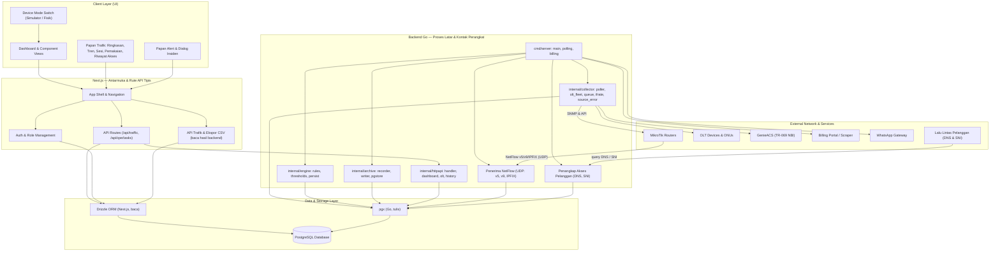
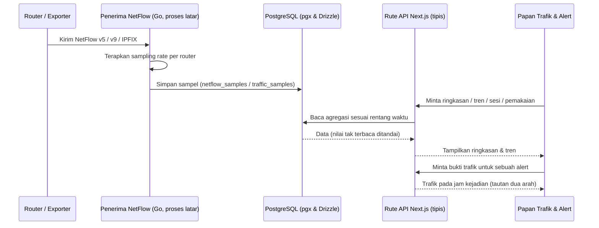

# PRD — Project Requirements Document

## 1. Overview

### Masalah yang Diselesaikan
Tim operasional NOC pada penyedia layanan internet (ISP) biasanya bekerja dengan banyak alat terpisah: satu layar untuk status router MikroTik, layar lain untuk OLT dan ONU, alat lain lagi untuk perangkat pelanggan (CPE), spreadsheet untuk data tagihan, dan grafik trafik yang berasal dari sumber berbeda-beda. Akibatnya operator harus berpindah-pindah konteks, sulit menghubungkan sebuah alert dengan bukti trafik pada jam kejadian, dan rawan salah baca ketika data dari beberapa sumber tidak seragam.

**NOC SYSTEM** (`ngodingpakeai-starter`) menyatukan pekerjaan tersebut dalam satu aplikasi web operasional: pemantauan perangkat, diagnostik koneksi, manajemen CPE, pemrosesan alert dan insiden, analisis trafik NetFlow, serta sinkronisasi data billing.

### Tujuan Utama
1. **Satu layar operasional** — operator memantau router, OLT/ONU, CPE, alert, dan trafik dari satu aplikasi, bukan dari banyak alat.
2. **Diagnostik yang bisa ditindaklanjuti** — setiap kegagalan koneksi perangkat menghasilkan panduan pemecahan masalah, bukan sekadar status merah.
3. **Analisis trafik yang jujur** — angka trafik yang ditampilkan sudah memperhitungkan *sampling rate*, dan nilai yang gagal dibaca ditandai "tidak dapat dibaca", tidak pernah disamarkan menjadi nol.
4. **Bukti pendukung insiden** — alert dapat ditautkan ke data trafik pada jam kejadian sehingga penanganan insiden berbasis data, bukan dugaan.
5. **Dasar penilaian FUP** — pemakaian per pelanggan tersedia sebagai bukti yang bisa dipakai saat pelanggan menanyakan tagihan atau pembatasan.
6. **Konsistensi data pelanggan** — status pelanggan dari portal billing dapat disinkronkan dan ketidaksesuaiannya terlihat jelas.
7. **NetFlow sebagai barang bukti** — halaman NetFlow tidak berhenti pada grafik volume: riwayat domain yang diakses tiap pelanggan tersimpan di database dan dapat ditelusuri per hari, sehingga ketika pelanggan menyangkal pemakaian, operator punya dokumen yang bisa ditunjukkan, bukan ingatan.

---

## 2. Requirements

### Persyaratan Fungsional
- Aplikasi terdiri atas **dua lapisan**: antarmuka dan rute API tipis pada **Next.js**, serta **backend Go** yang memegang seluruh kontak langsung ke perangkat dan seluruh proses latar yang berjalan terus-menerus.
- Rute API Next.js hanya melayani baca/tulis untuk UI; ia **tidak** melakukan kontak langsung ke MikroTik, OLT, maupun ONU, dan meneruskan pekerjaan berat ke backend Go.
- Operator dapat memantau alert aktif secara *real-time* dengan *auto-refresh*, kontrol suara peringatan, dan penanganan insiden (tiket/eskalasi).
- Operator dapat menguji konektivitas perangkat (MikroTik, OLT, GenieACS, Billing) dan menerima saran perbaikan saat gagal.
- Operator dapat mengelola CPE pelanggan melalui GenieACS NBI: ubah SSID/kata sandi Wi-Fi, lihat host terhubung, jalankan diagnostik.
- Operator dapat memantau OLT, port PON, dan ONU termasuk status dan level optik, serta memetakan ONU ke pelanggan.
- Operator dapat melihat trafik jaringan: ringkasan throughput, pemakaian uplink, *top talkers*, antarmuka tersibuk, dan tren bertingkat.
- Operator dapat menelusuri sesi/percakapan jaringan dan menyaringnya per pelanggan atau per port PON.
- Operator dapat melihat pemakaian bulanan per pelanggan beserta puncaknya sebagai bahan FUP.
- Penerima NetFlow berjalan sebagai proses latar yang terus menerus (v5, v9, IPFIX) dan UI hanya membaca hasilnya.
- Seluruh proses latar — penerima NetFlow, penangkap DNS/SNI, polling status MikroTik/OLT/ONU, dan sinkronisasi billing — dijalankan di **backend Go**, bukan di rute API Next.js, sehingga permintaan UI tidak pernah menunggu putaran kontak perangkat.
- Alert dapat menampilkan panel bukti trafik pada jam kejadian dengan tautan dua arah antara alert dan trafik.
- Data trafik dan pemakaian dapat diekspor ke CSV sesuai filter yang sedang aktif.
- Halaman NetFlow menjadi tempat bukti akses: selain volume trafik, ia menampilkan **apa yang dibuka** tiap pelanggan — nama domain yang diminta perangkat pelanggan melalui penangkap query DNS dan SNI TLS, disimpan sebagai riwayat harian per pelanggan dan dipasangkan dengan volume NetFlow pada tanggal yang sama.
- Halaman utama trafik menampilkan domain yang paling sering dikunjungi lintas pelanggan beserta volume aksesnya, tanpa menampilkan identitas pelanggan.
- Halaman detail pelanggan menampilkan riwayat domain pelanggan tersebut: jumlah akses, waktu pertama dan terakhir, kategori, serta tingkat keyakinan kategori.
- Riwayat akses disimpan sebagai agregat harian per kombinasi pelanggan–domain–tanggal; data mentah berpresisi detik hanya disimpan 1 hari.
- Kategori domain dapat berasal dari katalog internal dan dapat ditimpa manual oleh peran yang berwenang.
- Setiap pembukaan riwayat akses seorang pelanggan tercatat pada jejak audit beserta waktu, pelaku, dan alasannya.
- Operator dapat memantau sinkronisasi billing, riwayat sinkronisasi, dan menyelesaikan *mismatch* data pelanggan.
- Akses dibatasi berdasarkan peran (operator/teknisi) melalui modul autentikasi internal.

### Persyaratan Non-Fungsional
- **Kejujuran data:** nilai yang gagal dibaca ditampilkan sebagai "tidak dapat dibaca"; pengali *sampling rate* diterapkan sebelum angka ditampilkan.
- **Pemisahan data simulator dan data nyata:** data simulator dipisahkan secara visual agar tidak tercampur dalam pembacaan maupun perhitungan.
- **Ketahanan:** bila aliran data *real-time* terputus, sistem menampilkan banner dengan waktu pembaruan terakhir dan tombol sambung ulang.
- **Batas bukti yang dinyatakan:** pencatatan akses hanya membuktikan **nama domain dan waktunya**, bukan halaman, jalur URL, kata kunci, maupun isi. Sistem tidak membongkar enkripsi lalu lintas pelanggan, dan batas ini ditulis pada antarmuka agar tidak dibaca sebagai bukti yang lebih kuat daripada kenyataannya.
- **Privasi data pelanggan:** riwayat akses adalah data pribadi. Akses dibatasi peran berwenang, ditampilkan atas dasar kebutuhan penanganan (keluhan, sengketa tagihan, permintaan resmi), dan setiap pembukaan riwayat tercatat pada jejak audit.
- **Klasifikasi bukan tuduhan:** kategori sensitif ditampilkan sebagai **indikasi beserta tingkat keyakinan**, tidak pernah sebagai pernyataan pasti, karena klasifikasi berbasis nama domain selalu memiliki kemungkinan salah tetapkan.
- **Latensi ke perangkat:** polling MikroTik, OLT, dan ONU dilakukan **konkuren** di backend Go, bukan berurutan pada satu proses Node.js. Perangkat yang lambat atau mati tidak menahan perangkat lain, dan UI membaca hasil terakhir yang tersedia alih-alih menunggu kontak selesai. Ambang waktu kontak per perangkat ditetapkan agar satu perangkat tak merespons tidak memperlambat keseluruhan.
- **Beban proses:** backend Go berjalan sebagai **proses terpisah** dari proses Next.js, sehingga penangkapan aliran data berkelanjutan (NetFlow, DNS, SNI) tidak berebut siklus CPU dengan render antarmuka. Penulisan ke database dari Go memakai `pgx` dengan *connection pool* terbatas agar tidak menghabiskan koneksi PostgreSQL.
- **Keamanan kredensial:** sesi portal billing dan kata sandi scraper disimpan terenkripsi (AES-256-GCM).
- **Mode perangkat:** sistem dapat beroperasi dalam mode simulator maupun perangkat fisik riil melalui *Device Mode Switch*; kegagalan pada mode live tidak boleh diam-diam dialihkan ke data tiruan.
- **Kualitas kode:** standar ESLint dan pengujian End-to-End Playwright.

---

## 3. Core Features

Fitur disusun mengikuti kerangka roadmap yang sudah disetujui. Kapabilitas dasar NOC (pemantauan perangkat, CPE, alert, billing) sudah ada di aplikasi dan menjadi fondasi fitur-fitur di bawah ini.

### Kapabilitas Dasar yang Sudah Ada
- **Papan Pantau Operasional & Alerting** — pemantauan *real-time* dengan *auto-refresh*, kontrol suara peringatan, ringkasan metrik anomali, dialog eskalasi dan pembuatan tiket.
- **Manajemen OLT & ONU** — deteksi status perangkat (online, offline, LOS), validasi level optik, wizard konfigurasi OLT, pemetaan ONU ke pelanggan.
- **Pengelolaan CPE (TR-069)** — pengaturan Wi-Fi pelanggan, daftar host terhubung, pengujian GenieACS NBI.
- **Pengujian Konektivitas Perangkat** — panel uji terpadu untuk MikroTik, OLT, GenieACS, dan Billing dengan panduan *troubleshoot* otomatis.
- **Sinkronisasi Billing** — pelacakan riwayat *sync*, deteksi *billing mismatch*, penyimpanan kredensial terenkripsi.
- **Visualisasi & Pemetaan** — peta sebaran pelanggan, ODP, dan relasi ONU ke pelanggan.

### Fase 1 — Papan Ringkasan Trafik
Memperluas papan NetFlow yang sudah ada menjadi layar utama analisis trafik. Ringkasan atas dibangun lebih dulu di atas data tiruan agar tidak bergantung pada penerima data.
- **Throughput Masuk & Keluar** — kecepatan trafik masuk dan keluar saat ini dalam angka yang mudah dibaca operator.
- **Pemakaian Uplink** — persentase pemakaian jalur uplink terhadap kapasitasnya beserta sisa ruang yang tersedia.
- **Top Talkers** — daftar pemakai trafik terbesar yang sudah dipetakan ke nama pelanggan, bukan hanya alamat perangkat.
- **Antarmuka Tersibuk** — daftar antarmuka/port dengan trafik tertinggi agar operator tahu titik paling sibuk.
- **Penanda Tak Terbaca** — nilai yang gagal dibaca ditampilkan sebagai "tidak dapat dibaca" dan tidak pernah disamarkan menjadi nol, dengan pengali *sampling rate* sudah diterapkan pada angka yang tampil.

### Fase 2 — Analisis Trafik & Pelanggan
- **Tren Trafik** — memperluas grafik tren yang sudah ada dan menyatukan deret `netflow-*` serta `traffic-*` menjadi satu sumber kebenaran.
  - Grafik Tren Bertingkat: agregasi per menit, per jam, dan per hari dari satu sumber data yang sudah disatukan.
  - Pemilih Rentang Waktu: operator memilih rentang waktu dan tingkat agregasi.
  - Kebijakan Retensi: penjelasan berapa lama data disimpan di tiap tingkat agregasi.
  - Pemisah Data Simulator: data simulator dipisahkan visual dari tren nyata.
- **Sesi & Percakapan** — tabel sesi/percakapan jaringan dari data sampel yang sudah terkumpul.
  - Daftar Sesi: tabel percakapan terbaru beserta volume data dan durasinya.
  - Filter per Pelanggan: menyaring sesi untuk pelanggan tertentu.
  - Filter per Port PON: melihat aktifitas pada satu jalur optik.
  - Detail Sesi: rincian satu sesi termasuk nilai yang sudah dikalikan *sampling rate*.
- **Pemakaian Pelanggan** — pemakaian per pelanggan sebagai bahan penilaian FUP berbasis trafik nyata.
  - Total Bulanan: total pemakaian tiap pelanggan dalam sebulan.
  - Puncak Pemakaian: lonjakan tertinggi beserta waktu kejadiannya.
  - Daftar Perlu Perhatian: menyorot pelanggan yang mendekati atau melewati batas wajar.
  - Bukti Pemakaian: rincian per pelanggan untuk menjelaskan tagihan atau pembatasan.

### Fase 3 — Penerima NetFlow
Penerima NetFlow berjalan sebagai proses latar mengikuti pola *polling* dan pengarsipan yang sudah ada, sehingga UI hanya membaca hasilnya.
- **Penerima Multi Format** — menerima NetFlow v5, v9, dan IPFIX tanpa perlu dibuka dari halaman.
- **Daftar Exporter** — router mana saja yang mengirim data beserta waktu terakhir data masuk, sehingga router yang diam langsung terlihat.
- **Sampling Rate** — menyimpan dan menerapkan pengali *sampling rate* per router agar angka yang ditampilkan sudah diskalakan ke trafik sebenarnya.
- **Kesehatan Penerima** — status proses penerima serta peringatan bila aliran data berhenti, dengan penanda data tak terbaca yang jelas.

### Fase 4 — Bukti Trafik di Alert & Ekspor
- **Bukti Trafik di Alert** — menautkan NetFlow ke halaman Alert sebagai bukti trafik pada jam kejadian, dua arah, tanpa menyimpulkan akar masalah dan tanpa membuat alert sendiri.
  - Panel Bukti Trafik: trafik pada jam kejadian alert sebagai bukti pendukung, misalnya saat trafik padam padahal sesi pelanggan tercatat aktif.
  - Tautan Dua Arah: dari alert membuka trafik terkait, dan dari trafik membuka alert pada jam yang sama.
  - Penanda Kejadian: menandai periode trafik padam atau melonjak di sekitar jam kejadian sebagai petunjuk; kesimpulan tetap dipegang mesin aturan dan diagnosa.
- **Ekspor Data Trafik** — ekspor CSV dari halaman trafik agar hasil analisis bisa dibagikan atau diolah di luar aplikasi.
  - Ekspor Ringkasan: ringkasan throughput dan pemakaian uplink dalam CSV.
  - Ekspor Sesi: daftar sesi sesuai filter pelanggan atau port PON yang sedang aktif.
  - Ekspor Pemakaian Pelanggan: pemakaian bulanan per pelanggan sebagai bahan FUP dalam CSV.

**Keterkaitan dengan fase berikutnya.** Panel bukti trafik pada fase ini baru memuat **volume**. Pertanyaan "sedang dipakai untuk apa" belum terjawab, karena NetFlow tidak memuat nama domain. Karena itu *Bukti Akses Pelanggan di Alert* — yang membutuhkan catatan tujuan akses — **tidak** dikerjakan di fase ini, melainkan di **Fase 5**. Dengan begitu Fase 4 selesai tanpa menunggu fase sesudahnya.

### Fase 5 — Bukti Akses Pelanggan (Halaman NetFlow & Alert)
Halaman NetFlow bukan hanya grafik volume, melainkan **tempat barang bukti disimpan dan ditunjukkan**: apa yang dibuka pelanggan beserta waktunya. Untuk itu halaman NetFlow memakai dua sumber yang saling melengkapi dan bermuara pada satu halaman yang sama.

- **Sumber volume — Penerima NetFlow (Fase 3)**: menjawab *berapa banyak*. Catatan NetFlow memuat alamat IP, port, protokol, dan jumlah byte per sesi. Catatan ini **tidak memuat nama domain maupun URL**, sehingga ia tidak bisa menjawab "apa yang dibuka".
- **Sumber tujuan — Penangkap Tujuan Akses (fase ini)**: menjawab *apa*. Nama domain yang diminta perangkat pelanggan diambil dari query DNS dan SNI TLS, berjalan sebagai proses latar seperti penerima NetFlow.

Keduanya disimpan ke database, dipetakan ke pelanggan yang sama, lalu ditampilkan **berpasangan di satu halaman NetFlow**: volume dari NetFlow, tujuan dari penangkap akses. Inilah bentuk bukti yang bisa ditunjukkan saat pelanggan menyangkal pemakaian — bukan ingatan operator, dan bukan kesimpulan dari alamat IP semata. Tanpa fase ini, halaman NetFlow hanya bisa membuktikan besar trafik, tidak pernah bisa membuktikan tujuannya.

- **Penangkap Tujuan Akses** — dua sumber yang menangkap nama domain yang diminta perangkat pelanggan.
  - Penangkap Query DNS: membaca permintaan DNS (port 53) untuk memperoleh nama domain yang diminta beserta waktunya.
  - Penangkap SNI TLS: membaca *Server Name Indication* pada pembukaan koneksi terenkripsi untuk memperoleh nama tujuan, termasuk saat permintaan DNS tidak terlihat.
  - Pemetaan IP ke Pelanggan: setiap catatan dipetakan ke pelanggan pemilik alamat IP pada saat kejadian; catatan yang tidak dapat dipetakan ditandai sebagai tidak terpetakan, bukan dibuang diam-diam.
  - Penanda Mode Simulator: catatan dari data tiruan diberi penanda dan tidak pernah masuk ke riwayat pelanggan sebenarnya.
- **Riwayat Harian per Pelanggan** — penyimpanan hemat yang tetap layak dijadikan bukti.
  - Agregat Harian: satu baris per pelanggan–domain–tanggal yang memuat jumlah akses serta waktu pertama dan terakhir, disusun saat data masuk agar tabel mentah tidak membengkak.
  - Retensi Mentah 1 Hari: data berpresisi detik disimpan 1 hari untuk investigasi cepat pada hari yang sama.
  - Retensi Agregat 30 Hari: lapisan bukti utama disimpan 30 hari dengan pembersihan otomatis.
  - Filter Rentang 1 / 3 / 7 / 30 Hari: rentang 3 dan 7 hari adalah **penyaringan tampilan** di atas agregat 30 hari, bukan salinan tabel terpisah.
- **Klasifikasi Domain** — memberi konteks pada riwayat tanpa menuduh.
  - Katalog Domain: pemetaan domain ke kategori (media sosial, streaming, belanja, edukasi, dan kategori sensitif) yang dapat diperbarui.
  - Tingkat Keyakinan: setiap kategori membawa nilai keyakinan agar salah tetapkan terlihat, bukan tersembunyi.
  - Penimpaan Manual: peran berwenang dapat menetapkan kategori yang benar untuk domain tertentu, dan penimpaan tidak tertimpa oleh pembaruan katalog.
- **Tampilan Dua Tingkat** — masing-masing menjawab pertanyaan berbeda dan membaca tabel agregat yang sama.
  - Halaman Utama: Domain Teramai: domain yang paling sering dikunjungi lintas pelanggan beserta jumlah pelanggan yang mengakses dan trennya, **tanpa identitas pelanggan**.
  - Halaman Detail Pelanggan: riwayat domain satu pelanggan — domain, jumlah akses, waktu pertama dan terakhir, kategori, dan keyakinan — sebagai bahan dokumentasi saat pelanggan membantah.
  - Tautan ke Pemakaian: dari riwayat akses dapat dibuka pemakaian trafik pelanggan yang sama pada tanggal yang sama, sehingga volume dan tujuan akses terbaca berpasangan.
- **Kendali Akses & Audit** — syarat yang tidak boleh ditunda.
  - Izin per Peran: hanya peran berwenang yang dapat membuka riwayat akses pelanggan; peran lain cukup melihat halaman utama tanpa identitas.
  - Jejak Audit Pembukaan: setiap pembukaan riwayat pelanggan dicatat (pelaku, pelanggan, waktu, alasan) dan dapat ditelusuri.
  - Penegakan Retensi: pembersihan berjalan otomatis, dan kegagalan pembersihan dilaporkan sebagai peringatan, bukan gagal diam-diam.

**Batasan Fase 5 yang dinyatakan di antarmuka.**
- Yang tercatat adalah **domain**, bukan halaman: tidak ada jalur URL, kata kunci pencarian, nama akun, maupun isi konten.
- Lalu lintas pelanggan **tidak dibongkar** (tanpa intersepsi TLS); sistem hanya membaca nama tujuan yang memang dikirim terbuka pada pembukaan koneksi.
- Pelanggan yang memakai **DNS terenkripsi** (DoH/DoT) dapat lolos dari penangkap DNS; penangkap SNI menutup sebagian besar celah ini, tetapi cakupan tidak pernah dinyatakan 100%.
- Kategori sensitif adalah **indikasi**, bukan kesimpulan; dasar pemrosesan dan pemberitahuan kepada pelanggan disiapkan bersama kebijakan privasi sebelum fitur diaktifkan.

### 3.6 Ringkasan Fase & Ketergantungan

Tabel ini adalah rujukan tunggal urutan pengerjaan. Fase tidak boleh dikerjakan lebih dulu dari fase yang menjadi dasar kebutuhannya.

| Fase | Fokus | Bergantung pada | Keluaran yang dipakai fase lain |
|---|---|---|---|
| **1** | Papan Ringkasan Trafik — throughput, pemakaian uplink, *top talkers*, antarmuka tersibuk, penanda tak terbaca | Data trafik yang sudah tersedia | Kerangka halaman NetFlow, format angka, dan pola penanda "tidak dapat dibaca" yang dipakai seluruh fase |
| **2** | Analisis Trafik & Pelanggan — tren bertingkat, sesi/percakapan, pemakaian pelanggan | **Fase 1** (kerangka halaman, pola penanda) | **Pemetaan IP ke pelanggan**, agregasi bertingkat, kebijakan retensi, dan bukti pemakaian — dipakai Fase 4 dan Fase 5 |
| **3** | Penerima NetFlow berjalan di latar — v5/v9/IPFIX, daftar exporter, *sampling rate*, kesehatan penerima | Tidak bergantung pada fase trafik lain (proses latar) | Sampel NetFlow sebenarnya dan pengali *sampling rate* per router — membuat angka Fase 1–4 menjadi angka nyata |
| **4** | Bukti Trafik di Alert & Ekspor — panel bukti jam kejadian, tautan dua arah, ekspor CSV | **Fase 1** dan **Fase 3**; halaman Alert dari plan notifikasi | Panel bukti trafik pada alert dan tautan dua arah — diperluas Fase 5 dengan dimensi tujuan akses |
| **5** | Bukti Akses Pelanggan — penangkap DNS/SNI, riwayat harian, klasifikasi domain, tampilan dua tingkat, audit | **Fase 2** (pemetaan IP ke pelanggan, agregasi, filter rentang) dan **Fase 4** (panel bukti pada alert, tautan dua arah) | Riwayat domain per pelanggan sebagai dokumen bukti; halaman NetFlow menjadi tempat volume dan tujuan terbaca berpasangan |

**Catatan urutan yang perlu disadari.** Fase 1 dan Fase 2 dapat dikerjakan dengan data trafik yang sudah ada, sehingga tidak perlu menunggu Fase 3. Namun angka yang ditampilkan baru dapat disebut final setelah Fase 3 berjalan, karena hanya pada fase itulah *sampling rate* per router diketahui dan diterapkan.

**Ketergantungan ke plan lain.** Halaman Alert dan hasil diagnosa bukan milik plan ini. Fase 4 dan Fase 5 membaca halaman tersebut; bila belum tersedia, panel bukti trafik menyembunyikan tautan alih-alih menampilkannya kosong.

**Aturan pengikat lintas fase.**

1. **Satu sumber, satu tabel.** Seluruh fase membaca tabel yang sama. Tidak ada salinan tabel per fase; rentang 1/3/7/30 hari adalah penyaringan tampilan, bukan penyimpanan terpisah.
2. **Pengali *sampling rate* diterapkan sebelum tampil** — berlaku Fase 1 sampai Fase 5, tanpa kecuali.
3. **Tak terbaca bukan nol; tak terpetakan bukan dibuang.** Nilai yang gagal dibaca tampil sebagai "tidak dapat dibaca", dan catatan yang gagal dipetakan ke pelanggan ditandai — tidak dihilangkan diam-diam.
4. **Fase 5 tidak membuat halaman baru.** Ia menambah dimensi tujuan akses pada halaman NetFlow dan panel bukti yang sudah ada di Fase 4.
5. **Arah ketergantungan satu arah.** Fase 4 selesai tanpa menunggu Fase 5; sebaliknya Fase 5 tidak boleh dimulai sebelum pemetaan pelanggan (Fase 2) tersedia.
6. **Seluruh proses latar di backend Go.** Tidak ada fase yang menambahkan kontak langsung ke perangkat dari rute Next.js.
7. **Privasi bertingkat.** Fase 1–4 tidak menampilkan identitas pelanggan pada halaman utama; identitas hanya muncul pada tampilan detail Fase 5 yang terikat izin peran dan jejak audit.

---

## 4. User Flow

### A. Alur Operasional Dasar (sudah ada)
1. Operator membuka aplikasi dan masuk melalui modul autentikasi; menu yang tampil menyesuaikan peran.
2. Operator melihat papan pantau: alert aktif, ringkasan metrik anomali, dan status aliran data.
3. Operator mengklik alert untuk membuka dialog penanganan, membuat tiket, atau mengeskalasi.
4. Bila perlu memverifikasi perangkat, operator membuka panel uji koneksi, memilih mode simulator/fisik, lalu menjalankan pengujian; jika gagal, muncul panduan pemecahan masalah.
5. Untuk keluhan pelanggan, operator membuka board CPE, melihat host terhubung, menjalankan diagnostik, atau mengubah SSID/kata sandi Wi-Fi.
6. Operator memeriksa board billing untuk melihat hasil sinkronisasi terakhir dan menyelesaikan *mismatch*.

### B. Fase 1 — Melihat Ringkasan Trafik
1. Operator membuka layar trafik.
2. Sistem menampilkan ringkasan: throughput masuk/keluar, persentase pemakaian uplink, *top talkers* (sudah dipetakan ke nama pelanggan), dan antarmuka tersibuk.
3. Nilai yang gagal dibaca tampil sebagai "tidak dapat dibaca"; angka sudah dikalikan *sampling rate*.
4. Bila aliran data terputus, banner menampilkan waktu pembaruan terakhir dan tombol sambung ulang.

### C. Fase 2 — Menelusuri Tren, Sesi, dan Pemakaian
1. Operator memilih rentang waktu dan tingkat agregasi (per menit/jam/hari) pada grafik tren.
2. Operator membaca tren; data simulator terpisah secara visual dari tren nyata.
3. Operator membuka daftar sesi, menyaring per pelanggan atau per port PON, lalu membuka detail sesi (nilai sudah diskalakan *sampling rate*).
4. Operator membuka daftar pemakaian pelanggan, melihat total bulanan dan puncak pemakaian, lalu menyorot pelanggan yang perlu perhatian.
5. Saat pelanggan menanyakan tagihan/pembatasan, operator membuka bukti pemakaian pelanggan tersebut.

### D. Fase 3 — Penerima NetFlow Berjalan di Latar
1. Penerima NetFlow aktif sebagai proses latar; tidak perlu dibuka dari halaman.
2. Operator membuka daftar exporter untuk melihat router yang mengirim data dan waktu terakhir data masuk.
3. Router yang berhenti mengirim langsung terlihat; status kesehatan penerima dan peringatan aliran berhenti ditampilkan.
4. *Sampling rate* per router tersimpan dan otomatis diterapkan pada angka yang ditampilkan.

### E. Fase 4 — Bukti Trafik pada Alert dan Ekspor
1. Operator membuka sebuah alert dan melihat panel bukti trafik pada jam kejadian.
2. Dari panel tersebut operator dapat membuka tampilan trafik pada rentang waktu yang sama.
3. Dari halaman trafik, operator dapat kembali membuka alert pada jam yang sama (tautan dua arah).
4. Penanda kejadian menyorot periode trafik padam atau melonjak di sekitar jam kejadian sebagai petunjuk; kesimpulan tetap di mesin aturan dan diagnosa.
5. Operator mengekspor ringkasan trafik, daftar sesi terfilter, atau pemakaian bulanan pelanggan ke CSV.

### F. Fase 5 — Menelusuri Bukti Akses Pelanggan di Halaman NetFlow
1. Pencatat tujuan akses berjalan sebagai proses latar; domain yang diminta tercatat dan tersimpan ke database tanpa perlu dibuka dari halaman.
2. Operator membuka halaman utama NetFlow. Di atas: volume trafik dari data NetFlow. Di bawah: domain teramai lintas pelanggan beserta jumlah pelanggan yang mengakses dan kategorinya; tidak ada identitas pelanggan pada tampilan ini.
3. Saat ada keluhan atau sengketa, operator membuka detail pelanggan lalu memilih rentang 1, 3, 7, atau 30 hari.
4. Sistem menampilkan riwayat domain pelanggan: jumlah akses, waktu pertama dan terakhir, kategori, dan tingkat keyakinan; muncul penanda batas bahwa yang terbukti adalah domain dan waktunya.
5. Pembukaan riwayat tersebut tercatat pada jejak audit; bila peran operator tidak berwenang, tampilan ditolak dengan alasan yang jelas.
6. Operator dapat menautkan riwayat akses ke pemakaian trafik pelanggan pada tanggal yang sama untuk menunjukkan volume dan tujuan akses berpasangan.

---

## 5. Architecture

Sistem ini berjalan sebagai **dua lapisan proses** yang berbagi satu database PostgreSQL.

**Lapisan 1 — Backend Go (`backend/`).** Seluruh pekerjaan yang berjalan terus-menerus dan seluruh kontak langsung ke perangkat berada di sini: `cmd/server` (entrypoint, `polling.go`, `billing.go`), `internal/collector` (`poller`, `olt_fleet`, `queue`, `ifrate`, `source_error`), `internal/engine` (`rules`, `thresholds`, `persist`), `internal/archive` (`recorder`, `writer`, `pgstore`), `internal/billing` (`scraper`, `syncer`, `scheduler`), dan `internal/httpapi` (`handler`, `dashboard`, `olt`, `history`). Go dipilih bukan karena preferensi, melainkan karena bentuk pekerjaannya: menerima aliran UDP berkelanjutan, memanggil puluhan perangkat secara paralel dengan batas waktu per perangkat, dan menulis ke database dalam jumlah besar — semuanya cocok dengan goroutine dan proses tunggal berjejak memori kecil. Di Node.js pekerjaan seperti ini menahan *event loop* dan membuat antarmuka ikut melambat.

**Lapisan 2 — Next.js.** Antarmuka React, rute API tipis untuk UI (`/api/traffic`, `/api/cpe/tasks`), modul autentikasi dan peran, serta akses database baca melalui Drizzle ORM. Rute Next.js **tidak** menghubungi perangkat secara langsung; ia membaca hasil yang sudah ditulis backend Go, atau meneruskan perintah ke `internal/httpapi`. Dengan pemisahan ini, membuka halaman tidak pernah menunggu perangkat menjawab.

Keduanya berbagi **satu PostgreSQL**: Go menulis lewat `pgx`, Next.js membaca lewat Drizzle. Migrasi tetap satu pintu — Drizzle Kit — agar dua jalur akses tidak pernah menghasilkan skema berbeda.

Integrasi eksternal mencakup MikroTik, OLT/ONU, GenieACS NBI, portal billing (scraper), dan WhatsApp Gateway. Fitur trafik mengikuti pola *polling* dan pengarsipan yang sudah ada di Go; pada Fase 3 penerima NetFlow berjalan sebagai proses latar di Go yang menulis hasilnya ke database sehingga UI cukup membaca. Pada Fase 5 halaman NetFlow dilengkapi sumber kedua: **penangkap tujuan akses pelanggan (DNS & SNI)** — proses latar di Go dengan pola yang sama: menangkap, meringkas harian, lalu menulis agregatnya ke database; UI maupun rute API tidak pernah menangkap paket sendiri. Kedua sumber bermuara pada halaman NetFlow yang sama sehingga volume dan tujuan akses terbaca berpasangan.

### Alur data trafik (ringkas)

Catatan: pada Fase 1 ringkasan trafik dibangun di atas data tiruan agar tidak bergantung pada penerima data; setelah penerima NetFlow aktif (Fase 3), sumber data beralih ke hasil penerima tanpa mengubah tata letak layar.

---

## 6. Database Schema

Skema dikelola dengan Drizzle ORM pada PostgreSQL. Tabel di bawah adalah entitas yang benar-benar ada pada skema aplikasi. Kolom yang dicantumkan hanya kolom utama yang jelas perannya; rincian tipe lengkap mengikuti berkas skema Drizzle di repositori.

### Entitas Pengguna & Akses
| Tabel | Kolom Utama | Kegunaan |
|---|---|---|
| `user` | `id` (uuid), `email` (text), `role` (ref ke `roles`), timestamp | Akun operator/teknisi yang masuk ke aplikasi. |
| `account` | `id`, `user_id`, `provider`, kredensial | Tautan akun untuk keperluan autentikasi. |
| `session` | `id`, `user_id`, `expires_at` | Sesi login aktif. |
| `verification` | `id`, `identifier`, `token`, `expires_at` | Verifikasi identitas (mis. verifikasi email). |
| `roles` | `id`, `name`, deskripsi | Definisi peran dan batas akses. |
| `audit_log` | `id`, `user_id`, `action`, `created_at` | Jejak aksi operator untuk audit. |
| `notes` | `id`, `user_id`, `content`, `created_at` | Catatan operasional. |

### Entitas Infrastruktur NOC
| Tabel | Kolom Utama | Kegunaan |
|---|---|---|
| `routers` | `id`, `name`, `host`, `status` | Daftar router MikroTik yang dipantau. |
| `olts` | `id`, `name`, `host`, `status` | Daftar perangkat OLT. |
| `olt_pon_ports` | `id`, `olt_id`, `port_name`, `status` | Port PON pada tiap OLT. |
| `olt_onus` | `id`, `olt_id`, `pon_port_id`, `serial`, `status`, level optik | Unit ONU/ONT beserta status dan metrik optik. |
| `cpe_tasks` | `id`, `customer_id`, `task_type`, `status`, `created_at` | Tugas CPE (mis. ubah SSID/kata sandi Wi-Fi) via GenieACS. |
| `network_logs` | `id`, `device_id`, `level`, `message`, `created_at` | Log jaringan dan anomali. |
| `device_test_results` | `id`, `device_type`, `device_id`, `result`, `created_at` | Hasil pengujian konektivitas perangkat. |

### Entitas Pelanggan & Wilayah
| Tabel | Kolom Utama | Kegunaan |
|---|---|---|
| `customers` | `id`, `name`, `customer_code`, `address`, `status` | Data pelanggan ISP. |
| `onboarding` | `id`, `customer_id`, `stage`, `created_at` | Tahapan onboarding pelanggan. |
| `whatsapp` | `id`, `customer_id`, `phone`, `status` | Kontak WhatsApp untuk notifikasi/eskalasi. |

### Entitas Metrik & Alert
| Tabel | Kolom Utama | Kegunaan |
|---|---|---|
| `alerts` | `id`, `device_id`, `severity`, `message`, `created_at`, `handled_at` | Alert aktif dan riwayat penanganannya. |
| `alert_thresholds` | `id`, `metric`, `threshold_value`, `enabled` | Ambang batas pemicu alert. |
| `netflow_samples` | `id`, `exporter`, `src`, `dst`, `bytes`, `packets`, `sampled_at` | Sampel NetFlow yang diterima dari exporter. |
| `traffic_samples` | `id`, `interface`, `direction`, `value`, `sampled_at` | Sampel trafik per antarmuka untuk grafik tren. |

### Entitas Bukti Akses Pelanggan (Halaman NetFlow)
| Tabel | Kolom Utama | Kegunaan |
|---|---|---|
| `netflow_exporters` | `id`, `router_id`, `sampling_rate`, `last_seen_at`, `status` | Exporter NetFlow per router beserta pengali *sampling rate* dan kesehatan aliran datanya. |
| `dns_queries` | `id`, `customer_id`, `client_ip`, `domain`, `queried_at` | Catatan mentah query DNS; disimpan 1 hari untuk investigasi pada hari yang sama. |
| `tls_sni_events` | `id`, `customer_id`, `client_ip`, `sni_host`, `observed_at` | Catatan mentah nama tujuan dari SNI TLS; disimpan 1 hari. |
| `browsing_daily_rollups` | `id`, `customer_id`, `domain`, `date`, `hit_count`, `first_seen_at`, `last_seen_at`, `category`, `confidence` | **Lapisan bukti utama**: satu baris per pelanggan–domain–tanggal, disusun saat data masuk agar tabel mentah tidak membengkak; disimpan 30 hari. |
| `domain_catalog` | `id`, `domain`, `category`, `confidence`, `source`, `updated_at` | Pemetaan domain ke kategori beserta tingkat keyakinan. |
| `domain_category_overrides` | `id`, `domain`, `category`, `set_by`, `reason`, `created_at` | Penimpaan kategori manual yang tidak tertimpa pembaruan katalog. |
| `browsing_access_audit` | `id`, `user_id`, `customer_id`, `opened_at`, `reason` | Jejak setiap pembukaan riwayat akses pelanggan. |
| `browsing_retention_runs` | `id`, `started_at`, `finished_at`, `status`, `deleted_rows` | Riwayat pembersihan retensi; kegagalan dilaporkan sebagai peringatan, bukan gagal diam-diam. |

### Entitas Billing
| Tabel | Kolom Utama | Kegunaan |
|---|---|---|
| `billing_credentials` | `id`, kredensial terenkripsi (AES-256-GCM), `updated_at` | Sesi portal dan kata sandi scraper yang disimpan aman. |
| `billing_sync_runs` | `id`, `started_at`, `finished_at`, `status`, ringkasan hasil | Riwayat proses sinkronisasi billing. |
| `billing_status` | `id`, `customer_id`, `status`, `synced_at` | Status pelanggan hasil sinkronisasi. |
| `billing_mismatches` | `id`, `customer_id`, `field`, `billing_value`, `system_value`, `resolved_at` | Ketidaksesuaian data pelanggan antara billing dan sistem. |

### Diagram ER

```mermaid
erDiagram
    ROLES ||--o{ USER : "menentukan akses"
    USER ||--o{ SESSION : "memiliki sesi"
    USER ||--o{ ACCOUNT : "memiliki akun"
    USER ||--o{ AUDIT_LOG : "menghasilkan"
    USER ||--o{ NOTES : "menulis"

    CUSTOMERS ||--o{ ONBOARDING : "menjalani"
    CUSTOMERS ||--o{ WHATSAPP : "punya kontak"
    CUSTOMERS ||--o{ CPE_TASKS : "menerima tugas"
    CUSTOMERS ||--o{ BILLING_STATUS : "punya status"
    CUSTOMERS ||--o{ BILLING_MISMATCHES : "terdampak"
    CUSTOMERS ||--o{ OLT_ONUS : "dipetakan ke"

    OLTS ||--o{ OLT_PON_PORTS : "memiliki port"
    OLT_PON_PORTS ||--o{ OLT_ONUS : "menghubungkan"
    OLTS ||--o{ OLT_ONUS : "mengelola"

    ROUTERS ||--o{ NETFLOW_SAMPLES : "mengirim sampel"
    ROUTERS ||--o{ NETFLOW_EXPORTERS : "mengirim melalui"
    CUSTOMERS ||--o{ DNS_QUERIES : "diminta untuk"
    CUSTOMERS ||--o{ TLS_SNI_EVENTS : "membuka"
    CUSTOMERS ||--o{ BROWSING_DAILY_ROLLUPS : "memiliki riwayat"
    CUSTOMERS ||--o{ BROWSING_ACCESS_AUDIT : "dibuka riwayatnya"
    USER ||--o{ BROWSING_ACCESS_AUDIT : "membuka riwayat"
    DOMAIN_CATALOG ||--o{ BROWSING_DAILY_ROLLUPS : "mengkategorikan"
    DOMAIN_CATALOG ||--o{ DOMAIN_CATEGORY_OVERRIDES : "ditimpa oleh"
    ROUTERS ||--o{ TRAFFIC_SAMPLES : "menghasilkan"
    ROUTERS ||--o{ ALERTS : "memicu"
    ALERTS }o--|| ALERT_THRESHOLDS : "mengacu pada"
    ROUTERS ||--o{ NETWORK_LOGS : "mencatat"
    ROUTERS ||--o{ DEVICE_TEST_RESULTS : "diuji"

    BILLING_CREDENTIALS ||--o{ BILLING_SYNC_RUNS : "dipakai untuk"
    BILLING_SYNC_RUNS ||--o{ BILLING_STATUS : "memperbarui"
    BILLING_SYNC_RUNS ||--o{ BILLING_MISMATCHES : "menemukan"
```

Catatan: kolom khusus untuk fitur trafik lanjutan (mis. pengali *sampling rate* per router dan agregasi bertingkat) mengikuti pola penyimpanan yang sudah dipakai `netflow_samples` dan `traffic_samples`, dan ditambahkan mengikuti migrasi Drizzle pada fase terkait.

---

## 7. Tech Stack

Seluruh teknologi di bawah ini adalah yang benar-benar dipakai pada codebase `ngodingpakeai-starter` (bukan rekomendasi default).

| Lapisan | Teknologi | Keterangan |
|---|---|---|
| **Backend & proses latar** | **Go** (`backend/go.mod`, `backend/cmd/server/main.go`) | Proses terpisah dari Next.js. Menjalankan polling perangkat, penerima NetFlow, penangkap DNS/SNI, pengarsipan, engine aturan, dan sinkronisasi billing. Go dipilih karena pekerjaannya berjalan terus-menerus, konkuren, dan banyak menunggu jaringan. |
| Paket backend | `internal/collector`, `internal/engine`, `internal/archive`, `internal/httpapi`, `internal/billing`, `internal/auth` | `collector`: poller, `olt_fleet`, `queue`, `ifrate`, `source_error`. `engine`: rules, thresholds, persist, whatsapp. `archive`: recorder, writer, pgstore, history. `httpapi`: handler, dashboard, olt, ontweb, history. `billing`: scraper, syncer, scheduler. |
| Akses database dari Go | **pgx** (connection pool) | Jalur tulis data ber-volume besar (sampel NetFlow, catatan akses, hasil polling). Pool dibatasi agar tidak menghabiskan koneksi PostgreSQL. |
| Build & penerapan backend | **`golang:alpine`**, tanpa CGO (`CGO_ENABLED=0`) | Menghasilkan satu binary statis yang ringan, dijalankan sebagai service terpisah (systemd/container) berdampingan dengan proses Next.js. |
| Framework aplikasi | **Next.js** (`next.config.ts`) | Antarmuka React + rute API tipis. **Bukan** monolit: tidak melakukan kontak langsung ke perangkat. |
| Antarmuka | **React** + komponen modular (`alert-board.tsx`, `device-config-board.tsx`, `cpe-board.tsx`, `billing-board.tsx`, dll.) | Komponen terpisah per domain operasional. |
| Styling | **Tailwind CSS / PostCSS** (`postcss.config.mjs`) | Utilitas styling antarmuka. |
| ORM & Migrasi | **Drizzle ORM** + **Drizzle Kit** (`drizzle.config.ts`, direktori `drizzle/`) | Skema dan migrasi SQL ke PostgreSQL. |
| Basis data | **PostgreSQL** | Basis data relasional untuk data perangkat, alert, metrik, pelanggan, dan billing. |
| Autentikasi & Otorisasi | **Modul autentikasi internal Next.js** dengan *role-based access* | Tabel `user`, `session`, `account`, `roles`; pembatasan akses teknisi/operator. |
| Enkripsi kredensial | **AES-256-GCM** (`billing-credentials.ts`) | Penyimpanan sesi portal dan kata sandi scraper billing. |
| Integrasi jaringan | **MikroTik** dan **OLT/ONU** | Status perangkat, diagnostik, dan sumber data NetFlow. |
| Integrasi CPE | **GenieACS NBI (TR-069)** | Perubahan SSID/kata sandi Wi-Fi dan diagnostik ONT. |
| Integrasi billing | **Portal billing via scraper** | Sinkronisasi status pelanggan dan deteksi *mismatch*. |
| Notifikasi | **WhatsApp Gateway** | Pengiriman notifikasi/eskalasi alert. |
| Pengujian | **Playwright** (`playwright.config.ts`) | Pengujian End-to-End. |
| Kualitas kode | **ESLint** (`eslint.config.mjs`) | Standarisasi dan linting kode. |
| Runtime pengembangan | **Node.js** + npm/pnpm/yarn | Prasyarat menjalankan aplikasi. |

### Alat Penangkap & Sumber Kategori Tujuan Akses (Fase 5)

Fase 5 butuh dua kemampuan berbeda yang tidak boleh disatukan: **menangkap** nama domain, dan **menentukan kategori** domain tersebut. Keduanya memakai alat berbeda.

| Kebutuhan | Alat | Peran & batasan |
|---|---|---|
| **Penangkap nama domain** (DNS port 53, SNI TLS port 443, HTTP Host port 80) | **Zeek** | Menulis `dns.log`, `ssl.log` (memuat SNI), dan `http.log` secara terstruktur. Backend Go **mengimpor** log ini ke `dns_queries` dan `tls_sni_events`, bukan mem-parsing paket sendiri. Dipilih karena sudah teruji untuk ketiga sumber sekaligus. |
| Penangkap alternatif (murni Go) | **`gopacket`** + `af_packet` | Hanya bila penangkap wajib berjalan di dalam binary Go tanpa proses lain. Konsekuensi: pekerjaan jauh lebih besar dan lebih rapuh daripada memakai Zeek — perlu alasan kuat sebelum memilih jalur ini. |
| **Sumber kategori domain** (termasuk pornografi, judi, penipuan) | **TrustPositif** (`trustpositif.komdigi.go.id`) | Sumber utama untuk ISP Indonesia: sekaligus daftar kepatuhan dan sumber kategori. Diimpor berkala ke `domain_catalog` (kolom `source`, `confidence`). |
| Pelengkap kategori | **UT1 Top 1M**, **ShallaList**, atau **SquidGuard** | Daftar kategori umum dan gratis, menambal domain yang belum tercakup TrustPositif. Diunduh berkala, digabung dengan urutan prioritas yang jelas. |
| Deteksi aplikasi (opsional, belum masuk lingkup) | **`nDPI`** / `ntopng` | Hanya jika kelak dibutuhkan klasifikasi berbasis aplikasi (bukan domain). Tidak dipakai pada fase ini. |

**Aturan yang mengikat pemakaian alat di atas:**

1. **Kategori adalah indikasi, bukan tuduhan.** `domain_catalog` menyimpan `confidence`, dan `domain_category_overrides` menampung koreksi manual. Antarmuka wajib menampilkan tingkat keyakinan — konsisten dengan §2 non-fungsional.
2. **Batas bukti tidak berubah karena alat ini lebih baik.** Yang terekam tetap **domain dan waktu**; bukan path halaman, kata kunci, atau isi. Domain campuran (mis. `blogspot.com`, `reddit.com`, `x.com`) tidak bisa dipastikan isinya dari nama domain saja.
3. **DoH/DoT tidak diblokir dan ECH tidak dibongkar.** SNI menutup sebagian besar celah DNS terenkripsi, tetapi ECH (Encrypted Client Hello) menyembunyikan SNI sekaligus. Karena itu cakupan **tidak pernah** dinyatakan 100% di antarmuka.
4. **Impor log Zeek bersifat idempoten.** Impor ulang berkas yang sama tidak boleh menggandakan `jumlah_akses` pada `browsing_daily_rollups`; penggabungan memakai *upsert* berkunci `(pelanggan_id, domain, tanggal)`.
5. **Alat penangkap tidak menyimpulkan apa pun.** Klasifikasi dan kesimpulan tetap di `domain_catalog` + `engine/rules`; penangkap hanya mencatat.

**Catatan penerapan fitur trafik:** penerima NetFlow (Fase 3) dan penangkap tujuan akses (Fase 5) dijalankan sebagai proses latar **di backend Go**, mengikuti pola *polling* dan pengarsipan yang sudah ada di `internal/collector` dan `internal/archive`. UI membaca hasilnya melalui rute API Next.js yang tipis dan langsung dari PostgreSQL. Ekspor CSV (Fase 4) dihasilkan dari rute API trafik berdasarkan filter aktif.

**Catatan pembagian beban.** Kontak ke perangkat, penerimaan aliran UDP, dan pembersihan retensi berada di Go karena sifatnya berjalan terus-menerus dan menunggu jaringan. Render antarmuka, otorisasi halaman, dan penyajian data berada di Next.js. Batas ini dijaga agar tidak ada rute Next.js yang menghubungi perangkat secara langsung — itulah yang mencegah halaman ikut melambat ketika sebuah router lambat menjawab.