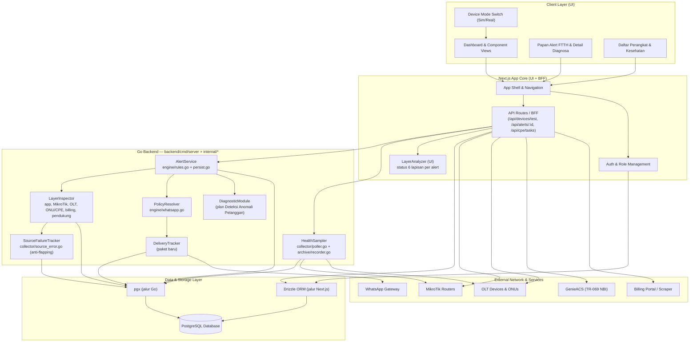
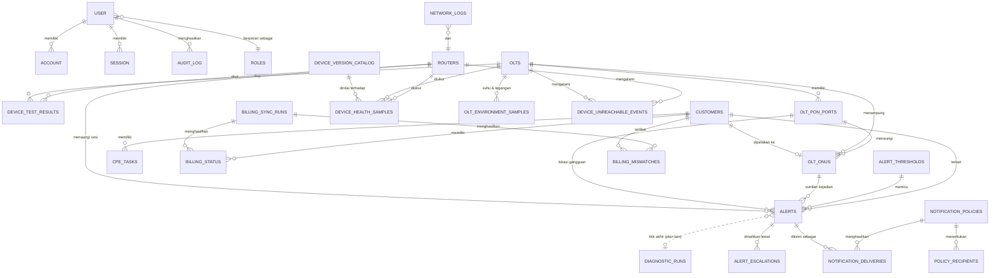

# PRD — Project Requirements Document

## 1. Overview

**NOC SYSTEM** (`ngodingpakeai-starter`) adalah aplikasi web operasional terpusat *Network Operations Center* (NOC) untuk penyedia layanan internet (ISP). Aplikasi ini menyatukan pemantauan, diagnostik, dan otomasi infrastruktur jaringan *real-time* yang sebelumnya tersebar di banyak alat terpisah.

**Masalah yang diselesaikan:**
- Operator dan teknisi harus berpindah-pindah antar sistem untuk memantau router MikroTik, perangkat OLT/ONU, dan perangkat pelanggan (CPE).
- Data *billing* dan kondisi jaringan sering tidak sinkron sehingga sulit ditelusuri.
- *Alert* jaringan mudah terlewat, menumpuk, atau tidak terarah ke penerima yang tepat.
- Sulit membedakan kondisi perangkat nyata dengan data uji coba (simulator).

**Tujuan utama aplikasi:**
- Menyediakan satu panel terpusat untuk memantau status router, OLT, port PON, ONU, dan CPE pelanggan.
- Menyediakan diagnostik dan pengujian konektivitas perangkat langsung dari dashboard, dengan panduan penanganan galat.
- Mengelola *alert*, insiden, dan notifikasi (termasuk WhatsApp) secara terarah.
- Menyelaraskan status pelanggan antara portal *billing* dan sistem jaringan.
- Menjaga keamanan kredensial (enkripsi AES-256-GCM) dan pembatasan akses berbasis peran.

Aplikasi ini **sudah terbangun dan berjalan**. PRD ini mendokumentasikan kondisi terkini sekaligus rencana pengembangan yang telah disetujui pada kerangka fitur (Fase 1–4).

---

## 2. Requirements

**Persyaratan fungsional utama (sudah berjalan):**
- Aplikasi **dua lapis**: backend **Go** (`backend/cmd/server`, `backend/internal/*`) sebagai mesin pengumpul, *rule engine* alert, dan pengirim notifikasi; serta aplikasi **Next.js** (App Router) dengan antarmuka React modular untuk UI, autentikasi, dan rute BFF. Keduanya berbagi satu PostgreSQL.
- Autentikasi sesi internal dengan pembatasan hak akses berbasis peran (*role-based access*).
- Mode pengoperasian ganda: **perangkat fisik riil** dan **simulator lokal**, diatur melalui *Device Mode Switch*.
- Integrasi langsung dengan: MikroTik RouterOS, perangkat OLT/ONU, GenieACS NBI (TR-069), portal *billing* (via scraper), dan WhatsApp Gateway.
- Penyimpanan persisten ke PostgreSQL melalui **Drizzle ORM** (jalur Next.js) dan **pgx** (jalur Go).
- Streaming data *real-time* (dengan banner peringatan bila aliran terputus).
- Pengujian konektivitas perangkat terpadu melalui `POST /api/devices/test` beserta panduan *troubleshoot* otomatis per kode galat.
- Pengelolaan tugas CPE melalui `POST /api/cpe/tasks` (perubahan SSID/kata sandi Wi-Fi, diagnostik, pemutusan host).
- Enkripsi kredensial sensitif (sesi portal & kata sandi scraper) dengan AES-256-GCM.

**Persyaratan fungsional plan ini (belum berjalan):**
- Halaman **Alert** adalah **permukaan analisis lintas lapisan**, bukan daftar pesan. Satu alert wajib memperlihatkan kondisi pada **enam lapisan** sekaligus — **aplikasi/platform, perangkat MikroTik, OLT, ONU/CPE, layanan pelanggan/billing, dan perangkat pendukung** — beserta lapisan mana yang menyimpang (rincian per lapisan pada §3.3 *Cakupan Analisis Lintas Lapisan*). Alert yang hanya menyebut "gangguan" tanpa menyebut lapisan dan angkanya dianggap belum memenuhi syarat.
- Halaman **Alert** itu juga **halaman Notifikasi** — satu halaman, bukan dua. Papan alert, kebijakan pengiriman, daftar penerima & kanal, dan catatan pengiriman berada di halaman yang sama sebagai tab, karena memisahkan "apa yang rusak" dari "siapa yang sudah diberi tahu" membuat operator harus menebak apakah sebuah alert benar-benar keluar.
- *Alert* pada plan ini berakar pada **layanan FTTH**, bukan pada perangkat semata: setiap alert membawa pelanggan, ONU/ONT, port PON, OLT, dan router yang terlibat.
- Setiap alert menautkan ke **hasil diagnosa** dari plan "Deteksi Anomali Pelanggan", dan tautan itu adalah **titik akhir** alert: membuka alert berarti membuka hasil diagnosa yang menyebabkannya.
- Alert yang masuk tanpa hasil diagnosa memicu diagnosa otomatis dan menampilkan status *diagnosa berjalan*; alert tetap terlihat tanpa menunggu diagnosa selesai.
- Hasil diagnosa otomatis **tidak boleh** membuat alert baru, agar tidak terjadi lingkaran alert → diagnosa → alert.
- Seluruh pembacaan metrik perangkat bersifat hanya-baca.

**Persyaratan non-fungsional:**
- Data yang berasal dari simulator harus jelas ditandai agar tidak terbaca sebagai kondisi nyata.
- Kegagalan integrasi tidak boleh menampilkan data tiruan seolah-olah nyata (mis. galat 404 pada port PON live tetap ditampilkan sebagai galat terisolasi).
- Pesan galat dan panduan penanganan disampaikan dalam Bahasa Indonesia yang mudah dipahami.
- Pengujian *end-to-end* menggunakan Playwright; standarisasi kode dengan ESLint.

---

## 3. Core Features

### 3.1 Kemampuan Dasar (sudah berjalan di codebase)

- **Papan Pantau Operasional & Alerting** — Monitoring *real-time* dengan *auto-refresh*, kontrol suara peringatan (`alert-sound-controller.tsx`), ringkasan metrik anomali, dialog penanganan insiden dan pembuatan tiket.
- **Manajemen OLT & ONU** — Deteksi status perangkat (online, offline, LOS), validasi level optik (`optical-badge.tsx`), wizard konfigurasi OLT, dan pemetaan ONU ke pelanggan.
- **Pengelolaan CPE (TR-069)** — Pengaturan Wi-Fi pelanggan, daftar host terhubung, dan pengujian GenieACS NBI.
- **Analisis Trafik & NetFlow** — Visualisasi tren trafik, pencatatan log NetFlow, pengarsipan sampel trafik berkala.
- **Sinkronisasi Billing** — Riwayat *sync*, deteksi *billing mismatch*, penyimpanan sesi scraper dan kredensial terenkripsi.
- **Pengujian Konektivitas Perangkat** — Panel uji terpadu dengan panduan *troubleshoot* otomatis.

### 3.2 Fase 1 — Kesehatan Perangkat (high)

Fondasi seluruh fase berikutnya: satu halaman Kesehatan Perangkat yang menjawab "perangkat mana yang perlu dilihat sekarang", sebelum ada metrik sedalam apa pun. Tanpa fase ini, Fase 2–4 tidak punya tempat menampilkan hasilnya.

#### Ringkasan Kesehatan
- **Tujuan** — Papan tunggal berisi seluruh router dan OLT beserta statusnya, agar operator tidak membuka satu per satu.
- **Perilaku** — Tiap perangkat tampil sebagai satu kartu dengan tiga status: *normal*, *perlu perhatian*, *tidak terjangkau*. Urutan bawaan: tidak terjangkau → perlu perhatian → normal. Kepala halaman menampilkan hitungan per status. Klik kartu membuka detail perangkat.
- **Sumber data** — `routers`, `olts`, `olt_pon_ports`, `olt_onus`, dan `device_test_results` (hasil uji terakhir).
- **Batasan** — Status *tidak terjangkau* hanya boleh berasal dari hasil uji yang benar-benar dijalankan dan belum kedaluwarsa. Perangkat yang belum pernah diuji berstatus **belum diuji** — bukan *normal*. Hasil uji yang sudah kedaluwarsa ditandai waktunya, tidak dianggap kondisi sekarang.
- **Selesai bila** — Ketiga status tampil benar; perangkat tanpa hasil uji tidak pernah terhitung normal; setiap kartu menyebut waktu data terakhir.

#### Kelompok per Lokasi
- **Tujuan** — Memungkinkan operator mempersempit pandangan ke wilayah/POP tempat gangguan terjadi.
- **Perilaku** — Perangkat dikelompokkan berdasarkan lokasi/POP; tiap kelompok menampilkan jumlah perangkat dan status agregat; kelompok bisa dibuka/tutup.
- **Sumber data** — Kolom lokasi pada `routers` dan `olts`.
- **Batasan** — Status agregat kelompok = status terburuk anggotanya, bukan rata-rata. Pengelompokan tidak boleh menyembunyikan perangkat: perangkat tanpa lokasi masuk kelompok *Tanpa lokasi* dan tetap tampil.
- **Selesai bila** — Tidak ada perangkat yang hilang dari tampilan karena lokasinya kosong; status kelompok berubah saat satu anggotanya rusak.

#### Pencarian & Filter
- **Tujuan** — Menemukan perangkat tertentu dengan cepat pada daftar yang panjang.
- **Perilaku** — Pencarian nama/IP perangkat; filter jenis (router/OLT), status, dan lokasi; filter dapat dikombinasikan; pilihan filter tercermin di URL agar bisa dibagikan; tersedia tombol reset dan jumlah hasil.
- **Sumber data** — Data perangkat yang sudah dimuat halaman.
- **Batasan** — Pencarian dan filter **tidak memicu pengujian atau polling perangkat**; keduanya murni menyaring data yang sudah ada. Ini menjaga agar operator tidak tanpa sengaja membebani router produksi hanya karena mengetik di kolom cari.
- **Selesai bila** — Kombinasi ketiga filter bekerja bersamaan; URL hasil filter dapat dibuka ulang dan memberi tampilan yang sama.

#### Penanda Simulator
- **Tujuan** — Mencegah data simulator terbaca sebagai kondisi jaringan nyata.
- **Perilaku** — Label mencolok pada setiap data yang berasal dari mode simulator, banner di tingkat halaman, dan pengulangan penanda saat halaman dimuat ulang atau mode diganti.
- **Sumber data** — Saklar mode perangkat yang sudah ada (*Device Mode Switch*).
- **Batasan** — Tidak ada data simulator yang boleh tampil tanpa penanda. Data simulator tidak boleh masuk perhitungan status nyata maupun dasar notifikasi.
- **Selesai bila** — Setiap kartu dari simulator berlabel; status keseluruhan tidak mencampur perangkat nyata dan simulasi.

### 3.3 Fase 2 — Metrik Router, Kondisi Optik OLT, Alert FTTH, & Kebijakan Notifikasi

Fase ini mengubah halaman Fase 1 dari "perangkat bisa dihubungi" menjadi "perangkat dalam kondisi baik", mengubah alert menjadi **pintu masuk diagnosa FTTH**, lalu menambahkan kendali atas siapa yang diberi tahu. Semua pembacaan metrik bersifat **hanya-baca** — tidak ada fase dalam plan ini yang mengubah konfigurasi perangkat.

#### Metrik Router (high)
- **Beban CPU & Memori** — Nilai terkini beserta tren jangka pendek, ditampilkan di detail perangkat pada halaman Kesehatan Perangkat. Setiap nilai wajib menyebut waktu pengambilan; nilai yang sudah lewat batas usia ditandai sebagai basi dan tidak dipakai menyimpulkan status. Sumber: `routers` dan hasil pembacaan RouterOS yang tersimpan.
- **Waktu Aktif** — Lama perangkat menyala. Penurunan nilai dibanding pembacaan sebelumnya dicatat sebagai kejadian *restart*, karena itulah tanda gangguan yang tidak terlihat dari status "online".
- **Sesi Aktif** — Jumlah sesi/pengguna yang sedang terhubung, dibandingkan dengan pembacaan sebelumnya agar lonjakan tak wajar terlihat.
- **Versi RouterOS** — Versi dan arsitektur yang terpasang, disimpan agar dapat dipakai fitur Perangkat Usang pada Fase 3 tanpa perlu membaca ulang perangkat.
- **Batasan bersama** — Metrik yang gagal dibaca tampil sebagai *tidak dapat dibaca* beserta alasannya, bukan sebagai nol. Nol adalah nilai yang sah dan mencampurnya dengan kegagalan membaca akan menghasilkan kesimpulan palsu "CPU 0%, aman".
- **Selesai bila** — Detail perangkat menampilkan keempat metrik beserta waktunya; restart terdeteksi dari penurunan waktu aktif; kegagalan baca tidak pernah tampil sebagai nol.

#### Kondisi Optik OLT
- **Suhu & Tegangan** — Suhu dan tegangan perangkat OLT beserta batas amannya, ditampilkan per perangkat.
- **Level Optik** — Kekuatan sinyal optik tiap ONU/port, memakai data optik yang sudah dikumpulkan. ONU dengan level di luar ambang disorot, dan sorotan itu harus menyebut angka serta ambangnya.
- **Status Port PON** — Ringkasan tiap port PON: *normal*, *gangguan*, atau *kosong*, beserta jumlah ONU yang bernaung di bawahnya. Port kosong dibedakan dari port rusak — keduanya tidak boleh tampil sama.
- **Peringatan Batas** — Menandai nilai di luar ambang wajar **tanpa mengirim notifikasi otomatis**. Ambang diambil dari `alert_thresholds` bila tersedia; bila tidak, dipakai nilai bawaan dan nilai bawaan itu dinyatakan terbuka di antarmuka agar operator tahu dasar penilaiannya.
- **Batasan** — Fitur ini hanya menandai, tidak membuat alert dan tidak menambah baris pada papan alert. Pembuatan alert tetap milik mesin alert yang sudah berjalan.
- **Selesai bila** — Suhu, tegangan, level optik, dan status port tampil per OLT; penandaan menyertakan angka dan ambang; tidak ada alert baru yang lahir dari halaman ini.

#### Alert FTTH & Tautan Diagnosa (high)

Alert pada plan ini **bukan** pesan lepas yang berhenti di "ada gangguan". Alert adalah **pintu masuk ke diagnosa**: ia lahir dari layanan FTTH tertentu, membawa identitas layanan itu, dan berakhir di hasil diagnosa yang menjelaskan lapisan mana yang bermasalah. Tanpa ketiga hal ini, alert hanya memindahkan pekerjaan menebak dari mesin ke operator.

- **Jenis alert berakar FTTH** — Jenis alert yang dipakai seluruhnya menunjuk ke layanan pelanggan, bukan hanya ke perangkat:
  - ONU tidak terdeteksi OLT / berstatus LOS.
  - Redaman RX/TX di luar ambang (memakai data optik dan penanda `isWeak` yang sudah ada).
  - Sesi PPPoE terdaftar tetapi tidak aktif, atau putus berulang.
  - Trafik padam mendadak padahal sesi masih aktif.
  - ONT tidak terjangkau TR-069 (GenieACS).
  - Antrean/*queue* menunjukkan limit tidak berjalan sebagaimana mestinya.
  - Layanan terputus karena isolir/tunggakan.
- **Identitas layanan wajib** — Setiap alert membawa pelanggan, nomor layanan, ONU/ONT, port PON, OLT, dan router. Alert yang tidak dapat dipetakan ke layanan FTTH **ditolak masuk** sebagai alert layanan dan dicatat sebagai alert perangkat, karena alert tanpa identitas layanan tidak bisa didiagnosa maupun ditindaklanjuti.
- **Titik akhir: hasil diagnosa** — Setiap alert menyimpan rujukan `diagnostic_run_id`. Membuka alert langsung membuka **hasil diagnosa yang sama** — bukan halaman kosong yang meminta operator mendiagnosa ulang. Hasil itu menampilkan seluruh lapisan yang diperiksa (MikroTik, optik, ONT, log, firewall, uplink/BGP, trafik, billing) beserta angka dan ambangnya.
- **Diagnosa menyusul bila belum ada** — Alert FTTH kritis yang masuk tanpa hasil diagnosa memicu diagnosa otomatis (mengikuti plan "Deteksi Anomali Pelanggan") dan tampil sebagai *diagnosa berjalan* sampai hasilnya siap. **Alert tidak menunggu diagnosa untuk tetap terlihat dan tetap dikirim.**
- **Ringkasan lapisan pada kartu alert** — Kartu alert menampilkan lapisan yang bermasalah beserta angka dan ambangnya (mis. "optik: RX −27,4 dBm, ambang −27"). Inilah yang membedakan alert FTTH dari alert generik, dan yang membuat operator tahu ke mana harus melihat sebelum membuka apa pun.
- **Rujukan dua arah** — Dari alert ke diagnosa, dan dari diagnosa ke alert yang memicunya. Operator yang sedang membaca diagnosa harus bisa tahu apakah kejadian ini sudah diberitahukan, ke siapa, dan kapan.
- **Batasan** —
  1. **Alert tidak menyimpulkan akar masalah.** Kesimpulan lapisan tetap milik mesin diagnosa. Menyalin logika kesimpulan ke alert akan menghasilkan dua kesimpulan berbeda untuk kejadian yang sama.
  2. **Diagnosa otomatis tidak membuat alert** (aturan dari plan diagnosa). Alert hanya lahir dari mesin alert yang sudah berjalan.
  3. **Tautan yang hilang tidak mengosongkan halaman.** Bila hasil diagnosa tidak ditemukan (data lama/terhapus), alert tetap tampil dan menyatakan *diagnosa tidak tersedia* beserta alasannya — bukan halaman kosong atau kesimpulan karangan.
  4. **Alert perangkat dicampur-pisah.** Alert murni perangkat (CPU tinggi, perangkat tidak terjangkau) tetap ada, tetapi dikelompokkan terpisah dari alert layanan FTTH melalui kolom `alerts.alert_scope` (`service` untuk layanan FTTH, `device` untuk perangkat) — penamaan kolomnya dirinci pada §6. Mencampur "pelanggan mati" dengan "perangkat sibuk" membuat prioritas penanganan salah.
  5. **Hanya-baca.** Menautkan dan menampilkan diagnosa tidak boleh mengubah apa pun pada perangkat pelanggan.
- **Selesai bila** — Setiap alert layanan membawa pelanggan, ONU/ONT, dan port PON; kartu alert membuka hasil diagnosa yang sama beserta angka dan ambangnya; alert tanpa identitas layanan tercatat sebagai alert perangkat, bukan alert layanan; alert tanpa diagnosa memicu diagnosa otomatis dan menyatakan statusnya; alert perangkat tidak tercampur alert layanan.

#### Cakupan Analisis Lintas Lapisan (high)

Halaman Alert menjawab satu pertanyaan tetap: **"lapisan mana yang menyimpang?"** Untuk itu setiap alert diperiksa terhadap enam lapisan di bawah. Daftar ini bukan tambahan jenis alert — ia adalah **sisi periksa** dari alert yang sama, sehingga satu kejadian pelanggan tetap menghasilkan satu alert, bukan enam.

| Lapisan | Yang diperiksa | Sumber di kode (terverifikasi indeks) |
|---|---|---|
| **1. Aplikasi / platform** | Sesi & peran operator, kesehatan rute API, koneksi PostgreSQL, antrean pengiriman notifikasi, status sinkronisasi billing | `backend/internal/httpapi/auth.go`, `backend/internal/auth/token.go`, `backend/internal/archive/pgstore.go`, `backend/internal/billing/scheduler.go` |
| **2. Perangkat MikroTik** | Keterjangkauan router, beban CPU/memori, waktu aktif, sesi PPPoE, antrean/*queue*, laju interface, syslog & webhook | `backend/internal/collector/poller.go`, `queue.go`, `ifrate.go`, `syslog.go`, `webhook.go`, `backend/internal/engine/rules.go` |
| **3. Perangkat OLT** | Suhu & tegangan, status dan okupansi tiap port PON, jumlah ONU bernaung, uplink OLT | `backend/internal/collector/olt_fleet.go` |
| **4. ONU / CPE pelanggan** | Status ONU (online/LOS), redaman RX/TX terhadap ambang, keterjangkauan TR-069 | `backend/internal/collector/olt_fleet.go`; GenieACS NBI |
| **5. Layanan & billing pelanggan** | Status isolir/tunggakan, ketidaksesuaian billing terhadap kondisi jaringan, riwayat sinkronisasi | `backend/internal/billing/` (`syncer.go`, `match.go`, `scraper.go`), `backend/internal/engine/engine.go` |
| **6. Perangkat pendukung (dan lainnya)** | Ketersediaan WhatsApp Gateway, GenieACS NBI, portal billing, DNS/internet sebagai jalur keluar yang dipakai lapisan di atas | `backend/internal/engine/whatsapp.go`, `backend/internal/billing/scraper.go` |

- **Tujuan** — Membuat operator tahu *di lapisan mana* gangguan berada sebelum membuka apa pun, dan mencegah satu gangguan FTTH dilaporkan sebagai enam alert terpisah.
- **Perilaku** — Untuk setiap alert, tiap lapisan diberi satu status: **bersih**, **menyimpang** (disertai angka dan ambangnya), **tidak diperiksa**, atau **tidak dapat diperiksa**. Lapisan yang menyimpang ditampilkan paling atas pada kartu alert, diikuti lapisan yang tidak dapat diperiksa. Ringkasan "lapisan bermasalah" inilah yang juga dipakai pada isi pesan WhatsApp (lihat Kebijakan Notifikasi).
- **Batasan** —
  1. **Satu kejadian, satu alert.** Enam lapisan adalah enam sisi pemeriksaan, bukan enam baris alert. Memecahnya menjadi enam alert akan mengembalikan masalah banjir notifikasi yang justru ingin diselesaikan Fase 3.
  2. **Tidak diperiksa ≠ bersih.** Lapisan yang tidak ikut diperiksa (mis. perangkat OLT tidak dipetakan ke layanan itu) wajib berstatus *tidak diperiksa*, tidak pernah hijau. Ini aturan yang sama dengan "data tak terbaca ≠ nilai baik".
  3. **Tidak dapat diperiksa ≠ nol.** Lapisan yang pemeriksaannya gagal (timeout, kredensial ditolak, gateway mati) wajib menyebut alasannya, bukan menampilkan nilai `0` atau status aman.
  4. **Hanya-baca.** Pemeriksaan lapisan 1–6 tidak mengubah konfigurasi router, OLT, ONU, maupun pelanggan.
  5. **Bukan mesin diagnosa kedua.** Pemeriksaan lapisan ini mengumpulkan **fakta per lapisan beserta angka dan ambang** untuk ditampilkan; ia tidak menyimpulkan akar masalah. Kesimpulan tetap milik mesin diagnosa pada plan "Deteksi Anomali Pelanggan" (§5 aturan pengikat 1–2).
  6. **Lapisan aplikasi tidak boleh menutupi lapisan jaringan.** Bila lapisan 1 (aplikasi) sendiri sedang bermasalah — mis. koneksi PostgreSQL terputus — alert jaringan tetap ditampilkan dengan penanda bahwa pemeriksaannya tidak lengkap, bukan disembunyikan. Alert tidak boleh hilang karena sistem yang menampilkannya sedang sakit.
- **Selesai bila** — Setiap alert menampilkan status keenam lapisan; lapisan yang menyimpang tampil dengan angka dan ambangnya; lapisan yang tidak diperiksa atau gagal diperiksa tidak pernah tampil hijau; satu kejadian pelanggan tetap menghasilkan tepat satu alert.

#### Satu Halaman: Alert & Notifikasi (high)

Halaman ini **satu halaman dengan dua peran**: ia papan analisis alert sekaligus permukaan notifikasi. Kebijakan, penerima, kanal, dan jejak pengiriman tidak boleh bersembunyi di halaman Pengaturan yang terpisah, karena di situlah alert paling sering terlewat — operator melihat gangguan, tetapi tidak tahu apakah pemberitahuannya sudah keluar.

- **Judul & menu** — Menu memakai label **Alert**; halaman yang sama adalah halaman Notifikasi. **Tidak ada menu "Notifikasi" terpisah**, supaya tidak ada dua tempat yang mengatur hal yang sama.
- **Empat tab dalam satu halaman** —
  - **Papan Alert** (Fase 2) — daftar alert layanan & perangkat, ringkasan lapisan yang menyimpang, dan tautan ke hasil diagnosa.
  - **Kebijakan** (Fase 2) — matriks jenis × keparahan × penerima × kanal.
  - **Penerima & Kanal** (Fase 2) — penerima per peran, nomor WhatsApp, dan status kesehatan gateway.
  - **Catatan Pengiriman** (Fase 4) — riwayat kirim, status, alasan gagal, dan kirim ulang.
- **Konteks alert terbawa antar tab** — Membuka sebuah alert lalu berpindah ke Catatan Pengiriman menampilkan jejak pengiriman **alert itu**, bukan seluruh riwayat. Operator tidak perlu mencari ulang.
- **Tautan langsung per alert** — `/alerts/[id]` membuka detail alert pada tab Papan Alert; `/alerts/[id]?tab=pengiriman` membuka jejak kirimnya. Tautan inilah yang dipakai di dalam pesan WhatsApp.
- **Ringkasan kirim pada kartu alert** — Tiap kartu menyebut status pemberitahuan terakhirnya: *terkirim*, *tertahan peredam*, *gagal*, atau *belum dikirim*, beserta waktunya. Tanpa ini, "sudah dikirim" hanya asumsi.
- **Batasan** —
  1. **Satu sumber kebenaran.** Penerima & kanal hanya boleh diubah dari tab Penerima & Kanal; tidak ada jalur kedua di halaman Pengaturan.
  2. **Analisis tidak bergantung pada notifikasi.** Kegagalan pengiriman tidak boleh mengosongkan Papan Alert — alert tetap tampil walau gateway mati.
  3. **Hak akses berbeda per tab.** Melihat alert dan mengubah kebijakan penerima adalah dua izin berbeda; tab Kebijakan dan Penerima & Kanal hanya untuk peran yang berwenang.
  4. **Hanya-baca pada perangkat.** Tidak ada tab di halaman ini yang mengubah konfigurasi router, OLT, ONU, atau pelanggan.
- **Selesai bila** — Papan Alert, Kebijakan, Penerima & Kanal, dan Catatan Pengiriman dapat dicapai dari satu halaman; tiap kartu alert menyebut status pemberitahuannya; membuka Catatan Pengiriman dari sebuah alert menampilkan jejak alert itu; tidak ada menu Notifikasi terpisah.

#### Kebijakan Notifikasi (high)
- **Aturan per Jenis** — Menentukan jenis alert **FTTH** mana yang dikirim keluar dan mana yang cukup tampil di dalam aplikasi. Jenisnya mengikuti daftar pada Alert FTTH di atas (LOS, redaman di luar ambang, PPPoE putus, trafik padam, ONT tidak terjangkau, isolir) — bukan daftar jenis generik.
- **Aturan per Keparahan** — Membedakan penerima dan kanal untuk alert ringan, sedang, dan kritis.
- **Penerima per Peran** — Memilih penerima berdasarkan peran (`roles`) atau pengguna tertentu, bukan sekadar satu nomor tujuan global.
- **Pilihan Kanal** — Mengaktifkan pengiriman lewat dalam aplikasi, suara, dan WhatsApp sesuai kebutuhan, memakai integrasi WhatsApp Gateway dan tabel `whatsapp` yang sudah ada.
- **Isi Pesan Wajib Informatif** — Setiap pemberitahuan keluar, termasuk WhatsApp, memuat **identitas layanan** (nama pelanggan, nomor layanan, ONU/ONT, port PON), **lapisan yang bermasalah beserta angka dan ambangnya**, serta **tautan ke hasil diagnosa**. Pesan yang hanya berbunyi "ada gangguan" tidak memenuhi syarat, karena memaksa penerima membuka aplikasi untuk tahu apa yang sebenarnya terjadi — dan itulah yang paling sering membuat alert diabaikan.
- **Batasan** — (1) Bila sebuah alert tidak cocok dengan aturan mana pun, sistem wajib punya penerima bawaan yang jelas — alert tidak boleh hilang diam-diam. (2) Alert kritis tidak boleh sepenuhnya terhenti oleh kebijakan; bila ditahan, penahanan itu tercatat dan bisa ditelusuri. (3) Setiap perubahan kebijakan dicatat di `audit_log` beserta pelakunya, karena perubahan ini menentukan siapa yang tahu saat jaringan rusak. (4) Kebijakan hanya berlaku untuk pengiriman **berikutnya**; ia tidak mengubah riwayat pengiriman yang sudah terjadi.
- **Selesai bila** — Matriks jenis × keparahan × penerima × kanal dapat diatur dan disimpan; pengiriman berikutnya mengikuti matriks itu; setiap keputusan kirim/tidak dapat dijelaskan dari konfigurasi, bukan dari tebakan.

### 3.4 Fase 3 — Eskalasi, Perangkat Usang, & Riwayat Tidak Terjangkau

Fase ini menangani dua sisi yang berlawanan: alert yang **terlewat** dan alert yang **membanjiri**. Keduanya berasal dari sumber yang sama, jadi diselesaikan bersama.

#### Eskalasi & Peredam
- **Aturan Eskalasi** — Alert yang belum ditangani dalam batas waktu naik ke penerima berikutnya. Eskalasi berhenti begitu alert ditangani, dan jumlah tingkat eskalasi dibatasi agar tidak berputar tanpa ujung.
- **Penggabungan Alert** — Alert berulang untuk kejadian yang sama dalam satu jendela waktu disatukan menjadi satu pemberitahuan dengan jumlah kejadian. Kejadian "sama" didefinisikan eksplisit: pelanggan/perangkat + jenis alert. Kejadian asal tetap disimpan, hanya pengirimannya yang digabung — supaya jumlah kejadian masih bisa dipertanggungjawabkan.
- **Jeda per Pelanggan** — Membatasi kiriman beruntun untuk pelanggan yang sama dalam kurun waktu tertentu.
- **Jeda per Perangkat** — Membatasi kiriman beruntun untuk perangkat yang sama.
- **Batasan** — Peredam tidak boleh menelan alert kritis tanpa jejak: minimal satu alert kritis per pelanggan/perangkat per jendela wajib lolos, dan jumlah yang ditahan harus terlihat. Peredam yang menyembunyikan gangguan nyata lebih berbahaya daripada banjir notifikasi yang ingin dicegah.
- **Selesai bila** — Eskalasi berhenti setelah alert ditangani; penggabungan menampilkan jumlah kejadian yang benar; jeda tidak pernah menahan seluruh alert kritis pada satu jendela waktu.

#### Perangkat Usang
- **Daftar Versi** — Merangkum versi RouterOS dan firmware seluruh perangkat dalam satu daftar, memakai data versi yang sudah dibaca pada Fase 2 sehingga tidak ada pembacaan ulang ke perangkat.
- **Peringatan Usang** — Menandai perangkat yang versinya tertinggal dari versi yang dianjurkan. Versi anjuran berasal dari konfigurasi yang ditetapkan operator, **bukan** hasil menebak dari internet.
- **Saran Versi** — Menampilkan rekomendasi versi target sebagai informasi.
- **Batasan** — Tidak ada pembaruan firmware, unggah paket, atau perubahan konfigurasi dari halaman ini. Perangkat yang versinya tidak terbaca ditandai *tidak diketahui*, bukan dianggap usang maupun mutakhir.
- **Selesai bila** — Daftar versi mencakup semua perangkat; perangkat tanpa data versi tidak salah diklasifikasikan; tidak ada aksi tulis ke perangkat.

#### Riwayat Tidak Terjangkau
- **Linimasa Gangguan** — Garis waktu kejadian perangkat tidak terjangkau per perangkat, bersumber dari `device_test_results` dan uji manual yang sudah ada.
- **Durasi & Frekuensi** — Ringkasan total durasi, jumlah kejadian, dan periode kejadiannya per perangkat.
- **Catatan Penyebab** — Catatan manual atas penyebab gangguan, beserta penulis dan waktu penulisan.
- **Batasan** — Gangguan yang masih berjalan ditampilkan sebagai *berjalan* beserta waktu mulainya, bukan sebagai durasi nol. Data simulator tidak boleh masuk riwayat ini.
- **Selesai bila** — Tiap kejadian punya waktu mulai dan selesai; gangguan berjalan terlihat sebagai berjalan; durasi total dapat dihitung ulang dari daftar kejadian.

### 3.5 Fase 4 — Catatan Pengiriman

Menutup lingkaran: setelah Fase 2 menentukan *apa yang dikirim* dan Fase 3 menentukan *kapan dan kepada siapa*, fase ini menjawab **apakah benar terkirim**. Tanpa jejak ini, kebijakan notifikasi tidak bisa dipercaya karena kegagalannya tidak terlihat. Fase ini **tidak membuat halaman baru**: isinya menjadi tab **Catatan Pengiriman** pada halaman Alert & Notifikasi (§3.3), agar jejak kirim sebuah alert bisa dibuka langsung dari alert itu.

#### Catatan Pengiriman
- **Daftar Pengiriman** — Riwayat pengiriman alert lintas kanal dalam satu daftar, dengan filter waktu, kanal, status, dan penerima. Tampil sebagai tab **Catatan Pengiriman** pada halaman Alert & Notifikasi (§3.3), dan dapat disaring ke satu alert bila dibuka dari kartu alert.
- **Status Terkirim/Gagal** — Menandai hasil tiap pengiriman, **beserta alasan kegagalan apa adanya** (kode galat/pesan dari kanal), bukan sekadar label "gagal" yang tidak bisa ditindaklanjuti.
- **Penelusuran & Kirim Ulang** — Pencarian pengiriman tertentu dan pengiriman ulang yang gagal. Kirim ulang mencatat percobaan **baru** tanpa menimpa catatan lama, dan jumlah percobaan ulang dibatasi agar tidak menjadi jalan banjir notifikasi baru.
- **Batasan** — Catatan pengiriman tidak boleh menyimpan isi pesan yang memuat kredensial atau rahasia. Riwayat pengiriman bersifat catatan, bukan pengganti papan alert: menghapus catatan tidak boleh menghapus alert aslinya.
- **Selesai bila** — Setiap pengiriman punya status dan alasannya; kirim ulang membuat baris baru; riwayat lama tetap utuh dan bisa ditelusuri.

### 3.6 Ringkasan Fase & Ketergantungan

| Fase | Fokus | Fitur utama | Bergantung pada |
|---|---|---|---|
| 1 | Fondasi tampilan perangkat | Ringkasan Kesehatan, Kelompok per Lokasi, Pencarian & Filter, Penanda Simulator | — |
| 2 | Kedalaman metrik + alert FTTH bertaut diagnosa | Metrik Router, Kondisi Optik OLT, Alert FTTH & Tautan Diagnosa, Cakupan Analisis Lintas Lapisan, Satu Halaman: Alert & Notifikasi, Kebijakan Notifikasi | Fase 1 (tempat menampilkan); plan "Deteksi Anomali Pelanggan" (hasil diagnosa, `diagnostic_run`) |
| 3 | Ketepatan pengiriman + riwayat | Eskalasi & Peredam, Perangkat Usang, Riwayat Tidak Terjangkau | Fase 2 (versi perangkat; jenis & keparahan alert) |
| 4 | Keterlacakan pengiriman | Catatan Pengiriman | Fase 2 & 3 (kanal, eskalasi, peredam) |

**Aturan pengikat lintas fase:**
1. **Hanya-baca.** Tidak ada fase dalam plan ini yang mengubah konfigurasi router, OLT, atau perangkat pelanggan.
2. **Data tak terbaca ≠ nilai baik.** Setiap metrik yang gagal dibaca wajib tampil sebagai *tidak dapat dibaca* beserta alasannya, tidak pernah sebagai nol atau hijau.
3. **Simulator tidak menyamar.** Data simulator tidak boleh masuk perhitungan status, riwayat, maupun dasar notifikasi tanpa penanda.
4. **Kegagalan notifikasi harus terlihat.** Peredam dan kebijakan boleh menahan pengiriman, tetapi penahanan itu harus tercatat dan bisa ditelusuri.

---

## 4. User Flow

1. **Masuk & Navigasi** — Operator/teknisi masuk melalui autentikasi, lalu mengakses *App Shell* yang menampilkan menu utama (Alert, Perangkat, CPE, Billing, dan — pada Fase 1 — Kesehatan Perangkat).
2. **Memilih Mode Perangkat** — Pengguna mengaktifkan mode simulator atau perangkat fisik melalui *Device Mode Switch*. Setiap data simulator ditandai jelas (Fase 1: Penanda Simulator).
3. **Memantau Kesehatan Perangkat** — Pada halaman Kesehatan Perangkat, operator melihat ringkasan status semua router & OLT, mengelompokkan per lokasi/POP, serta mencari dan memfilter perangkat (Fase 1).
4. **Meninjau Metrik & Kondisi Optik** — Operator membuka detail perangkat untuk melihat beban CPU/memori, waktu aktif, sesi, dan versi RouterOS (Fase 2), serta suhu, tegangan, level optik, dan status port PON pada OLT (Fase 2).
5. **Mengelola & Menguji Perangkat** — Operator menjalankan uji konektivitas melalui panel uji terpadu. Jika gagal, sistem menampilkan panduan *troubleshoot*. Riwayat perangkat tidak terjangkau tercatat dalam linimasa beserta catatan penyebab (Fase 3).
6. **Menangani Alert FTTH** — Alert layanan FTTH masuk ke papan dashboard dengan identitas pelanggan, ONU/ONT, dan port PON. Membuka alert **langsung membuka hasil diagnosa** yang menyebabkannya (Fase 2: Alert FTTH & Tautan Diagnosa); bila diagnosa belum ada, sistem menjalankannya dan menampilkan status *diagnosa berjalan* sementara alert tetap terlihat. Setelah membaca diagnosa, operator memakai dialog penanganan/tiket. Sistem menerapkan aturan notifikasi (jenis, keparahan, peran, kanal) (Fase 2), eskalasi, penggabungan, dan jeda agar tidak membanjiri operator (Fase 3). Semua pengaturan pemberitahuan berada di halaman yang sama — tab **Kebijakan** dan **Penerima & Kanal** — bukan di halaman Notifikasi terpisah.
7. **Meninjau Perangkat Usang** — Operator melihat daftar versi seluruh perangkat, peringatan usang, dan saran versi target sebagai informasi (Fase 3).
8. **Menelusuri Pengiriman Alert** — Operator membuka tab **Catatan Pengiriman** pada halaman Alert & Notifikasi untuk melihat jejak tiap alert yang dikirim, status terkirim/gagal, lalu melakukan pencarian atau kirim ulang bila gagal (Fase 4). Tab ini juga bisa dibuka langsung dari sebuah alert, sehingga yang tampil adalah jejak alert itu saja.
9. **Mengelola CPE Pelanggan** — Operator mengubah SSID/kata sandi Wi-Fi, melihat host terhubung, dan memutus koneksi (sesuai otorisasi).
10. **Menyelaraskan Billing** — Operator memantau status sinkronisasi *billing* dan menyelesaikan *mismatch* melalui dialog tindakan.

---

## 5. Architecture

Sistem **bukan** monolit Next.js. Kode yang ada menjalankan **dua lapis nyata** yang berbagi satu basis data PostgreSQL:

- **Backend Go** (`backend/cmd/server`, `backend/internal/*`) — mesin pengumpul (*collector*), *rule engine* alert, pengirim WhatsApp, pengarsip sampel, dan sinkronisasi billing. Ini yang berbicara langsung ke MikroTik, OLT, dan portal billing, serta mengakses PostgreSQL lewat **pgx**.
- **Aplikasi Next.js** (`app/`, `components/`, `app/api/*`) — antarmuka React, App Shell, autentikasi & peran, dan rute BFF yang meneruskan permintaan ke backend Go. Akses datanya lewat **Drizzle ORM**.
- **PostgreSQL** — satu basis data, dua jalur akses (pgx dari Go, Drizzle dari Next.js). Kolom dan tabel pada §6 berlaku untuk keduanya.

**Pemetaan komponen PRD ke kode Go yang sudah ada:**

| Komponen di PRD | Padanan Go | Status |
|---|---|---|
| `AlertService` (identitas layanan + tautan diagnosa) | `engine/rules.go`, `engine/thresholds.go`, `engine/persist.go` | Ada, perlu diperluas |
| `PolicyResolver` (kebijakan → peredam → eskalasi) | `engine/whatsapp.go` | Sebagian — baru pengiriman WhatsApp |
| `LayerInspector` (periksa 6 lapisan) | `collector/poller.go`, `collector/olt_fleet.go`, `collector/queue.go`, `collector/ifrate.go`, `collector/syslog.go`, `billing/syncer.go` | Bahan sudah ada, belum disatukan per alert |
| `HealthSampler` (metrik perangkat berkala) | `collector/poller.go`, `archive/recorder.go`, `archive/pgstore.go` | Ada |
| Pelacak perangkat tidak terjangkau | `collector/source_error.go` → `SourceFailureTracker`, `DefaultUnreachableThreshold` | **Sudah ada** (anti-flapping) |
| `DeliveryTracker` (catatan pengiriman) | — | **Belum ada**, paket baru |
| `DiagnosticModule` | — | Milik plan "Deteksi Anomali Pelanggan" |

Konsekuensi untuk Fase 3: fitur **Riwayat Tidak Terjangkau** tidak dibangun dari nol — anti-flapping dan pelacakan kegagalan berturut-turut sudah berjalan di `collector/source_error.go`; pekerjaannya adalah **menyimpan** kejadiannya (`device_unreachable_events`) dan menampilkannya.



**Alur nyata: alert FTTH → diagnosa → pemberitahuan (sequence):**

```mermaid
sequenceDiagram
    actor Operator
    participant UI as Papan Alert (React)
    participant Shell as App Shell
    participant Auth as Auth & Role Module
    participant API as /api/alerts
    participant Alert as AlertService
    participant Diag as DiagnosticModule
    participant Pol as PolicyResolver
    participant DB as PostgreSQL (Drizzle & pgx)
    participant Ext as MikroTik / OLT / WhatsApp

    Note over Ext,Alert: 1. Alert FTTH terbentuk dari lapisan layanan, bukan dari perangkat
    Ext-->>Alert: Kejadian / metrik di luar ambang
    Alert->>DB: Petakan ke identitas layanan (pelanggan, ONU, port PON, OLT, router)
    alt Identitas layanan tidak lengkap
        Alert->>DB: Simpan sebagai alert perangkat (bukan alert layanan)
    else Identitas layanan lengkap
        Alert->>Diag: Minta diagnosa (trigger_mode = automatic)
        Diag-->>Alert: diagnostic_run_id (status = berjalan)
        Alert->>DB: Simpan alert + diagnostic_run_id
    end
    Note over Alert: Alert tampil lebih dulu; tidak menunggu diagnosa selesai

    Note over Operator,DB: 2. Operator membuka alert → titik akhir adalah hasil diagnosa
    Operator->>UI: Buka alert
    UI->>Shell: Minta detail alert
    Shell->>Auth: Validasi sesi & peran
    Auth->>DB: Cek user, session, roles
    DB-->>Auth: Hasil validasi
    Auth-->>Shell: Izin diberikan
    Shell->>API: GET /api/alerts/:id
    API->>Alert: Ambil alert + tautan diagnosa
    Alert->>DB: Baca alert + diagnostic_run terkait
    DB-->>Alert: Data alert & hasil diagnosa
    alt diagnostic_run_id kosong
        Alert-->>UI: "Diagnosa tidak tersedia" + alasan
    else Tautan ada
        Alert-->>UI: Ringkasan lapisan + angka & ambang + kesimpulan
    end

    Note over Alert,Ext: 3. Pemberitahuan keluar lewat kebijakan, peredam, lalu eskalasi
    Alert->>Pol: Jenis alert × keparahan → kanal & penerima
    Pol->>DB: Baca notification_policies, peredam, alert_escalations
    DB-->>Pol: Kebijakan yang berlaku
    alt Ditahan peredam
        Pol->>DB: Catat penahanan (tidak dikirim diam-diam)
    else Lolos
        Pol->>Ext: Kirim (WhatsApp / dalam aplikasi / suara)
        Ext-->>Pol: Status kirim
        Pol->>DB: Simpan notification_deliveries
    end
```

**Aturan pengikat arsitektur:**

1. **Alert adalah pintu masuk diagnosa, bukan pesan lepas.** `AlertService` tidak menyimpulkan akar masalah dan tidak menyalin logika lapisan. Ia hanya memetakan kejadian → identitas layanan → `diagnostic_run_id`. Kesimpulan tetap milik `DiagnosticModule` milik plan "Deteksi Anomali Pelanggan", agar tidak ada dua kesimpulan berbeda untuk kejadian yang sama.
2. **DiagnosticModule dipakai lintas plan, tidak diduplikasi.** Halaman alert tidak boleh punya mesin diagnosa sendiri. Bila plan Deteksi Anomali belum ada di repo, tautan alert menampilkan "diagnosa tidak tersedia" beserta alasannya — bukan diam-diam mengosongkan halaman.
3. **Alert tampil lebih dulu, diagnosa menyusul.** Pembuatan alert tidak menunggu diagnosa selesai; `diagnostic_run_id` boleh terisi dengan status `berjalan` dan ditampilkan apa adanya.
4. **Hanya-baca ke perangkat.** `HealthSampler` dan `AlertService` tidak pernah menulis konfigurasi ke MikroTik/OLT/ONT.
5. **Notifikasi keluar hanya lewat `DeliveryTracker`.** Tidak ada jalur kirim langsung dari komponen UI atau rute API lain, supaya peredam, eskalasi, dan catatan pengiriman tidak bisa dilewati.
6. **Kegagalan baca dicatat sebagai "tidak dapat dibaca"**, tidak pernah menjadi nilai `0` atau status aman.

> Catatan: Fitur Fase 2–4 (Kebijakan Notifikasi, Eskalasi & Peredam, Catatan Pengiriman) memakai komponen di atas tanpa menambah lapisan baru. Yang bertambah hanya entitas pada Data Layer (§6).

---

## 6. Database Schema

Basis data relasional **PostgreSQL** diakses lewat **dua jalur**: **Drizzle ORM** dari aplikasi Next.js dan **pgx** dari backend Go. Migrasi tetap satu pintu — dikelola **Drizzle Kit** (`drizzle/`) dan dijalankan sebelum kedua lapis dinyalakan — sehingga dua jalur baca-tulis tidak pernah menghasilkan skema berbeda. Tabel-tabel berikut terbukti ada pada dokumentasi codebase. Kolom rinci per tabel dikelola pada berkas skema Drizzle dan tidak seluruhnya dirinci di dokumentasi ini; yang dicantumkan hanya nama entitas, peran, dan relasi yang dapat dipastikan.

**Tabel Autentikasi & Akses:**
- `user` — Data pengguna/operator.
- `account` — Akun terkait pengguna (kredensial/sesi penyedia).
- `session` — Sesi login aktif.
- `verification` — Token verifikasi (mis. verifikasi email/reset).
- `roles` — Definisi peran dan hak akses.
- `audit_log` — Jejak audit aktivitas sistem.
- `notes` — Catatan terkait entitas operasional.

**Tabel Infrastruktur NOC:**
- `routers` — Data router MikroTik yang dipantau.
- `olts` — Data perangkat OLT.
- `olt_pon_ports` — Port PON pada tiap OLT.
- `olt_onus` — Unit ONU/ONT beserta status dan metrik optik.
- `cpe_tasks` — Tugas CPE (perubahan Wi-Fi, diagnostik, dll.).
- `network_logs` — Log jaringan dan NetFlow.
- `device_test_results` — Hasil pengujian konektivitas perangkat.

**Tabel Pelanggan & Wilayah:**
- `customers` — Data pelanggan.
- `onboarding` — Data proses pendaftaran/pemasangan pelanggan.
- `whatsapp` — Data terkait integrasi WhatsApp.

**Tabel Metrik & Alert:**
- `alerts` — Kejadian alert/insiden. Pada siklus ini dipakai sebagai **alert layanan FTTH** dan wajib membawa identitas layanan (lihat di bawah).
- `alert_thresholds` — Ambang batas pemicu alert.
- `netflow_samples` — Sampel data NetFlow.
- `traffic_samples` — Sampel trafik jaringan berkala.

**Tabel Alert FTTH & Tautan Diagnosa (perubahan pada tabel berjalan):**

`alerts` sudah ada dan **tidak dibuat ulang**. Yang ditambahkan adalah kolom berikut, semuanya boleh kosong agar alert lama tetap sah:

| Kolom | Wajib untuk alert layanan | Keterangan |
|---|---|---|
| `alert_scope` | ya | `service` (layanan pelanggan) atau `device` (perangkat). Menentukan apakah alert boleh tampil di papan alert FTTH. |
| `customer_id` | ya | Pelanggan pemilik layanan. Kunci pemetaan ke identitas layanan. |
| `onu_id` | ya | ONU/ONT yang terlibat, bila kejadian berasal dari sisi optik. |
| `pon_port_id` | tidak | Port PON tempat ONU bernaung, untuk menandai gangguan sepangkal. |
| `olt_id` | tidak | OLT yang terlibat, agar gangguan satu OLT bisa dikelompokkan. |
| `router_id` | tidak | Router yang menaungi sesi pelanggan (PPPoE, queue). |
| `service_identity_ok` | ya | `true` bila seluruh identitas wajib terisi. `false` berarti alert dicatat sebagai alert perangkat dan **tidak** muncul di papan alert layanan. |
| `diagnostic_run_id` | tidak | Tautan ke `diagnostic_runs` (milik plan Deteksi Anomali Pelanggan) yang menjadi **titik akhir** alert. Kosong berarti diagnosa belum tersedia. |
| `diagnostic_state` | tidak | `none` / `queued` / `running` / `done` / `failed` / `unavailable` — disalin dari kondisi `diagnostic_run` agar papan alert tidak perlu membaca tabel plan lain untuk merender status. |
| `severity` | ya | Dipakai Kebijakan Notifikasi per Keparahan. Bila belum ada pada tabel, ini penambahan kolom, bukan tabel baru. |

**Tabel pendukung yang sudah direncanakan fase lain.** Kedelapan entitas itu dirinci tepat satu kali — pada tabel di akhir bagian ini, lengkap dengan fase pemakai dan perannya — supaya tidak ada dua daftar yang bisa saling berbeda.

**Ketergantungan lintas plan.** `diagnostic_runs` dan `diagnostic_findings` dimiliki plan "Deteksi Anomali Pelanggan". Plan ini **tidak** membuatnya, hanya menyimpan `diagnostic_run_id` sebagai rujukan. Relasi ini sengaja dinyatakan sebagai rujukan lunak (tanpa foreign key wajib) agar tabel `alerts` tetap sah meski tabel plan lain belum dimigrasikan.

**Tabel Billing:**
- `billing_credentials` — Kredensial scraper portal billing (terenkripsi AES-256-GCM).
- `billing_sync_runs` — Riwayat proses sinkronisasi billing.
- `billing_status` — Status billing per pelanggan.
- `billing_mismatches` — Ketidaksesuaian data antara billing dan sistem jaringan.



> **Entitas baru yang dibutuhkan — satu-satunya daftar (belum ada di skema saat ini).** Fase 2–4 tidak dapat dikerjakan tanpa tabel berikut; semuanya bersifat menambah dan tidak mengubah tabel yang sudah berjalan:
>
> | Entitas | Fase | Peran |
> |---|---|---|
> | `device_health_samples` | 2 | Riwayat CPU, memori, sesi, waktu aktif, versi per perangkat beserta waktu pengambilan |
> | `olt_environment_samples` | 2 | Riwayat suhu dan tegangan per OLT |
> | `device_version_catalog` | 3 | Versi anjuran per jenis/keluarga perangkat, ditetapkan operator |
> | `device_unreachable_events` | 3 | Kejadian tidak terjangkau: mulai, selesai, durasi, catatan penyebab, penulis |
> | `notification_policies` | 2 | Matriks jenis alert × keparahan × kanal × status aktif |
> | `policy_recipients` | 2 | Penerima per kebijakan: peran atau pengguna tertentu |
> | `notification_deliveries` | 4 | Jejak tiap pengiriman: kanal, penerima, status, alasan gagal, percobaan ke-berapa |
> | `alert_escalations` | 3 | Tingkat eskalasi, batas waktu, dan penerima berikutnya per alert |
>
> Catatan penting: `alerts` dan `alert_thresholds` **sudah ada** dan menjadi dasar fitur ini — tidak dibuat ulang. Kolom keparahan pada `alerts` perlu dipastikan tersedia sebelum Kebijakan Notifikasi per Keparahan dikerjakan; bila belum ada, itu penambahan kolom pada tabel yang sudah berjalan, bukan tabel baru.

---

## 7. Tech Stack

Berdasarkan dokumentasi codebase yang ada:

**Backend Go** (`backend/`) — mesin yang berbicara langsung ke perangkat dan ke basis data:
- **Go** (`backend/go.mod`) — bahasa backend. Titik masuk `backend/cmd/server` (`main.go`, `polling.go`, `billing.go`).
- **pgx** — driver PostgreSQL untuk jalur Go (`internal/archive/pgstore.go`, `internal/collector/loader.go`). Tidak memakai Drizzle.
- **`internal/collector`** — pengumpul data perangkat: `poller.go` (router MikroTik), `olt_fleet.go` (OLT & ONU), `queue.go`, `ifrate.go`, `syslog.go`, `webhook.go`, `source_error.go` (pelacak kegagalan sumber / anti-flapping), `loader.go`.
- **`internal/engine`** — *rule engine* alert dan pengiriman: `engine.go`, `rules.go`, `thresholds.go`, `persist.go`, `whatsapp.go`.
- **`internal/archive`** — pengarsipan sampel trafik: `recorder.go`, `writer.go`, `pgstore.go`, `history.go`.
- **`internal/billing`** — sinkronisasi billing: `scraper.go`, `syncer.go`, `scheduler.go`, `match.go`.
- **`internal/httpapi`** — permukaan HTTP Go: `handler.go`, `dashboard.go`, `olt.go`, `ontweb.go`, `history.go`, `billing.go`, `auth.go`.
- **`internal/auth`** — `token.go` untuk penerbitan/validasi token.
- **Kontainer** — target build `golang:alpine` **tanpa CGO**, karena pgx murni Go. Binary tunggal; worker polling dan billing berjalan di proses yang sama.

**Frontend & Framework:**
- **Next.js** (App Router, `next.config.ts`) — antarmuka UI dan rute BFF yang meneruskan permintaan ke backend Go. **Bukan monolit**: UI tidak berbicara langsung ke MikroTik/OLT, dan pemrosesan jaringan tidak berjalan di dalam rute Next.js.
- **React** — komponen antarmuka modular.

**Basis Data & ORM:**
- **PostgreSQL** — satu basis data yang dipakai kedua lapis.
- **Drizzle ORM** — akses data dan relasi pada jalur Next.js.
- **pgx** — akses data pada jalur Go (lihat *Backend Go* di atas).
- **Drizzle Kit** (`drizzle.config.ts`, berkas migrasi SQL di `drizzle/`) — satu-satunya jalur migrasi skema; dijalankan sebelum kedua lapis dinyalakan.

**Styling & Kualitas Kode:**
- **Tailwind CSS / PostCSS** (`postcss.config.mjs`) — styling.
- **ESLint** (`eslint.config.mjs`) — standarisasi kode.
- **Playwright** (`playwright.config.ts`) — pengujian *end-to-end*.

**Autentikasi & Keamanan:**
- Modul autentikasi internal Next.js dengan *role-based access*, ditopang penerbitan/validasi token di backend Go (`backend/internal/auth/token.go`, `backend/internal/httpapi/auth.go`).
- Enkripsi **AES-256-GCM** untuk kredensial sensitif (sesi portal & kata sandi scraper).

**Integrasi Eksternal:**
- **MikroTik RouterOS** — pemantauan dan diagnostik router.
- **OLT/ONU** — status perangkat optik dan port PON.
- **GenieACS NBI (TR-069)** — pengelolaan dan diagnostik CPE pelanggan.
- **Billing Portal (via scraper)** — sinkronisasi status pelanggan.
- **WhatsApp Gateway** — pengiriman notifikasi dan eskalasi alert.